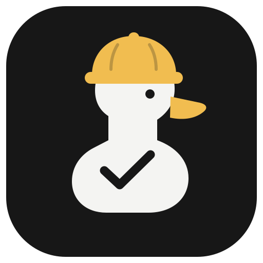
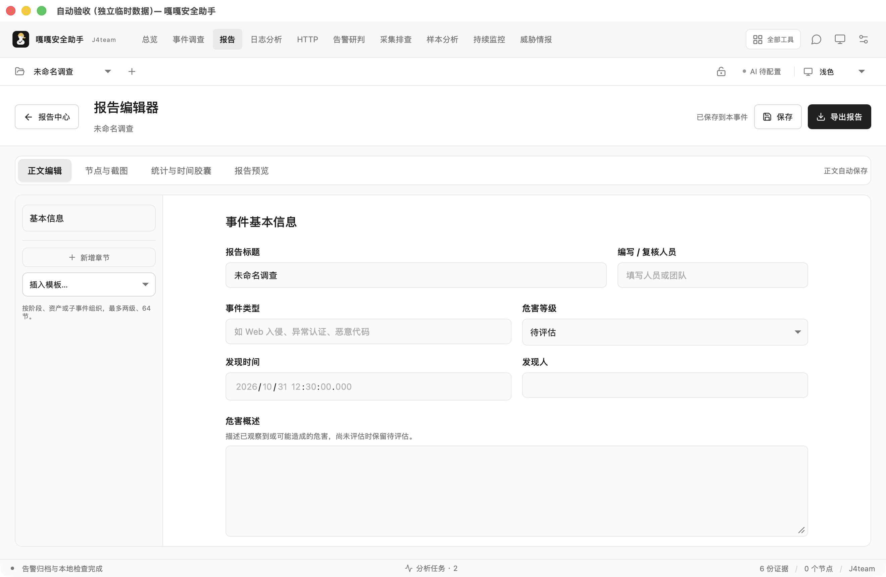
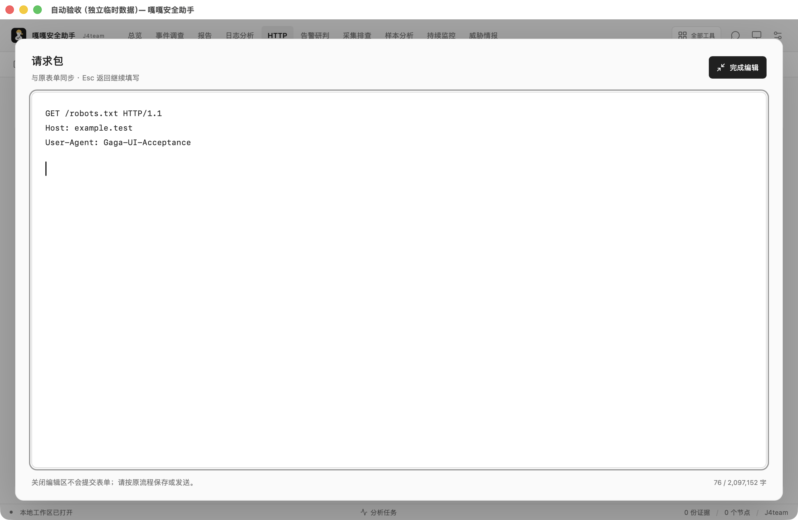
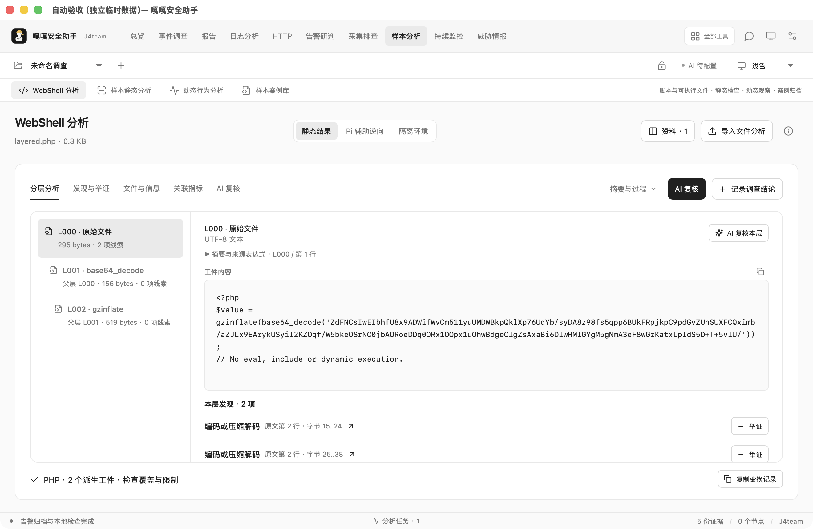
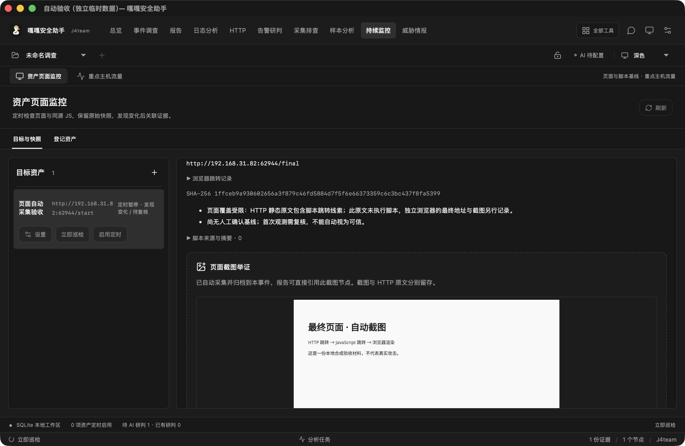
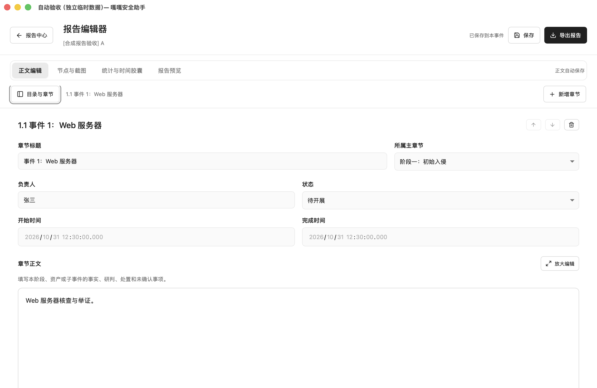

# GagaSec

<p align="center">
  
</p>

<p align="center"><strong>GagaSec · Blue-team investigation and response terminal</strong></p>

<p align="center">
  <a href="README.md">English</a> ·
  <a href="README.zh-CN.md">简体中文</a>
</p>

<p align="center">
  <a href="https://github.com/J1wawawa/GagaSec">GitHub</a> ·
  <a href="docs/QUICKSTART.md">Quick start</a> ·
  <a href="SECURITY.md">Security</a> ·
  <a href="LICENSE.txt">License</a>
</p>

GagaSec is a desktop-first blue-team workbench for personal computers. It brings incident evidence, HTTP pairs, logs, WebShell triage, container snapshots, host collection, asset monitoring, AI-assisted review, collaboration, and report delivery into one case-centered workspace.

The product is built for investigators who need to move from **raw material → evidence → analysis → response → timeline → report** without losing source boundaries.

> Current release status: **0.10.1 macOS development preview / release candidate**. The current acceptance evidence is Apple Silicon macOS. Windows, CAPE, real Linux eBPF hosts, multi-device P2P networks, and all four official model accounts still require their corresponding environment acceptance.

## Language

The default project introduction is English. Use [简体中文](README.zh-CN.md) for the Chinese version.

## What you can do

| Area | Current workflow |
| --- | --- |
| Incident workspace | Keep cases independent; attach findings, operators, timestamps, screenshots, receipts, and evidence to the correct event. |
| HTTP analysis | Paste or load request and response text, inspect both sides together, preserve source excerpts, extract indicators, and keep unknowns visible. |
| Log investigation | Stream Common/Combined, JSON-line, Linux syslog and auth-style logs with bounded parsing, line numbers, time normalization, and timeline references. |
| WebShell triage | Run bounded, static-only analysis in an isolated container; track encoded layers, compressed payloads, source spans, aliases, and evidence provenance. No source execution. |
| Container review | Inspect Docker metadata with explicit coverage states. Missing fields remain unknown; a non-hit is never treated as proof of safety. |
| Host collection | Generate a task-scoped agent package, collect a fixed read-only scope, encrypt the response for the originating client, reject tampering/replay, and retain tool versions, permissions, timezone, clock offset, missing items, and collection scope. |
| Asset monitoring | Schedule page and same-origin JavaScript checks, archive snapshots, compare changes, and optionally capture a browser screenshot in the monitored case. |
| AI review | Configure DeepSeek, Qwen, GLM, or Kimi official endpoints. Preview the exact material, redaction, provider, model, and budget before sending. |
| Response and reporting | Record approval, execution, receipt, rollback and recovery verification. Compose multi-stage reports and export HTML/DOCX; PDF uses the system print dialog. |
| LAN collaboration | Pair devices explicitly over TLS, exchange messages, reactions, screenshots and files, and recover bounded history from an online peer. |

## Screenshots from the real macOS acceptance workspace

The images below are captured from the client UI and report workflow. They are included as interface evidence, not decorative mockups.

### Case report editor



The report editor is a dedicated writing surface. Nodes can be organized by intrusion phase, asset, or sub-event; each node keeps its owner, time, status and evidence references.

### HTTP request + response analysis



Request and response are entered together so the analysis can preserve both sides, response status, headers, body excerpts, and proof gaps.

### WebShell static analysis



The static view shows bounded decoding layers and source provenance. It does not execute the submitted source and does not claim that a rule hit proves compromise.

### Asset monitoring and automatic evidence capture



Asset checks retain the URL, collection time, HTML/JavaScript digests and change evidence. Browser capture is optional and runs within the documented network and container boundaries.

### Report preview



The final report combines timeline nodes, source excerpts, screenshots, hashes, responsibility and response receipts without replacing original evidence with AI summaries.

## Quick start

### Requirements

- Apple Silicon macOS for the currently verified desktop build.
- Node.js and Rust for development builds.
- Docker Desktop only for the isolated WebShell/sample/container workflows.
- API credentials are optional and must be configured by the operator. GagaSec does not ship model keys.

### Run the development client

```sh
npm install
npm run dev
```

For the native Tauri desktop shell:

```sh
npm run desktop
```

See [docs/QUICKSTART.md](docs/QUICKSTART.md) for workspace setup, evidence import and report export.

## Safety model

GagaSec treats source material, derived analysis, AI output and human response as separate layers:

1. Original evidence is archived and hashed before analysis.
2. Analyses are bounded and preserve line, byte or JSON-path provenance.
3. AI material is previewed and redacted before an external request.
4. AI conclusions, rule matches and page changes remain reviewable findings, not automatic incident verdicts.
5. Dynamic samples require a dedicated disposable isolation VM acknowledgement. Ordinary Docker shares the host kernel and is not a malware-proof sandbox.
6. Workspace files are locally protected, but the current edition is not an encrypted WORM evidence vault and cannot resist a local administrator who changes both the database and evidence.

Read [PRIVACY.md](PRIVACY.md), [SECURITY.md](SECURITY.md), and the [deep audit](docs/DEEP-AUDIT-2026-11-01.md) before using the product with sensitive cases.

## AI providers

Only the following official provider families are supported by the current catalog:

- DeepSeek
- Qwen / Alibaba Cloud Model Studio
- GLM / Zhipu
- Kimi / Moonshot

The client validates the endpoint and model catalog in the backend. It does not support arbitrary proxy endpoints or unlisted model names. Network calls are explicit and bounded; the operator chooses the material sent for each review.

## Project status

The current macOS verification includes Rust regression tests, UI state tests, source hygiene, Tauri security checks, IPC documentation checks, and a production frontend build. The latest deep audit recorded **177 Rust tests passed, 0 failed, and 4 explicitly ignored**.

The following still need environment-specific acceptance before a platform-wide release claim:

- Windows desktop packaging and CAPE VM integration.
- Real Linux host eBPF capture and long-running traffic windows.
- Two physical devices across real LAN/router conditions for P2P recovery.
- Full official API acceptance for Qwen, GLM and Kimi accounts.
- Long-duration storage, backup and restore drills with production-sized cases.

## Contributing

Bug reports, detection rules, parser fixtures, report templates, UI improvements and documentation are welcome. Please do not submit customer evidence, API keys, live malware or private incident data.

Start with [CONTRIBUTING.md](CONTRIBUTING.md), review [SECURITY.md](SECURITY.md), and use the community submission flow in [docs/community/README.md](docs/community/README.md).

## License

GagaSec is maintained by **J4team**. The project uses the J4team Non-Commercial Source License in [LICENSE.txt](LICENSE.txt): personal and non-commercial use is free; commercial use requires separate written authorization from J4team. Third-party dependencies remain under their own licenses.

## Name

- Product: **嘎嘎安全助手**
- English project name: **GagaSec**
- Positioning: **A personal blue-team investigation and response terminal**
- Maintainer: **J4team**
