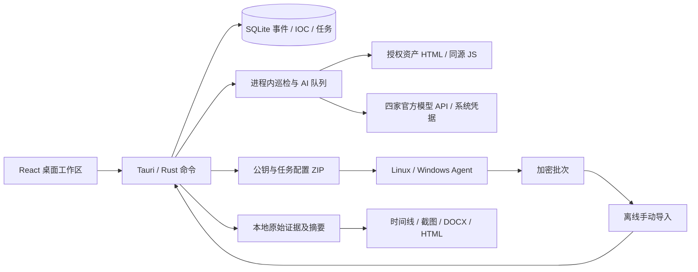

# 嘎嘎安全助手 / J4team

<p align="center"><a href="README.md">English</a> · <strong>简体中文</strong></p>

当前版本 **0.10.1 开发预览版**。产品定位：**面向防御团队、运行在个人 PC 上的一站式安全终端**。首次操作见 [使用指南](docs/QUICKSTART.md)，功能与平台验证状态见客户端设置。

长文本输入区已统一加大：报告正文、HTTP 报文、告警、AI 材料、举证说明与处置回执支持「放大编辑」，返回原表单保留文字；处置说明与回执允许正常换行。见 [编写空间与验收](docs/WRITING-SPACE-2026-10-31.md)。

2026-11-01 体验复核补充了非打断式操作反馈：分析、保存、导出完成或失败会在工作区短暂显示状态提示，底部状态栏保留持久状态；不抢焦点、不覆盖正文。见 [UX 深度复核](docs/UX-POLISH-2026-11-01.md)。

2026-10-31 复核巡检与报告流程：修复关闭跟随后仍发生的 HTTP 跳转、浏览器错误页误截图、旧镜像复用及模块切换刷新问题；实际验收与边界见 [本轮专项审计](docs/AUDIT-MONITOR-REPORT-2026-10-31.md)。

0.10.1 深入审计个人蓝队调查闭环：修复情报查询在异步地址准备后的外发授权复查，以及 CI 隔离镜像标签不一致。功能成熟度、正式发布门槛与后续重点见 [本轮审计与调研](docs/PERSONAL-TERMINAL-AUDIT-2026-10-30.md)。

0.10.1 增加局域网聊天历史恢复：已配对且在线的伙伴可按页提供加密聊天记录；长文本按帧大小切分，恢复按消息 ID 幂等去重并保留原时间。附件先恢复元数据，用户确认后才从伙伴取回正文并校验 SHA-256。见 [P2P 群组与恢复](docs/P2P-GROUPS.md) 和 [IPC 接口契约](docs/IPC-API.md)。

0.10.0 增加可选官方情报查询：微步按方向查询、域名 RDAP、AbuseIPDB 和 VirusTotal 既有 Hash 报告，独立外发锁、系统凭据库、事件隔离、缓存、取消及报告举证。首批不上传样本或主动扫描；需 Key 的服务仍须各账号鉴权验收。见 [使用与边界](docs/THREAT-INTELLIGENCE-0.10.0.md)、[审计](docs/AUDIT-0.10.0.md) 和 [C4 增量](docs/C4-intelligence-0.10.0.md)。

0.9.0 落实第二批调研成果：WebShell 常量编码与压缩分层展开、父层和来源表达式追溯、有限 Java 类常量池线索、按层 AI 预览与举证，以及可编辑的 Web 入侵／勒索／容器报告模板。解析仍在禁网容器，不执行样本、不反序列化。参考 ABC_123 的公开功能思路，独立实现；其公开仓库只有说明，没有可复用的算法源码。见 [调研实施矩阵](docs/RESEARCH-IMPLEMENTATION-2026-10-30.md)、[分层分析使用与边界](docs/WEBSHELL-LAYERS-0.9.0.md)、[本轮审计](docs/AUDIT-0.9.0.md) 和 [C4](docs/C4-architecture-0.9.0.md)。

0.8.0 将日志、WebShell 和 PE/ELF 文件导入接入持久化后台任务：真实归档字节、日志行数/解析/跳过/命中、最多24条发现预览、阶段记录、取消、切页继续与重启状态恢复。样本工具仍在禁网容器解析，不执行样本；普通 AI 仍为阶段状态展示、完整回答返回后显示。见 [任务设计与验证](docs/LOCAL-ANALYSIS-0.8.0.md)、[本轮审计](docs/AUDIT-0.8.0.md)、[开源产品调研](docs/BLUE-TEAM-DESIGN-RESEARCH-2026-10-30.md) 和 [接口契约](docs/IPC-API.md)。

0.7.9 继续修复异常恢复：日志按任务/级别区分去重，写失败可立即重试，截断末行不会吞掉下一条；同用户多个进程共享日志使用文件锁。报告失败展示任务 ID，日志可按它搜索与复制。Agent 包改用临时文件提交、显式事件绑定、失败任务回收；报告补保护升级快照。LAN 身份、水印密钥与错误索引完整写入后再排他发布，普通异常展开清理临时文件。见 [本轮审计](docs/AUDIT-0.7.9.md)、[C4 增量](docs/C4-architecture-0.7.9.md)、[运行日志](docs/LOGGING.md) 和 [接口契约](docs/IPC-API.md)。

0.7.8 增加“设置 → 运行日志”，独立保存启动、界面/IPC 和报告等后台任务错误，支持搜索、复制与无消息正文的错误索引；日志轮转上限 10 MiB。升级存在异常嵌套 PDF 解析崩溃公告的 lopdf 与归档库，检查可解析页数，补验 18 页报告加水印后的 PDFKit 逐页文字/尺寸与渲染。Mac 改为 release 优化应用及拖入 Applications 的 DMG，仍为 ad-hoc、未公证。见 [本轮审计](docs/AUDIT-0.7.8.md)、[日志说明](docs/LOGGING.md)、[接口契约](docs/IPC-API.md)、[C4](docs/C4-architecture-0.7.8.md) 和 [安装](docs/INSTALLATION.md)。PDF 生成仍用系统打印，不将对话框已打开当成文件已保存。

0.7.7 将数据库初始化移到后台，原生窗口先展示安全帽鸭子的黑白启动页，显示工作区检查、数据库校验、组件注册、事件恢复与界面渲染的实际状态和耗时；失败保留阶段与错误，收起动效不会跳过初始化。重播展示本次真实启动记录，不重开数据库。局域网附件支持查询接收状态，补偿断线丢失的保存/拒绝回执；补查多尺寸明暗主题和长内容布局。见 [启动架构与验收](docs/C4-startup-0.7.7.md)。

0.7.6 新增独立“局域网协作”：同网段发现、一次性邀请配对、认证在线状态、文字与表情、PNG/JPEG/WebP/GIF、粘贴截图预览、显式接收文件和送达回执。后续版本增加处置/封禁/研判群组、通知和历史恢复。聊天正文、配对凭据、附件单独加密保存在本工作区；重启保留记录，监听默认关闭。普通事件备份排除通信数据。文件上限 32 MiB、图片 8 MiB；无公网中继，Windows 和双物理设备尚待联调。见 [局域网架构与使用](docs/C4-lan-0.7.6.md)。

报告增量包含“统计与时间胶囊”、阶段耗时、材料分布、举证跳转和加密电子水印；HTML、DOCX 与客户端共用统计入口。PDF 写入水印时仅追加元数据，保留原页面字节。新原件与截图增加只读保护，读取继续核对 Hash；原件及数据库仍未整库加密。水印密钥不随通用备份导出。范围与密钥保管要求见 [报告交付与保护边界](docs/C4-report-delivery.md)。此前交付 ZIP 保留。

0.7.5 将新增节点、截图图注和报告章节关联放进同一窗口，保存后可留在分析页或直接打开报告；增加证据查找与分页、报告返回来源和本机环境检查指引。见 [本轮验收](docs/MAC-ACCEPTANCE-0.7.5.md) 和 [举证架构](docs/C4-record-entry-0.7.5.md)。公众号投稿暂由 J4team 后台收件分析，社区文件见 [共建说明](docs/community/README.md)，线上仓库和群聊仍待公布。

0.7.4 移除正式界面的测试报文、内置示例和演示数据入口。报告改为自由编排的主章节与子章节，可按入侵阶段、资产、子事件组织正文，五步处置作为可选模板；支持章节负责人、时间、状态及跨章节引用举证。同时补齐巡检与采集历史查询索引、累计数据和启动诊断验证。现有 Mac 为本阶段验收基线，Windows / CAPE 待有对应环境后单独验收。见 [本轮验收](docs/MAC-ACCEPTANCE-0.7.4.md)、[报告架构增量](docs/C4-reports-0.7.4.md) 和 [存储架构增量](docs/C4-storage-0.7.4.md)。

0.7.3 将 HTML/DOCX 导出改为后台任务：实际原件校验进度、取消、跨页面状态和按事件绑定的报告快照。导出只加载所选节点及引用，拒绝覆盖内部证据和数据库。见 [当前审计](docs/AUDIT-0.7.3.md) 和 [当前 C4 架构](docs/C4-architecture-0.7.3.md)。

0.7.2 增加可持久保存的 AI 外发锁、清楚的联网说明、仅当前授权事件新观测的自动研判，以及发布前源码检查；收紧本次发送材料的引用范围和预算。见 [隐私与外发](PRIVACY.md)、[审计与验收](docs/AUDIT-0.7.2.md)、[0.7.2 C4 架构](docs/C4-architecture-0.7.2.md)、[社区发布流程](docs/COMMUNITY-RELEASE.md) 和 [变更记录](CHANGELOG.md)。历史版本验收分别保留，不将旧结果冒充本轮实测。

使用 Tauri 2、Rust、React 与 SQLite。macOS / Windows 共用代码；当前实际运行验收为 Apple Silicon macOS，Windows 尚未实机验证。构建与贡献规则见 [CONTRIBUTING.md](CONTRIBUTING.md)。

黑白灰浅色与深色主题，支持跟随系统和手动切换并记住选择。原创戴安全帽的小鸭子 SVG 图标，启动动画可以跳过、关闭，并响应系统“减少动态效果”。使用系统原生窗口、文件选择器与菜单。

## 可以实际使用的功能

| 模块               | 当前能力                                                                                                                                                            | 边界                                                                                                                                                                               |
| ------------------ | ------------------------------------------------------------------------------------------------------------------------------------------------------------------- | ---------------------------------------------------------------------------------------------------------------------------------------------------------------------------------- |
| 告警研判           | 粘贴告警原文 / JSON，保留设备描述、可见指标、原文及证据缺口                                                                                                         | 粘贴上限 2 MiB；不将同源名称、标签和编码当成多份佐证                                                                                                                               |
| 动态行为分析       | Docker 环境预检、Linux 临时容器系统调用记录、自动清理；Windows CAPE API v2 提交 / 查询 / 取回报告                                                                   | 普通容器共享内核，必须使用专用隔离 VM；Windows VM 由外部 CAPE 管理，尚未真实 VM 联调                                                                                               |
| HTTP 报文分析      | 粘贴 / 加载请求和响应，HAR 批量关联、双栏视图；请求、响应与关联线索举证                                                                                             | 每侧文本 2 MiB；HAR / 文件 32 MiB、最多 200 条；静态规则，不回放请求、不以 200 判定成功                                                                                            |
| 日志分析           | Common / Combined、JSON 行和 Linux syslog / auth 日志；请求、SSH、sudo、定时任务规则、IP / HTTP 统计、原文行号                                                      | 流式处理，上限 2 GiB；9 类规则，每类展示前 100 项、完整命中计数；单行超过 256 KiB 跳过并说明                                                                                       |
| 容器排查           | 导入 docker inspect JSON；13 类配置检查、四态覆盖及 JSON 路径举证                                                                                                   | 16 MiB；仅配置快照，字段缺失不代表安全；Agent 快照可采集固定元数据                                                                                                                 |
| WebShell 分析      | 禁网容器内常量/拼接/固定别名、多层编码及压缩、敏感调用与输入线索；派生层 Hash 和来源定位，有限 Java 类常量池；按层 AI 预览与举证                                    | 文件 8 MiB，深度分析前 1 MiB；最多 8 层深度 / 48 工件 / 累计 4 MiB；不是完整 AST / 污点分析，不执行源码；仅保存派生预览与摘要                                                      |
| 样本静态分析       | 禁网容器内 PE / ELF 头部与部分结构、PE 导入函数、ASCII 字符串、字节熵；识别 Mach-O                                                                                  | 128 MiB；没有反编译；动态沙箱在独立页面；Mach-O 仅识别                                                                                                                             |
| 情报溯源           | 从文本提取 IPv4、URL、MD5 / SHA1 / SHA256、域名候选                                                                                                                 | 在线查询已独立接入微步 / RDAP / AbuseIPDB / VT Hash；凭据服务待各账号验收，名单与来源单独管理                                                                                      |
| AI 复核            | 自配四家官方 API；逐文件选择材料、编辑后发送；实际过程耗时、结构化依据和证据引用、最终 Prompt；基于当前复核追问、人工处置反馈；可加入事件                           | 无默认模型或内置 Key；隔离服务验证请求与持久化；0.7.0 已实测 DeepSeek 官方连接、HTTP 结构化研判及追问；Qwen / GLM / Kimi 缺少 Key，待验收；此处为逐证据复核，工具 Agent 见 Pi 页签 |
| 证据管理           | 复制原始文件、SHA-256、新原件与截图只读、分析 JSON、SQLite 事件隔离与持久化                                                                                         | 证据及数据库明文保存；只读防误写，管理员仍可删除；没有证据库加密、身份认证、完整审计链或证据删除入口                                                                               |
| 事件时间线         | 独立记录发生时间、录入时间、人员、举证说明、关联文件和发现；选择是否纳入报告                                                                                        | 所填人员为人工标注，不是已认证身份；本版发生时间统一保存和展示为 UTC+8                                                                                                             |
| 截图举证           | 原图归档、SHA-256、必填图注、重启后读取、报告嵌图                                                                                                                   | PNG / JPEG / WebP，单图 8 MiB；支持点击节点粘贴框后 ⌘V / Ctrl+V；读取与导出校验 Hash                                                                                               |
| 报告               | 自定义主/子章节、排序/改归属、负责人/时间/状态；可选五步、入侵阶段、Web 入侵、勒索和容器模板；真正可编辑的 DOCX 和单文件 HTML，含截图、图注、原文定位与完整文件摘要 | 最多两级、64 节；模板只追加指导性章节，事实需填写；PDF 通过系统打印窗口“存储为 PDF”；导出为待复核草稿                                                                              |
| 报告统计与时间胶囊 | 节点跨度、去重原件、附图覆盖、记录人员、候选 IOC、材料分布、章节进度、阶段耗时、按真实时间排列的胶囊                                                                | 仅统计报告已选节点；跨度不等于响应耗时，章节完成不等于结案，候选 IOC 仍待研判                                                                                                      |
| 电子水印           | DIY 名称、生成时间与批次加密写入 HTML/DOCX 元数据；PDF 另存水印副本；当前工作区查询                                                                                 | 64 MiB 文件限制；密钥不随通用备份导出，暂无迁移 UI；元数据可被移除，不认证整份正文或真实身份                                                                                       |

WebShell / 可执行样本导入前需要启动 Docker 并在「样本分析 → 隔离环境」构建分析镜像。解析与 Pi 工具均在隔离容器运行，无宿主机解析回退。

正式界面只接收用户导入或录入的材料，不提供填入测试报文、内置示例或创建演示事件入口。旧工作区中已标记的演示材料仍保留来源标记，避免混入真实调查。规则命中不等于已证明入侵，未命中也不能证明安全。

## 运行源码

需要 Node.js 22.12+、Rust stable、Go 1.27.3+ 与 Tauri 2 平台编译依赖。macOS 安装 Command Line Tools；Windows 需要 Visual Studio C++ Build Tools、Windows SDK、WebView2，以及 AWS-LC 的 CMake / NASM。

```sh
npm ci
npm run desktop
```

生产前端可单独检查：

```sh
npm run build
cargo test --manifest-path src-tauri/Cargo.toml
```

浏览器中 `npm run dev` 只提供界面预览，文件分析、证据库和导出需要桌面客户端，不会用模拟结果代替后端。

## HTTP 请求与响应分析

顶部「HTTP」支持三种输入：

- 两个文本框粘贴或分别加载请求 / 响应文件。每侧最多 2 MiB UTF-8，消息头与正文间必须有空行；可只提供请求，界面会明确标记响应缺失。
- 导入 HAR 1.2 文件，最多 32 MiB / 200 条 entry。每个 entry 的请求与响应成组，支持 content.text 的 Base64；HAR 未导出正文或 status=0 时会显示缺口。
- 导入原始请求文本、报文对 JSON，或使用独占一行 `===RESPONSE===` 分隔两侧的文本文件。不通过猜测响应起始行来自动切分任意 TCP 流。

报文对 JSON 格式：

```json
{
  "format": "gaga-http-pair/1",
  "request": "GET /.env HTTP/1.1\r\nHost: example.test\r\n\r\n",
  "response": "HTTP/1.1 403 Forbidden\r\nContent-Length: 0\r\n\r\n"
}
```

原始材料完整归档。手动输入保存为 JSON 容器，并对两侧文本分别计算 SHA-256；这证明归档文本内容，不证明采集来源或它们确为同一会话。HAR 保存原文件，双栏内容由其字段重建，不能当作线上字节原样。

分析包括请求目标 / 正文的路径穿越、敏感配置、SQL / 命令 / 脚本注入与脚本上传特征；响应中的敏感配置、类 passwd 行、数据库报错、目录索引、异常堆栈、类命令输出，以及部分请求片段回显。请求与响应分别举证并给出关联解释。HTTP 200、回显、错误或命令样式输出均不直接证明攻击成功；403 也不直接证明所有业务影响均已阻断。

可切换报文、消息头和解码正文视图，按交互选择线索、记录时间线、附图并导出报告。HAR 证据定位到 entry 和请求 / 响应对象。转入报告的发现会同时保留两侧阅读视图及其来源。

只检查正文前 1 MiB；展示上限为正文 24000 字、报文 16000 字。原始文本支持有界 Chunked 处理、gzip / zlib 解压；非 UTF-8 / 不支持编码、损坏、长度不符、缺失或截断均会标注。HAR text 按导出后的已解码内容处理，不重复按 Content-Encoding 解压。HTTP 文件分析不提供 PCAP / TLS 解密、HTTP/2 二进制帧或 HTTP/3 解析、Brotli、WebSocket或自动主动验证。Linux 连接元数据观测位于独立 eBPF Agent。

HTTP 的 AI 预览增加双侧上下文，并遮盖常见认证头与密码 / Token 字段；这不是完备的数据脱敏，发送前仍需检查。原始归档与本地举证不改写。

## 调查总览

启动进入顶部「总览」。数据库聚合展示累计证据数量 / 大小、最新 AI 研判的待处置状态、已启用 / 已登记资产、证据关联去重 IOC、当前任务与接收端、监控 AI 队列、分析失败和已选报告节点缺图数。7 / 30 天趋势按北京时间统计归档和分析启动日期，可切换精确数据表、点击日期筛选最近记录。证据 / IOC / 风险级别分布、最新动态、待复核与失败记录各有独立面板；卡片和记录可跳转原始功能页。

统计读取 SQLite 全量匹配记录，不以 UI 最近 200 / 500 条列表作为总数。每份证据仅以最新 AI 复核及其最新处置计算待复核数；待处置和继续调查属于未完成状态，忽略 / 误报不计入。规则风险级别不等于入侵结论，有效采集任务不等于主机在线。当前事件 IOC 只统计有该事件证据来源的指标，手工导入的无来源指标在全局情报库查看。

「全部业务事件」排除带演示标记的事件；仅在演示材料出现的 IOC 也排除。多事件汇总可按事件选择后打开对应模块，记录跳转始终切回它的原事件。所有数据面板仅本机读取；可见时每 15 秒刷新，也可手动刷新，后台任务事件触发更新。长记录在面板内部滚动。

0.7.4 已移除创建演示数据入口，已有演示事件仅为历史兼容保留明确来源；普通工作区后端也拒绝注入内置示例。开发验收夹具仅在显式启用的 debug 隔离测试工作区使用。

## 模型配置与数据发送

在顶部「AI 与设置 → 模型连接」选择服务商与模型，输入 API Key，点击「保存并使用」。仅接入 **DeepSeek、Qwen、GLM、Kimi 四家官方 API**。固定地址不允许编辑；后端按完整官方端点和所属模型校验，拒绝第三方中转、其他厂商、任意模型名、重定向以及旧版本遗留的自定义地址。当前目录按 2026-10-27 官方文档核对，模型是否对你的账号开放以官方平台为准。

| 服务商            | 固定 API 基础地址                                   | 下拉模型                                              |
| ----------------- | --------------------------------------------------- | ----------------------------------------------------- |
| DeepSeek          | `https://api.deepseek.com`                          | `deepseek-flash`、`deepseek-v4-pro`                   |
| Qwen / 阿里云百炼 | `https://dashscope.aliyuncs.com/compatible-mode/v1` | `qwen3.8-max`、`qwen3.7-plus`、`qwen3.8-flash`        |
| GLM / 智谱        | `https://open.bigmodel.cn/api/paas/v4`              | `glm-5.3`、`glm-4.7`                                  |
| Kimi / Moonshot   | `https://api.moonshot.cn/v1`                        | `kimi-k3.1-pro`、`kimi-k3.1-pro-highspeed`、`kimi-k3` |

Qwen 当前仅提供北京地域端点，需对应地域 Key。厂商目录及请求选项统一保存在 `src/ai-providers.json`，前端与 Rust 共用。DeepSeek / Qwen 及 GLM 4.7 使用非思考模式；GLM 5.3 与 Kimi K3 始终思考，使用 `reasoning_effort: low`。不发送通用 temperature，以避免模型参数不兼容。Kimi 追问把已存最终回答作为有标记的历史资料发起新请求，不回放缺失推理状态的 assistant 消息。

「测试连接」实际调用已保存的当前模型，只发送固定短句，最多 2048 输出 token，45 秒超时，不携带事件证据；可能产生少量费用。显示成功 / 失败、所测模型、请求耗时、时间和简短返回或错误原因。最近 20 次记录保存在本机；修改配置后旧测试标为历史配置，未保存配置不能测试。401 / 403 / 404 / 429 等有明确提示，超时、空内容、异常 JSON、超过响应上限均不会显示成功。

顶部工具栏支持直接切换当前服务商的分析模型；切换工作区会记住上次打开的模块。四家配置分别保存，API Key 使用 keyring 保存至 macOS 钥匙串 / Windows 凭据管理器，不写入 SQLite / localStorage。切换回已保存的厂商可复用原 Key，也可删除指定厂商 Key。隔离测试 Key 已验证 macOS 系统凭据的保存、读取和删除，SQLite 无 Key 明文；0.7.0 已从系统凭据读取已有 DeepSeek Key 完成官方连接、研判和追问，未复制凭据；Windows 凭据路径未实机验证。常规客户端不支持本机模型；仅单元测试与 debug 的显式 `--ui-smoke` 隔离模式允许 localhost 固定测试服务。

本地规则运行不联网。在分析文件后点击“AI 复核”，客户端选取前 30 项发现、前 8 项附加信息和分析限制，预览最多约 16000 字；可以编辑删减。点击发送才将所显示材料和问题交给所配置服务，同时附上内置蓝队复核指令。不会自动上传原始文件或截图；可选的监控自动 AI 会按独立开关发送观测摘要。请求超时 120 秒，不自动重试，禁止重定向；模型服务可能收费。

AI 回答、实际 messages、模板版本、材料、问题、模型、地址、真实执行步骤和时间单独保存。结构化回答按依据、引用、建议、缺口和 ATT&CK 建议展示；结构化校验失败保留原文。引用范围可校验，不自动证明引用支持结论。任何模型的攻击成功断言均保留为未确认；人工告警 / 行为报告隐藏百分比可信度，不把标签一致直接认定入侵。不会展示模型隐藏推理。回答不执行命令、不自动封禁。规则、AI 建议和人工处置保留各自来源。AI 节点导入报告前仍需人工复核。

## 分析过程、追问与处置

默认打开调查总览，可从顶部进入 HTTP 粘贴入口；“告警研判”也可以直接录入 NDR / WAF / EDR 原文或 JSON。开始分析先执行本地归档与检查，然后可选择 AI 研判，预览并删减发送材料。

AI 过程按实际执行记录证据校验、分析器选择、Prompt 构建、模型 API 请求、结果校验和归档。AI 自动流程尚未接入知识检索或在线情报，明确显示未执行，无伪造耗时；在线情报由独立页面手动选择查询与举证。模型 API 耗时包含网络和服务等待，不等同模型内部推理时间。失败与断连记录为失败，不生成成功研判。

每条研判可以查看实际完整 Prompt，并基于该复核原材料及最近三轮对话追问；历史模型回答不算新证据。处置和准确 / 有误 / 误报反馈追加保存，标记误报必须写依据，不改写原 AI 回答。所填人员不是认证身份。研判和动态记录可加入有引用和截图占位的时间线。

## 动态行为分析

**Linux Docker：**客户端检测 CLI、当前 context、引擎 OS / 架构与 `gaga-observer:0.1.0` 镜像。可选择 Alpine 官方源或阿里云镜像源，保留 apk 签名校验。首次点击“构建监控镜像（联网）”，会用工程内 Dockerfile 安装 strace 和 tini；不自动安装 Docker，不关闭系统安全功能，不修改其他容器。镜像首次构建需访问 Alpine 仓库，运行时固定解析到的镜像 ID。

导入样本只执行静态检查和原文归档。选择当前事件内的 Linux ELF / 带 sh 或 bash shebang 的脚本，确认 Docker 位于专用、可丢弃的隔离虚拟机，然后启动观察。样本上限 32 MiB，时间 5–60 秒；ELF 必须与 Linux 引擎架构一致，不自动装模拟器。Alpine 镜像不保证运行 glibc 动态链接样本；bash 脚本由 `/bin/sh` 解释，不保证 bash 扩展语法兼容。

临时容器不挂载主机目录和 Docker socket，默认禁网、只读根目录、普通 UID、drop ALL capabilities、no-new-privileges、默认 seccomp；内存 256 MiB / CPU 0.5 / PID 64，`/tmp` 32 MiB 且 noexec。启动前检查实际容器配置，不符则拒绝启动。通过固定 cat 接收不执行的字节流，写入本任务专属临时 Docker 卷；观察容器只读挂载此样本卷，不在宿主机运行。strace 记录进程 / 文件 / 网络系统调用；容器状态与 stdout 也进入报告，结束后删除容器和样本卷。异常退出后可按本应用工作区专属 label 清理遗留容器与卷，不执行全局 prune。

普通容器共享内核，以上限制不能保证隔离恶意样本，不能替代专用 VM。跟踪可能被反调试或同权限篡改；禁网只观察连接尝试，没有互联网响应或完整 PCAP；限制会改变行为，不提供“完整全链路”保证。strace 输出由 Docker 日志收集，采集器与样本 stderr 混合；最多读取日志末 5000 行、每输出通道 500000 字节，日志轮转和截断均可能丢失行为，UI 为进一步节选；原始行为报告归档保存 SHA-256。137 仅表示可能超时或 SIGKILL，不能单独区分。应用意外退出可能留下容器与样本卷，须重新预检清理。

**Windows VM：**连接已部署的 CAPE API v2，配置 API 基础地址（如 `http://127.0.0.1:8000/apiv2`）、可选机器名与 API Token。远端须 HTTPS，Token 存系统凭据。保存后可检查机器列表；当前适配 `tasks/create/file/`、`tasks/view/<id>/`、`tasks/get/report/<id>/json/`。EXE / DLL 样本上传到所配置服务，指定 windows 平台，时间 15–300 秒；客户端不会在宿主机直接执行。

CAPE 负责 VM 启动、行为采集、隔离网络和干净快照还原。用户点击查询状态，reported 后取回 JSON，归档进程、文件 / 注册表和网络摘要及原始报告。报告最大约 30 MiB（封装归档上限 32 MiB）。任务绑定事件、原服务地址与样本摘要。客户端尚未验证真实 CAPE 版本、Windows VM 或快照还原；本地测试服务仅验证协议，不代表 Windows 动态分析已实机完成。没有内置虚拟机镜像、Windows 授权或自动安装 CAPE。

## 构建与桌面验证

独立执行 `cargo test` 前可先运行 `npm run build:agents` 生成三种采集模板；`npm run desktop` 与 `tauri build` 均会自动生成模板。

macOS 本地开发包：

```sh
npm run desktop:build:mac-dev
```

正式版本由发布者在相应操作系统构建、测试、签名 / 公证后发布：

```sh
npm run tauri -- build
```

`.github/workflows/build.yml` 提供 macOS / Windows CI 配置；尚未推送或运行该工作流。上述 macOS 开发命令在完整 bundle 生成后执行 ad-hoc 签名并严格校验，没有 Developer ID 签名或 Apple 公证。

开发可执行程序还提供隔离验证（请使用新的测试目录，勿指向真实证据库）：

```sh
"path/to/嘎嘎安全助手.app/Contents/MacOS/gaga-security-assistant" --verify-local "path/to/new-test-directory"
"path/to/嘎嘎安全助手.app/Contents/MacOS/gaga-security-assistant" --workspace "path/to/test-directory"
```

`--verify-local` 运行示例日志 / 源码 / inspect / HAR 分析、当前程序结构识别、演示图片归档、DOCX / HTML 导出和数据库重开检查，生成 `workspace-verification.json`。`--workspace` 只在 debug 构建可用，便于查看隔离测试空间。测试材料不代表真实入侵事件。

## 容器采集与大日志实测（0.5.0）

`tests/field-exercise.mjs` 可复现实际容器采集和大文件验收：生成物理写入的约 128 MiB 访问日志、约 1 GiB / 465 万行系统日志，使用客户端生成的真实 Linux Agent 在无网络、非 root、只读根文件系统的临时容器里采集元数据，输出加密包，导回原客户端解密入库。验证其他客户端私钥无法解封、篡改与重放拒绝、文件摘要、实际命令错误、原文行号、尾部成功登录和 sudo 线索，以及 AI 材料涵盖不同规则类型。AI 材料优先选每类代表原文，避免重复失败登录淹没稀有成功记录；不会上传整份 GiB 日志。

还会在独立容器执行只有固定输出与无害文件操作的诊断脚本，检查 strace 的 execve、文件写入、连接尝试与自动清理；PHP WebShell 特征仅存在于注释中，入口固定退出，另有无命中特征的对照文件。没有下载、执行真实恶意程序，没有使用真实客户日志或调用外部 AI。需要本机已存在 `gaga-observer:0.1.0` 和 `xben-041-24-php:latest` 镜像；后者仅作 PHP CLI 环境，不启动其 Web 应用服务。会生成约 2.3 GiB 测试输入与归档数据，脚本不触碰其他容器或真实证据库。

```sh
node tests/field-exercise.mjs "/absolute/path/to/debug-executable" "/absolute/path/to/new-test-directory"
```

测试结果写入 `workspace/field-verification.json`、DOCX / HTML 报告与 SQLite。验证结束删除本次隔离空间的测试私钥；生成的测试任务不能用于正式采集。Windows EVTX / ETL 等二进制系统日志尚未接入，请先导出文本 / JSON；Linux 文本系统日志支持常见 RFC3164 和带时间戳的 journald 导出形式，不等于完整日志取证引擎。

## 持续监控、采集与情报（0.4.0）

客户端采用固定工作区：顶部「研判工作台 / 持续监控 / 情报中心 / 事件管理」切换模块，右上角提供环境与设置；事件工具栏和横向功能标签固定，长数据仅在列表或检查器内部滚动。资产与流量采用列表 / 详情分栏，导入、生成任务、接收配置、AI 调度单独切页。设置与动态分析也采用分类页，避免纵向堆叠。

| 功能页       | 实现                                                                                                                       | 限制                                                                                                                                                                                          |
| ------------ | -------------------------------------------------------------------------------------------------------------------------- | --------------------------------------------------------------------------------------------------------------------------------------------------------------------------------------------- |
| 资产页面监控 | URL 批量登记、定时启停、立即巡检、人工基线、页面与 JS 摘要差异、静态隐藏链接、原始内容归档                                 | 每事件最多 100 个；间隔 60–86400 秒；客户端运行期间每 5 秒调度，最多 4 并发；退出停止                                                                                                         |
| 重点主机流量 | Linux eBPF socket filter + AF_PACKET，按窗口聚合流，显示丢包 / 未解析 / 超限省略和名单 / 情报匹配                          | 当前网络命名空间与所选网卡；不解密 TLS、不重组 TCP、不关联 PID，不保存完整 PCAP；历史版本在 Docker Desktop 独立回环命名空间验证过加载与加密；0.6.7 未重新完成内核挂载，真实主机全流量尚未验收 |
| 采集 Agent   | Linux amd64 / arm64、Windows amd64 模板，专属公钥配置和任务凭据，离线包导入与显式 HTTPS 回传、撤销、重放校验、中断批次重试 | 二进制模板可复用，专属的是任务配置与凭据；未部署到真实客户主机；没有安装 / 持久化 / 任意远程命令                                                                                              |
| 本地情报库   | 自动索引报文双侧、日志、发现与归档 Hash；IP / IPv6 / CIDR / 域名 / URL / MD5 / SHA1 / SHA256；原文来源和人工复核           | 自动提取及导入默认待复核；域名候选可能把文件名视为域名；不是在线信誉结论                                                                                                                      |
| 黑白名单     | 当前事件 / 全局、失效时间、启停、依据、精确及 CIDR 命中、冲突呈现                                                          | 不自动封禁；白名单不删除证据；域名不做通配后缀匹配                                                                                                                                            |
| 样本案例库   | Hash、家族备注、人工分类、分析笔记与当前事件证据关联                                                                       | 不自动判定家族；不是反编译器；Hash 不等于恶意                                                                                                                                                 |
| 本机环境     | 系统 / 架构 / CPU、可写数据目录、可用磁盘、内置 Agent 模板、Docker 检查                                                    | Linux eBPF 的内核 / 权限要在目标运行 `-check`，不是在 macOS 本机验证                                                                                                                          |

静态资产巡检：HTML 最大 1 MiB；最多记录 100 个脚本来源，抓取最多前 8 个同源脚本，每个 512 KiB；外链 / 静态隐藏链接各最多 200 个。每个请求 12 秒超时；HTTP / meta 跳转可按资产开启，逐跳保存原文。可选的独立 Docker 浏览器支持 JS 导航、DOM 及 1440×900 视口自动截图，并归档到本事件举证节点；无登录态、不递归爬站、不抓取跨源脚本原文。页面、脚本及跳转原始字节以 Base64 写入证据，列表仅展示元数据；正常发布、CDN 等也可能引起变化。详见 [页面自动举证说明](docs/REPORT-WORKSPACE-MONITOR-2026-10-31.md)。

Agent 快照固定采集 OS / proc 元数据与 `ps`、`ss`、Docker 元数据（Windows 为 tasklist / netstat / systeminfo）；命令各 8 秒、输出各 256 KiB，缺工具 / 权限 / 截断会明确记录。不是「全部主机信息」。不采集密码、浏览器、环境变量、历史，不运行样本，不修改目标权限或 sysctl。任务时长参数用于 eBPF；快照按固定清单完成。

eBPF 默认每 15 秒一个窗口，单窗最多 2000 个定向流；客户端界面及自动 AI 只包含前 100 个流，完整窗口关联原始证据。每包解析截取 128–4096 字节、任务最长 24 小时；明文 HTTP 首行片段默认关闭，开启后可能包含敏感路径。丢包统计失败会记录错误，不能把缺值视为零丢包。IPv6 扩展头、非首片、TCP 重组等不支持；多网卡可能重复观察同一包。Agent 加密输出上限 128 MiB，到上限停止。只有流量窗口而没有包字节原文时，不能还原 HTTP 请求 / 响应全文。

任务 ZIP 含 `gaga-agent`（或 exe）、`gaga-task.json` 和说明。在授权目标上先执行：

```sh
./gaga-agent -config gaga-task.json -check
./gaga-agent -config gaga-task.json -out ./gaga-output
```

Windows 使用 `.\gaga-agent.exe`。Linux eBPF 需要内核支持与 CAP_BPF（或依内核 CAP_SYS_ADMIN）、CAP_NET_RAW；不自动提权。容器内只能看对应网络命名空间，要监控整台宿主机必须在宿主机获得授权运行；不会自动添加 privileged、host network 或挂载 Docker socket。

传输采用 gzip JSON → 随机 AES-256-GCM → RSA-OAEP SHA-256 封装 AES Key，加上每任务 HMAC-SHA256。AAD 绑定任务、随机批次 ID 和创建时间。客户端私钥与 HTTPS 证书私钥保存在 OS 凭据，DB 中的任务凭据由客户端公钥封装；生成包不含私钥或模型 Key。加密只证明完整性 / 接收方绑定，任务凭据只证明持有凭据，不证明目标未失陷或源主机身份。完整解密内容在本地证据库明文保存。**本版无采集私钥备份 / 恢复界面，系统凭据丢失后旧包无法解密。**

0.7.0 将 RSA-OAEP 私钥运算迁移至 AWS-LC，旧 PKCS#8 和包格式保持兼容，不再使用受 RUSTSEC-2023-0071 影响的 RustCrypto rsa 实现。HTTPS 接收默认关闭，需先配置证书与目标可达地址，再显式启动；Agent 固定信任任务包证书。实现替换和功能回归不构成整套协议通过独立密码学审计的声明。

每个包最大 32 MiB、解压最大 16 MiB。已完成批次拒绝重复；失败 / 中断批次仅允许同摘要重试并复用已归档证据。任务有效期 1–168 小时，可撤销。更多依赖公告与处置见 [供应链审阅](docs/DEPENDENCY-REVIEW-0.7.0.md)。

自动 AI 默认关闭。配置模型后，可在 Agent / 流量页「AI 调度」显式授权当前事件，只有本次启用后新插入的观测可自动分析，历史积压留待人工；同一工作区同时授权一个事件。切换事件不扩大授权，再次保存启用会建立新边界。最小间隔 15–3600 秒、每小时 1–240 次；串行处理、失败也计入预算，不自动重试。只发送观测摘要、名单匹配和有界流元数据，不发送完整 HTML / JS / 抓包 / 快照文件。队列过多会积压，不承诺每个原始包实时进入模型。锁定 AI 外发会停用自动分析，解锁不恢复授权。详细联网和保存边界见 [PRIVACY.md](PRIVACY.md)。没有向量 RAG 或在线微步 / WHOIS 查询。任务与观测始终写回原始事件，不随用户切换事件而改变。

分享支持选中 IOC 的嘎嘎 JSON / CSV / STIX 2.1 基础等值指标；文本 / CSV / XML 仅提取其中可识别的明文 IOC，不是完整 OpenIOC 模式引擎。分享不含原始证据、私密备注、密钥或样本字节；CSV 字段做公式前缀处理。导入方重新复核分类。设置提供 SQLite 一致性备份、校验恢复到新目录、下次启动切换与存储统计。恢复不携带系统凭据，后台任务停用；原始证据没有自动删除/清理策略，长期监控需要分工作区归档。

架构：



## 当前未实现

完整主机取证、Kubernetes / 宿主机深度实时调查、实际目标主机全流量验收（仅完成隔离 Linux 回环内核实测）、Windows 桌面实机验收、微步 / WHOIS / RDAP 在线查询、OpenCode 适配、向量 RAG、YARA / capa / Ghidra、反编译、内置 Windows VM 调度、全流量 HTTPS 明文还原、团队身份与完整审计、后台 PDF 渲染、自动报告定稿。当前版不自动封禁；只有用户在动态行为页明确启动的任务才会执行样本。

## 许可与品牌

Copyright © 2026 J4team。参见 [LICENSE.txt](LICENSE.txt)：个人及非商用免费，商用需 J4team 单独授权。此为自定义源码可见许可，**不是 AGPL，也不是 OSI 定义的开源许可**。依赖组件分别遵循各自许可。Logo 源文件位于 `public/gaga-icon.svg`。

开发原生界面自检：在 debug 可执行文件后追加 `--ui-smoke path/to/new-test-directory`，将使用独立真实 SQLite 空间，通过 WebView 界面录入并分析报文、导入 HAR、记录时间线、检查 AI 预览及窗口布局，并输出 native-ui-verification.json。仅当隔离测试空间明确配置 local-ui-test-service 时，才额外测试模型本机服务与固定无害脚本容器观察；不会将用户真实样本用于自检。只有此启动模式允许记录界面自检结果，不会请求外部模型。

原生完整工作台自检脚本：`node tests/native-workbench.mjs /absolute/path/to/debug-executable`（Node 22.13+），是下方完整平台自检的兼容入口。脚本启动本地固定响应服务，不请求外部模型。Docker 与监控镜像可用时，仅执行脚本内固定无害诊断样本。

新增平台自检：`node tests/native-platform.mjs /absolute/path/to/debug-executable`，使用真实 macOS WebView、独立 SQLite、localhost 网页 / JS / 模型固定响应与真实 TLS 接收；流量窗口是显式测试数据，不能视为 eBPF 内核实测。`node tests/layout-platform.mjs /absolute/path/to/output` 需要自行启动 Chrome CDP 9226 与 Vite 1420，检查 1320×860、1100×760、960×660 的固定窗口布局。Agent `go test ./...` 覆盖报文解析和加密；跨语言固定向量位于 `fixtures/agent-interop/`，其私钥**只用于公开测试，生产任务从不使用它**。构建脚本支持用环境变量 `GAGA_GO` 指定 Go 路径。

## 历史改动与验收

以下按版本保留历史说明，当前增量结果见 [0.7.4 验收](docs/MAC-ACCEPTANCE-0.7.4.md)，报告专项见 [0.7.3 审计](docs/AUDIT-0.7.3.md)。0.7.3 / 0.7.4 未请求官方模型；0.7.2 官方 DeepSeek 测试因系统凭据授权超时在请求前失败，未完成官方研判，不以历史通过替代本轮结果。0.7.1 结果见 [审计](docs/AUDIT-0.7.1.md)，0.7.0 官方模型、大日志及完整案例见 [验收](docs/ACCEPTANCE-0.7.0.md)，0.6.7 见 [审计](docs/AUDIT-0.6.7.md)。

### 0.6.0 深度审计与调查管理

新增事件列表（搜索、状态、独立数量、50 条分页）。每事件证据、时间线、样本案例和报告独立；IOC 知识明确全局共享。节点截图可以直接粘贴并填写图注，重启后继续编辑。

日志每个规则命中行均保存在该事件的派生 SQLite 索引，100 条 keyset 分页、源 IP / 类型筛选、跨文件按确定时间排序；旧证据可手动重建。无年份或时区的记录保留未知，补充参数后重建；不会用导入时间冒充发生时间。AI 复核材料包含全量计数、代表行、原文位置、覆盖范围和断点，发送前可编辑。

容器检查区分风险、本项未命中、数据未知和未覆盖；缺失字段、错误类型不能证明安全。截图读取、报告嵌图和 AI 发送前的归档校验、工作区独占锁、历史名单匹配及采集凭据稳定关联均纳入审计回归。

实际架构见 [C4 文档](docs/C4-architecture-0.7.3.md)。它描述当前已实现路径和实测边界，并非功能规划图。

## 0.6.2 本机验收

验收范围、实际输入、通过断言和未完成能力见 [本机验收报告](docs/ACCEPTANCE-0.6.2.md)。本轮修复弹窗错误遮挡、焦点与键盘交互、截图读取失败及重试；调整小窗口日志页；增加原生命令调用记录和导出物理文件检查。原生界面测试按单客户端串行执行。系统打印另存 PDF、Windows / CAPE 实机及未配置厂商的官方请求未通过本轮验收。

## 0.6.3 功能导航拆分

顶部提供总览与八个任务入口：事件调查、日志分析、HTTP、告警研判、采集排查、样本分析、持续监控、威胁情报。日志、HTTP 和告警可直接进入；采集 Agent 与容器排查相邻；样本案例库归入样本分析。每组仅显示相关工具，最多四个，并记住最近使用的位置。

右上角「全部工具」列出 21 个独立入口，可按中文名称或 HTTP、Docker、eBPF、IOC 等关键词搜索。⌘K / Ctrl+K 打开，方向键选择，Enter 进入，Esc 关闭；已有弹窗时不打断输入。环境检查与设置保留在右上角。导航配置和搜索集中在 `src/Navigation.tsx`，不改变事件隔离和证据存储。

本轮导航、HTTP 与既有大日志 / 容器工作区的针对性回归记录见 [导航改版验收](docs/NAVIGATION-0.6.3.md)。既有未实现能力和外部环境限制继续以 0.6.2 验收报告为准。

## 0.6.4 分析工作区

日志、HTTP、告警等单一入口不再重复显示二级导航；分析标题压缩为一行，格式与限制由「分析说明」按需展开。材料录入与归档结果分别占用工作区，可随时返回结果或继续录入，切换保留草稿；告警提交成功后自动显示结果。AI 复核与记录调查结论固定在证据标题右侧，统计与过程摘要使用紧凑布局，分析 ID 在展开过程后查看。

共用布局集中在 `src/analysis-workspace.css`。原生官方模型回归使用 `tests/native-official.mjs`，从指定工作区复制 DeepSeek 配置元数据，在独立事件中通过真实界面执行连接、HTTP / 告警 / 日志研判与追问，再重新启动客户端读取结果。Key 仍由系统凭据服务读取；该模式禁止本机模型模拟。验收范围和记录见 [体验改版与 DeepSeek 实测](docs/UX-0.6.4.md)。

`tests/native-platform.mjs` 实测原生工作台与 10 资产两轮后台调度；`tests/native-http.mjs` 独立测试 HTTP 输入 / 失败 / 重试；`tests/check-artifacts.py` 检查 SQLite 和导出的 DOCX / HTML / 情报文件，需要 Pillow。

## 0.6.5 独立报告与五步处置

顶部新增独立「报告」入口。基本信息记录事件类型、发现时间、发现人和危害；正文依次为危害评估与影响范围、事件紧急处置、事件过程排查（包含木马分析）、攻击或威胁溯源、处置结果。每步记录负责人、开始 / 完成时间和状态，可直接关联本事件的证据节点、粘贴截图。章节内证据与未分章节的时间线附录同步导出到 DOCX / HTML。

正文自动保存且按事件隔离，旧版内容保留；节点修改保留版本。完整合成案例脚本使用真实官方 DeepSeek 与独立工作区，Key 继续保存在系统凭据服务。设计、复现和验收边界见 [五步报告](docs/REPORTS-0.6.5.md) 与 [案例验收](docs/CASE-ACCEPTANCE-0.6.5.md)。macOS 原生官方测试通过 Launch Services 启动 .app；请勿同时对同一工作区启动多个 GUI 测试实例。

## 0.6.6 隔离解析与 Pi 工具分析

「样本分析」增加「静态结果 / Pi 辅助逆向 / 隔离环境」页签。WebShell 与 PE / ELF 解析移入临时禁网容器；Pi Agent Core 0.73.1 通过标准输入输出请求四个只读工具与官方模型，模型 Key 留在系统凭据服务。支持源码片段、ASCII 字符串、x86 / x64 入口附近线性反汇编、过程与工件 Hash、取消、事件隔离及时间线 / 报告归档。不执行样本，没有反编译、自动脱壳或复杂恶意代码检出保证；真正动态运行仍需专用 VM。

使用和限制见 [隔离分析](docs/ISOLATED-REVERSE-0.6.6.md)，架构见 [C4 增量文档](docs/C4-isolated-reverse-0.6.6.md)。四家官方模型沿用既有目录；本次有 Key 的真实模型仅为 DeepSeek，其他三家不标记实机通过。

针对反调试、反沙箱与延迟触发样本，当前提供固定字符串线索和显式覆盖缺口，未观察到行为不判安全。已实现与后续实验策略见 [反分析说明](docs/ANTI-ANALYSIS.md)。

### 报告工作区与页面自动举证

报告编辑器支持独占工作区和按需打开的章节目录。资产巡检可分别开关跟随跳转、自动页面截图；截图由独立临时浏览器容器生成，自动关联事件节点与现有报告导出。首次使用需在资产设置中准备 Docker 截图环境。配置、隔离边界、API 和复现见 [使用与架构说明](docs/REPORT-WORKSPACE-MONITOR-2026-10-31.md)。
