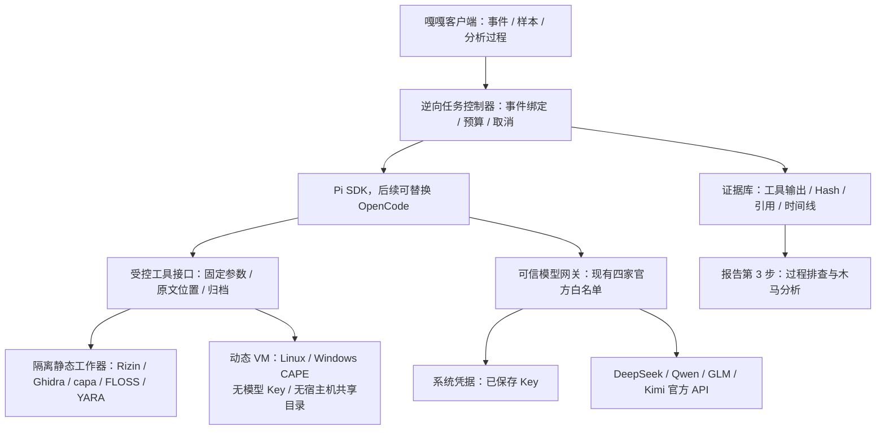

# AI 辅助逆向与沙箱接入方案

2026-10-28 · J4team · 0.6.5 历史设计稿。0.6.6 已落地的容器 / Pi 静态流程与限制见 [隔离分析](ISOLATED-REVERSE-0.6.6.md)；以下规划不代表均已实现。

## 当前能力与实测

| 功能 | 已实现路径 | 已知边界 |
|---|---|---|
| HTTP | 请求 / 响应粘贴、HAR、双方原文引用、结构化 AI 研判 | 非 PCAP；无 TCP 重组、TLS 解密或 HTTP/2/3 二进制会话还原 |
| 流量 | Linux eBPF socket filter + AF_PACKET，流量窗口、黑白名单 / IOC 匹配、预算控制的摘要 AI 调度 | 每窗最多 2000 定向流，界面 / 自动 AI 前 100；无全包保存、PID 归因；不能由摘要还原完整 HTTP |
| WebShell | 文本规则、原文行号、小脚本上下文、AI 复核 / 追问 | 脚本 AI 上下文最多前 80 行 / 8000 字；全材料仍有上限。无 AST / 污点分析、自动反混淆或执行证明 |
| 可执行样本 | PE / ELF 基础结构、导入、有限字符串、Hash、AI 复核 | 无反编译、脱壳、YARA / capa / FLOSS；Mach-O 只识别格式；加壳 / 加密 / 反沙箱样本不保证可判断 |
| Linux 动态 | Docker 环境检测、临时容器与样本卷、strace、日志、超时与清理；报告归档后可 AI 复核 | 仅当前 Linux 引擎架构的 ELF / sh；不是 Windows EXE 环境。容器共享内核，真实恶意样本需可丢弃专用 VM |
| Windows 动态 | CAPE 上传、状态、报告接口 | 协议回环测试通过，尚无 Windows / CAPE 实机验收；客户端不创建或调度本地 Windows VM |

证据：0.6.5 四组合成案例完成 9 次真实 DeepSeek 研判与 1 次追问；183 项原生初次、23 项重开、142 项物理文件检查。禁用脚本判为 benign，但不能将这一结果外推为复杂 WebShell 检出率。

0.6.2 eBPF 实机记录证明 Linux 7.0.12-linuxkit 独立回环命名空间中加载并挂载成功，120 包 / 12 聚合流，加密后由原客户端解密，缺权限明确失败。这不等于宿主机全部流量、生产持续监控或 TLS 解密已验收。

本次环境检查：Docker 可连接 Linux arm64 引擎，Rizin 已安装；未检测到 Pi、OpenCode、Ghidra、capa、FLOSS 或 YARA 命令。没有安装或运行外部 Agent，也没有运行真实恶意样本。

## 推荐架构

优先以 Pi SDK 嵌入受控 Agent 编排；OpenCode 作为后续可替换执行适配器。两者承担模型会话、工具调度与过程事件，不提供恶意代码隔离或反编译器本身。

可信控制器可使用经过裁剪的模型材料；处理不可信文件的静态工作器也要隔离，因为文件解析器可能存在漏洞。动态样本运行环境不包含 API Key、宿主机目录、Docker socket 或控制器管理凭据。

模型网关复用现有系统凭据，不把原始 Key 写入 Pi / OpenCode 的持久 auth 配置。Agent 只持有绑定任务的短期访问凭证，网关从白名单解析实际端点与模型，限制时长、调用与材料大小；任务结束撤销。样本 VM 不能访问模型网关。此网关及其令牌协议尚未实现。

本地运行 Agent 仍会将指定材料发送到当前配置的官方模型。真正离线推理是另一个能力，不由启动本地 Pi / OpenCode 自动获得；仍遵守当前只提供四家官方模型的产品约束。

## 工具与数据路径

先确定 Hash / 类型 / 架构和加壳线索，再抽取字符串、导入、规则命中、函数与交叉引用；模型按需请求指定函数的反汇编 / 伪代码。长脚本按语法结构分块、跨文件依赖和输入到危险调用的路径分析，保留字节偏移或原文行号。不能只将前 80 行重复交给模型并宣称完成全文件逆向。

规划工具：

- `sample_metadata`、`strings_search`、`scan_yara`、`scan_capa`、`decode_strings`。
- `list_functions`、`read_disassembly`、`decompile_function`、`find_xrefs`。
- `request_dynamic_observation`、`read_behavior_artifact`、`record_analysis_finding`。

工具使用结构化参数，不让模型拼接宿主机 shell。解码与解包在工作器执行，不使用宿主机 eval 执行待分析代码。预置工具与规则固定版本；外部工具更新不由样本中的指令触发。

每份输出记录 caseId、sampleEvidenceId、样本 SHA-256、工具和版本、参数、开始 / 完成时间、退出码、输出 Hash、截断 / 缺失信息；每条判断引用函数地址、原始行号或行为工件。派生解码文件单独归档，不覆盖原样本。多事件之间不共享样本读写权限。

执行状态显示“类型识别 → 工具调用 → 反汇编 / 解码 → AI 复核 → 可选动态观察 → 交叉验证 → 待人工复核结论”，展示调用、耗时、关键观察和工件，不展示隐藏思维链。

## 桌面入口

样本分析增加独立“AI 逆向”入口，连接现有样本库，避免将所有功能堆入动态行为页。

- 新建任务：选择本事件样本、静态 / 动态方案、架构和预算；动态运行显式启动。
- 分析过程：任务队列、当前步骤、工具输出、失败原因、取消与继续。
- 证据工作区：函数 / 字符串 / 行为 / IOC / 判断缺口；一键记录为调查节点。
- 报告关联：在报告第 3 步纳入这些节点、负责人及截图，沿用原始证据引用。
- 环境检查：Docker / 虚拟机 / 架构、工具安装与版本、模型连接。未安装与不兼容明确显示，不能用空结果替代失败。

## 接入选择与验证顺序

Pi 的 SDK 文档提供模型运行时、资源加载、会话和自定义工具边界，适合宿主产品替换默认工具与资源发现。必须禁用默认 bash、宿主机任意文件读取、项目扩展 / 技能自动发现，并由平台提供全部工具。

OpenCode 提供 headless server、SDK、SSE、会话与权限配置，可作为第二适配器。官方权限文档说明多数工具默认 allow；必须显式收紧。其权限规则不能替代操作系统和 VM 隔离。

先验收受控静态任务：使用已知源码的无害 PE / ELF 和正常 / 注释 / 混淆脚本对照，验证函数地址、引用、跨事件拒绝、工具失败、超时和重启。再接 Linux VM 动态行为交叉验证，最后用真实 Windows / CAPE 环境验证 EXE / DLL。只有这些步骤完成，才可声称相应 AI 逆向链路可用；不能将编排框架安装成功当作木马分析验收。

上游 Pi main 文档已使用 `@earendil-works/pi-coding-agent`，而本次查询的旧 npm 名 `@mariozechner/pi-coding-agent` 为 0.73.1；实现时需锁定同一版本的包、文档、事件与工具协议，不能混用 main 与旧包示例。

## 已核对的上游资料

- Pi SDK：https://github.com/badlogic/pi-mono/blob/main/packages/coding-agent/docs/sdk.md
- OpenCode SDK：https://opencode.ai/docs/sdk/
- OpenCode server：https://opencode.ai/docs/server/
- OpenCode permissions：https://opencode.ai/docs/permissions/

这些资料证明有嵌入和调度接口，不代表本项目已完成集成或四家模型与所有逆向工具都完成兼容验证。
