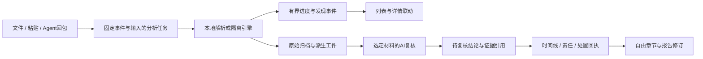

# 开源蓝队产品设计调研与客户端改进建议

调研日期：2026-10-30。对照版本：嘎嘎安全助手 0.7.9。定位：运行在个人 PC 上的一站式防御调查终端。

## 结论

最值得学习的是成熟工具如何帮助调查员完成工作：看清分析进展、从结论返回证据、关联多份材料、记录处置责任、生成能交付的报告。嘎嘎已经具备独立事件、证据归档、时间线、截图粘贴、可变报告章节和隔离分析基础，下一阶段应先改善这些能力之间的衔接。

建议优先组合三种经验：Wireshark 的桌面窗格联动、Timesketch 的多源时间线、DFIR-IRIS 的调查与报告组织。WebShell 的逐层解码参考 CyberChef，采集与覆盖说明参考 Velociraptor，规则输出与扩展接口参考 Hayabusa / Chainsaw，动态工件组织参考 CAPE。

本次实际读取了官方文档、公开仓库 README 与许可证，并对照本项目源码；没有安装并逐一操作这些产品，没有进行性能排名，也没有把文档功能视为本项目已实现的功能。调研下载仅包含公开资料，未上传客户材料、工作区或模型密钥。

## 1. 产品与可借鉴之处

| 产品 | 官方资料确认的设计 | 对嘎嘎的具体启发 | 采用方式 |
| --- | --- | --- | --- |
| [Wireshark][1] | 列表、字段详情、原始字节联动；可调整布局；键盘导航与过滤栏 | 日志 / HTTP 使用紧凑列表与可收起详情；点击发现能定位到原始行、字段或字节；窗格可拖动并记住尺寸 | 优先借鉴客户端交互 |
| [DFIR-IRIS][2] | 每个事件有独立上下文；任务状态、指派、评论；事件模板；调查报告和活动报告；报告数据引用证据、任务、时间线 | 事件内明确责任、动作与回执；报告从已关联材料取数；保留自由章节，同时提供可选调查模板 | 改善既有事件与报告流程 |
| [Timesketch][3] | 一次调查可纳入多条时间线；事件评论、星标、标签；保存搜索；聚合结果；Stories 组合文字、事件与聚合 | 多日志关联、时间分布、保存调查视图、关键节点标记；把筛选结果和统计图引用到报告，保留证据定位 | 优先改善日志调查 |
| [Velociraptor][4] | 离线采集按 artifact 选择与配置；资源设置、请求复核；采集包有结果、日志、上下文、文件元数据与完整性信息；Notebook 组合文字与查询 | 生成 Agent 前显示采什么、需要什么权限、耗时与大小限制；回包显示成功、缺失、失败的项目；保存采集规格与版本 | 改善现有 Agent 向导与覆盖说明 |
| [CyberChef][5] | 输入 / 配方 / 输出分区；可重排操作；逐步执行与断点；保存配方；输入输出定位联动；本地处理 | WebShell 每一层解码独立可查，保存输入、操作参数、输出摘要和映射；常用静态变换可复用 | 交互优先；变换在受限环境执行 |
| [Hayabusa][6] | Windows 日志检测时间线；输出字段与 profile 可配置；Sigma 相关规则；可输出面向 Timesketch 的字段 | 把时间、主机、通道、规则、原始记录 ID 等标准化；兼顾简洁视图与完整详情；规则版本与来源可追溯 | 后续考虑离线结果导入或可选引擎适配 |
| [Chainsaw][7] | 独立轻量 CLI；事件日志检索、Sigma / 自定义规则、取证工件时间线；表格、CSV、JSON 输出；可在 Mac 运行 | 客户端界面与检测引擎分离，支持结构化输入输出；Mac 也可处理客户提供的 Windows 日志 | 后续验证外部进程适配；不冒充 Windows 主机实测 |
| [CAPE][8] | 行为观测、文件变动、PCAP、截图、内存与解包载荷、配置提取等分项工件 | 样本结果按进程、文件、网络、截图、配置分类；每项注明观测来源和运行条件；无行为时展示覆盖与限制 | 先统一结果模型；Windows / CAPE 实机验收仍待补齐 |
| [MISP][9] | IOC / 对象关联、分类标签、warning lists、sightings、结构化导入导出及共享控制 | 本地情报保留出处、首次 / 最近观察时间、关联证据、复核状态、共享范围；命中警告列表提供解释 | 改善本地情报模型与分享预览 |
| [Falco][10] | 规则、宏、列表、例外与选择性启用；规则和插件版本兼容信息 | 容器传感器按规则输出有上下文的事件；让使用者解释和维护白名单；展示采集缺口与事件丢失信息 | Linux 侧后续适配；Mac 客户端负责管理和分析 |

这些项目分属桌面程序、Web 平台、CLI 和服务端引擎。适合复用的是任务组织和证据交互；部署方式应继续服从个人 PC 客户端的定位。

资料版本也有差别：本次 IRIS 主仓库 README 标记 v3.0.0-beta.1，并建议生产使用稳定版 v2.4.29；其在线操作文档部分页面更新时间为 2023 年。这里借鉴文档中明确描述的流程，不声称已实测最新 v3 界面。Velociraptor 文档也明确指出离线采集默认没有全局超时，本项目的限制策略需要根据目标主机负载另行设计。

## 2. 当前“实时展示”的准确情况

“扫描期间看得到进度”“结果逐批出现”“AI 文字逐字输出”“持续监控新数据”是不同能力。

| 当前入口 | 0.7.9 实际实现 | 使用上的差距 |
| --- | --- | --- |
| 日志文件本地分析 | 后端逐行读取，命中行写入独立索引；前端等待文件分析返回；本地过程记录在完成后保存和发送 | 没有扫描期间的已读字节、行数、速率与新增发现列表；后端流式读取不等于界面实时展示 |
| WebShell 普通静态检查 | 在隔离流程完成后返回规则结果，随后选中证据显示详情 | 没有统一的逐层解码过程窗格，也没有本地扫描中间结果流 |
| 普通 AI 研判 / 追问 | 有阶段状态事件与耗时显示；通用请求明确使用 `stream: false`，回答完整返回后保存 | 可知道请求进行到哪一步，但正文没有逐字输出；还需要统一超时、取消与切页后找回任务的体验 |
| Pi 辅助逆向 | 订阅 `reverse-progress`；保存工具调用事件和工件；以 revision 合并，3 秒轮询补偿状态 | 已有真实过程展示，应保留并接入统一任务入口；不据此推断普通静态检查也具备同等体验 |
| 日志行为时间线 | 分析后按已确定时间查询命中记录；支持当前日志 / 当前事件全部日志、IP / 行为筛选和分页；未知时间明确保留 | 还需时间分布、更多实体联动、保存视图，以及非命中原文的上下文调查能力 |

源码依据：`src/main.tsx` 的 `analyze`、`perform`、`ProcessCard`；`src-tauri/src/investigation.rs` 的 `local_analyze` 先执行 `work()` 再发送完成记录；`store.rs::analyze_file_for_case`；`analyzers.rs::analyze_log_stream`；`logbook.rs::index`；`ai.rs::request_chat`；`src/Reverse.tsx` 和 `isolated/records.rs`。

因此，当前基础链路能够支持调查，但等待反馈还不够充分。优先补齐真实进度与可定位的中间发现，比再增加一个仪表盘更能改善日常使用。

## 3. 建议的分析工作区

保留现有独立的日志、HTTP、WebShell、报告等功能页，以及已有的 `⌘K / Ctrl+K` 工具搜索。允许固定常用工具与最近使用入口，记住每个事件的筛选、选中项和窗格尺寸。

单页采用“发现列表—证据详情”联动：列表紧凑显示时间、主机、级别、行为、复核状态；详情按需要展开原文、命中原因、关联材料与 AI 复核。过程面板停靠在底部或侧面，用户能收起，页面不依赖整页长滚动才能操作。

| 位置 | 内容 | 交互约定 |
| --- | --- | --- |
| 固定工具栏 | 当前事件、材料入口、过滤、开始 / 停止、任务状态 | 每次操作明确事件与输入；不因切页改变后台任务归属 |
| 发现列表 | 分批出现的命中、待复核状态、关键字段 | 新记录不抢焦点；滚动查看旧记录时提示新增数量；可暂停自动跟随 |
| 证据详情 | 原文行号 / 字节、上下文、规则版本、解码层、事实与推断 | 点引用能回到材料；原始证据与派生结果分别保存 |
| 任务抽屉 | 真实阶段、计数、耗时、工具调用、错误与重试 | 切页后仍可找回；取消和部分完成状态明确，不假装成功 |
| 记录动作 | 保存调查发现、加入时间线、关联报告章节、粘贴截图 | 沿用当前快捷举证；保留事件、证据、节点和章节关联 |

WebShell 重点展示“原文 → 静态变换各层 → 可疑语义 → 证据引用”。记录 Base64 / 压缩 / 编码等操作的参数、输入输出摘要与限制。静态变换不得通过执行样本完成；遇到不可静态求值的动态行为，明确转到隔离分析。AI 可以解释工件、提出下一步，不能把猜测补成已经观察到的行为。

日志重点展示“时间分布 → 过滤结果 → 原始上下文 → 多源关联”。时间胶囊中的攻击发生时间、发现时间、下令时间、设备回执时间分别记录。未知时区或时钟偏移必须显式标注；同 IP、同名文件或时间接近只提供关联线索。

## 4. 分阶段改进与验收标准

以下是建议实施的工作，不是本次调研已经交付的产品功能。

### 第一优先：真实任务进度与日常操作

1. 让日志、WebShell、普通 AI 使用一致的任务状态和入口。复用既有报告任务 / 逆向任务的经验，固定 `caseId`、输入摘要、任务 ID、revision、终态和错误信息；切页、重启、取消后都能说明任务发生了什么。
2. 日志扫描显示已读字节 / 总字节、已处理行数、可识别 / 未识别 / 跳过行、命中数、耗时与实际速率。百分比只在有分母的阶段显示，解析读完不等于索引提交完成。ETA 仅在采样稳定时提供估算。
3. 前端按批次接收进度与有限预览，例如 100–250 ms 合并刷新；不逐行跨 IPC，不无限累积到 React 数组。完整结果写 SQLite，列表分页或虚拟化；终态用快照补偿丢失事件。
4. 第一条有效发现可在完成前出现，并标明“分析进行中”。取消或失败保留已确认的原始归档与受控部分工件，整体状态不得显示为完成。
5. AI 优先展示可核对的执行阶段、材料范围、脱敏结果、工具工件和证据引用；有需要时再加入流式回答。流式片段是未完成草稿，不能直接视为最终结构化判断；无需展示模型内部思维过程。

验收：大文件期间界面仍能切页和查看已有材料；新增发现不改变正在查看的选中行；任务取消 / 错误 / 重启均有明确状态；同一任务不跨事件串记录。展示刷新频率不等于模型调用频率，不把每条日志直接发给云模型。

### 第一优先：报告作为完整交付流程

已有的自由章节、子章节、负责人、起止时间、状态、节点关联和截图粘贴继续作为基础，避免重新写成固定五步表单。参考 IRIS 模板与 Timesketch Stories，增加可选的“Web 入侵 / 勒索 / 容器”调查模板；模板只预填结构，用户可自由修改。

报告引用结论时同时引用证据定位、时间依据、截图和复核人。正文中的事实、推断与待补证分别表达。建议提供“管理摘要 + 技术过程 + 证据附录”的编排预设，保留详细调查资料。导出时固定报告修订与所用节点快照，记录版本；后续分析不能悄悄改掉已经交付的结论。

验收：从发现列表选中一条结果，能够直接关联目标章节和截图；点击引用可在客户端定位材料。用多阶段、多资产、多子事件和长截图验证排版、目录、分页及编号。继续保留失败不覆盖旧目标、错误可按任务 ID 查询的约束。PDF 仍经系统打印保存，不能以打开打印窗口代替导出成功。

### 第二优先：调查深度与覆盖解释

- 时间分布与保存视图：支持按时间窗、主机 / IP / 账号等实体逐步深入；保存筛选条件、标签和关键节点，用于报告引用。
- “没发现”解释：显示解析器和规则版本、检查项目、权限缺失、工具不可用、超限、未识别与跳过数量。区分无命中、未采到、未检查、执行失败；不能把解析成功率当作威胁覆盖率。
- Agent 向导：采集前复核目标、项目、权限、资源限制、回传方式与公钥标识；回包以相同清单逐项对照。参考 Velociraptor 的上下文与元数据设计，原始时间、路径、哈希和命令返回状态保持可追溯。
- WebShell 静态变换：逐层工件、输入输出定位、复用配方、深度 / 膨胀比 / 超时限制；无结论不自动放行为安全。
- 本地情报：从证据提取 IOC 后保留来源与复核状态；黑白名单注明范围、理由、负责人和有效期，命中后可解释；分享前预览字段和脱敏内容。

验收采用已知命中、正常对照、时间缺失、部分采集、工具缺失及损坏输入等案例，分别检查结果与限制提示；不以单个命中数量作为检测质量证明。

### 后续：可选引擎和社区扩展

Hayabusa / Chainsaw 可以先做结构化结果导入，再评估隔离的 CLI 适配；Mac 上可解析离线 Windows 日志，不需要等待 Windows 客户端，但这不代表 Windows / CAPE 环境已验收。CAPE 接入继续以独立沙箱工件为依据。Falco 类 Linux 传感器侧先筛选和汇总事件，客户端再做关联与 AI 复核；eBPF 不等于自动拿到全部明文流量，HTTPS 解密与应用层观测需另行评估。

社区投稿可拆成规则包、解析器、静态变换、调查模板和脱敏案例。每项携带作者、版本、许可证、适配范围和正常 / 异常对照样例。导入时先预览内容与权限，安装和启用由用户决定。客户证据不随规则包分享；社区解析器不能自动获得本机文件、网络或任意命令权限。

## 5. 架构上的采用方式

任务状态、发现、证据、人工处置和报告节点分别建模。分析输出需要引擎 / 规则 / 模型版本与来源工件标识，便于复现和说明。采用单调序号或 revision 合并推送与快照，限制进度频率和内存预览数量，保留 SQLite 分页；新能力不应依赖把大文件全文装入前端。

界面继续保持轻量。大型沙箱、解析器和规则资源按需使用，环境检查说明依赖、空间和版本；不要求个人使用者为基础调查搭建一整套集中式平台。后台任务只能使用启动时捕获的事件与配置，不依赖随时变化的“当前事件”。

## 6. 许可证与资料边界

本次核对的主仓库：IRIS 为 LGPLv3；Timesketch、CyberChef、Falco 为 Apache 2.0；Hayabusa、MISP 为 AGPLv3；Chainsaw、CAPE 为 GPLv3；Velociraptor 的实际许可证正文为 AGPLv3（GitHub 自动识别为 Other）；Wireshark 为 GPLv2 系列。组件、规则与数据可能另有许可：Hayabusa README 特别区分代码的 AGPLv3 和检测规则的 DRL 1.1。

本项目当前采用个人及非商用免费、商用由 J4team 单独授权的许可。借鉴工作流程与直接复制、修改或再分发他人代码是不同事项。引入代码、引擎、规则和商标前应逐项核对兼容性、归属和分发条件；外部 CLI / API 边界本身不自动解决所有许可问题。本次没有复制这些项目的实现代码或打包第三方引擎。

## 7. 官方来源

链接于调研日读取；分支和在线文档后续可能更新。调研快照的获取结果和摘要指纹另存于公开来源索引。页面抓取失败的旧路径未用作功能依据，已改用可访问的官方页面。

[1]: https://www.wireshark.org/docs/wsug_html_chunked/ChUseMainWindowSection.html
[2]: https://docs.dfir-iris.org/operations/cases/case_operations/
[3]: https://timesketch.org/guides/user/basic-concepts/
[4]: https://docs.velociraptor.app/docs/deployment/offline_collections/building/
[5]: https://github.com/gchq/CyberChef#how-it-works
[6]: https://yamato-security.github.io/hayabusa/output/
[7]: https://github.com/WithSecureOpenSource/chainsaw
[8]: https://github.com/kevoreilly/CAPEv2
[9]: https://github.com/MISP/MISP
[10]: https://falco.org/docs/concepts/rules/

- IRIS：[事件任务](https://docs.dfir-iris.org/operations/cases/tasks/)、[报告数据与模板](https://docs.dfir-iris.org/operations/reports/)、[事件模板](https://docs.dfir-iris.org/operations/case_templates/)、[仓库及版本说明](https://github.com/dfir-iris/iris-web)。
- Timesketch：[基本概念 / Stories / 聚合][3]、[查询指南](https://timesketch.org/guides/user/search-query-guide/)、[仓库](https://github.com/google/timesketch)。
- Velociraptor：[离线采集构建][4]、[回包结构与元数据](https://docs.velociraptor.app/docs/deployment/offline_collections/collection_data/)、[Notebook](https://docs.velociraptor.app/docs/notebooks/)、[实际许可证](https://github.com/Velocidex/velociraptor/blob/master/LICENSE)。
- CyberChef：[四区域、Auto Bake、逐步执行与本地处理](https://github.com/gchq/CyberChef#how-it-works)。
- Hayabusa：[输出字段与 profile][6]、[规则说明](https://yamato-security.github.io/hayabusa/rules/)、[代码与规则许可区分](https://github.com/Yamato-Security/hayabusa#license)。
- Chainsaw：[功能、输出和 Mac 支持][7]。
- CAPE：[行为观测与工件分类][8]、[结果说明](https://capev2.readthedocs.io/en/latest/usage/results.html)、[Web 使用](https://capev2.readthedocs.io/en/latest/usage/web.html)。
- MISP：[对象关联、warning lists、sightings、共享和导入导出][9]。
- Falco：[规则、例外和版本兼容信息][10]、[仓库](https://github.com/falcosecurity/falco)。

这份文档是调研与实施建议。0.7.9 现有发布包保持原样，新增建议不计入已实现或已验收功能。
