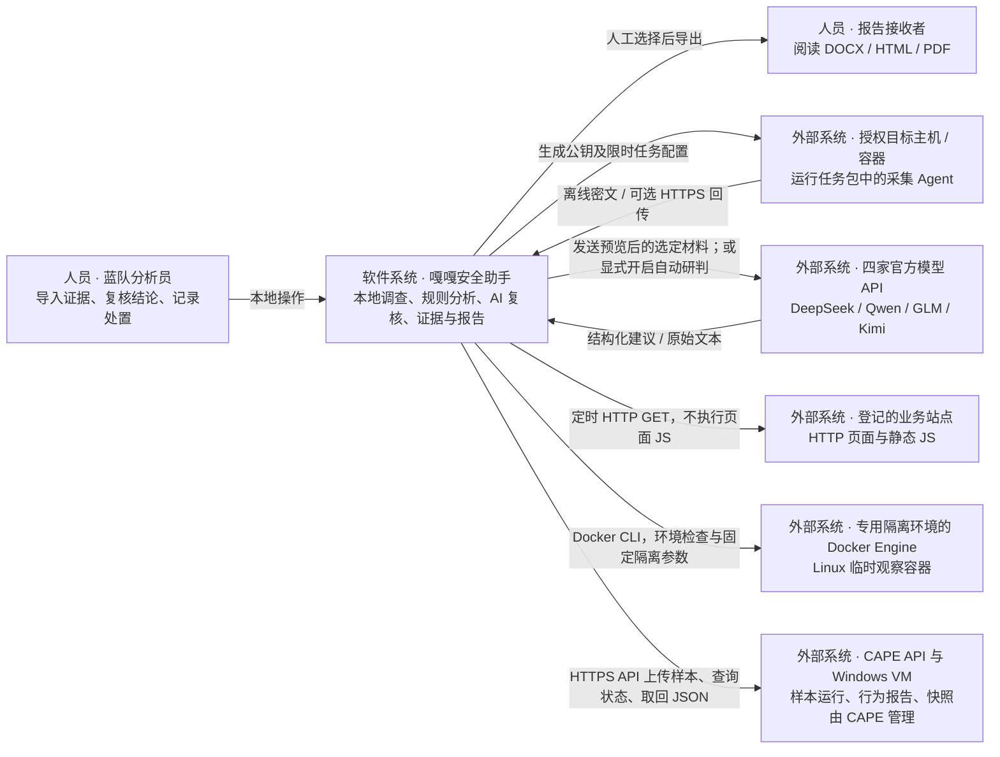
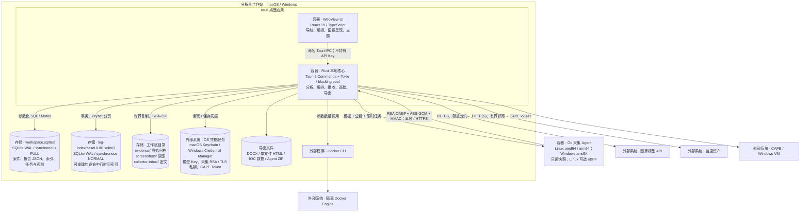
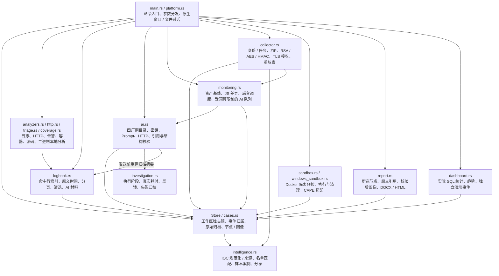
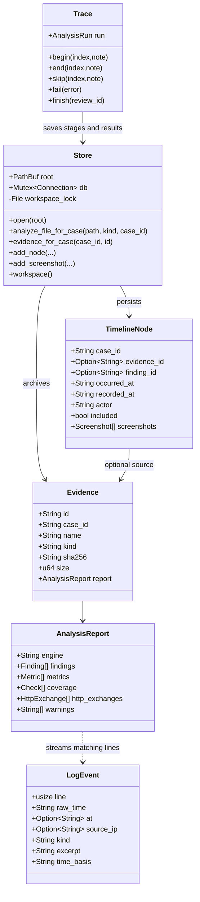
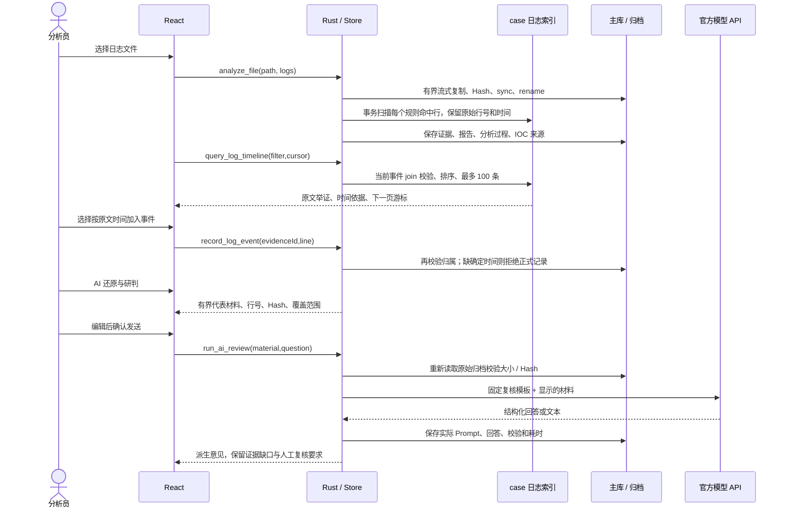
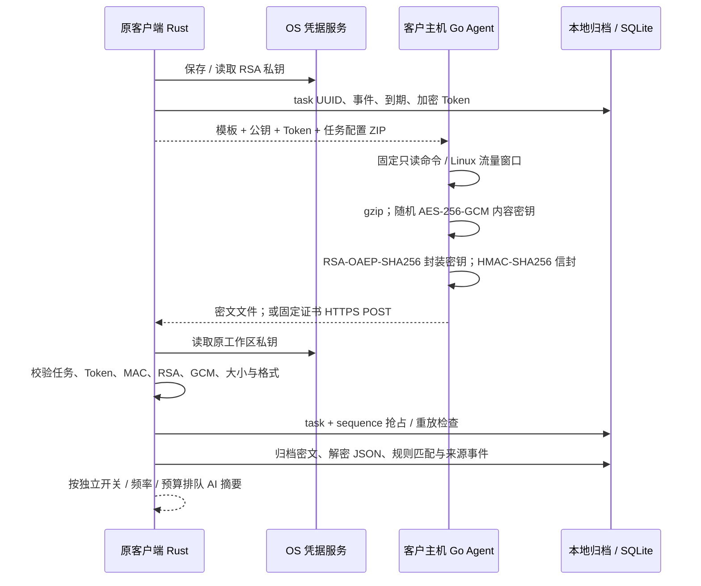

# 嘎嘎安全助手：C4 实际架构

版本：0.6.0 开发预览版 · J4team · 审计日期：2026-10-27

本文件依据当前 React / Rust / Go 源码、SQLite 建表语句和本机验收生成。图中的实线表示已存在的调用关系，不表示对应外部系统已完成实机认证。图使用 Mermaid flowchart 表达 C4 的层级、职责与关系，避免将逻辑模块误写成独立服务。

## 1. 系统定位与边界

嘎嘎安全助手是本地调查桌面应用。它将事件、原始材料、规则结果、AI 派生意见、人员记录与截图串成可编辑报告。主机不运行集中式业务服务器；可选 HTTPS 接收器与定时巡检均在客户端进程内，关闭客户端后停止。

操作系统账户是当前信任边界；“事件隔离”是同一个本机工作区的资料归属边界，不是租户权限系统。人员名称是人工标注，不是认证身份。对客户主机的采集另由 Go Agent 执行。

## 2. C4 Level 1：System Context

未画为现有外部系统的能力：微步、WHOIS / RDAP、RAG、在线漏洞库、反编译服务。这些尚未接入；UI 的未执行状态不能解释为已检索且无结果。

## 3. C4 Level 2：Container

这里的 Container 指可执行单元或数据存储；与 Docker 容器不是同一个术语。

UI 通过 Tauri IPC 调用 Rust；文件、网络和凭据操作由 Rust 负责。CSP 限制脚本为本地资源，阻止 iframe / object，图像允许本地 data / blob。报告及样本内容以文本或受控图片呈现，不直接执行不可信 HTML。浏览器模式仅用于界面预览，不能替代原生功能验收。

## 4. C4 Level 3：Rust 核心组件

组件职责与源码：

| 范围 | 实际文件 | 设计重点 |
| --- | --- | --- |
| UI | `src/main.tsx`, `Cases.tsx`, `Investigation.tsx`, `Dashboard.tsx`, `Platform.tsx`, `Sandbox.tsx` | 顶部工作区、独立结果视图、固定窗口与内部滚动；截图用 DOM paste 事件 |
| IPC / 初始化 | `src-tauri/src/main.rs`, `platform.rs` | 管理 Arc\<Store\>、接收器状态与后台任务；大量 IO 使用 spawn_blocking |
| 归档与业务关系 | `store.rs`, `cases.rs` | 有界复制临时文件、sync_all、rename；事件 ID 绑定、图像 Hash |
| 执行留痕 | `investigation.rs` | 阶段完成 / 跳过 / 失败、实际 messages 与结果分别存；Drop 将未完成运行记为失败 |
| 日志 | `analyzers.rs`, `logbook.rs` | 2 GiB 流式解析、256 KiB 行界限、每命中行入索引、未知时间明确待补 |
| 基线 | `coverage.rs` | 13 类配置检查；risk / clear / unknown / not_covered 四态 |
| 采集 | `collector.rs`, `agent/*.go` | 客户端保存私钥；Agent 不含解密私钥；任务密钥不证明目标主机可信 |
| 外部模型 | `ai.rs`, `src/ai-providers.json` | 单一厂商目录源，固定端点、模型选择验证、网络上限、凭据不入数据库 |
| 动态分析 | `sandbox.rs`, `windows_sandbox.rs`, `sandbox/` | Linux 系统调用观察 / CAPE 协议，导入静态材料不触发运行 |
| 输出 | `report.rs` | DOCX 为真正 OOXML ZIP；HTML 自包含；PDF 调系统打印 |

## 5. C4 Level 4：关键代码与数据结构

### 5.1 事件隔离矩阵

| 数据 | 范围与关联 | 读取 / 操作约束 |
| --- | --- | --- |
| `cases` | 工作区事件目录 | 可跨事件列出名称、数量、状态，50 条分页 |
| `evidence`, `nodes`, `analysis_runs` | 明确 `case_id` | 工作台读取当前事件；后台采集和自动 AI 使用任务原事件，不依赖当前 UI |
| `screenshots` | `node_id → nodes.case_id` | 读取和新增均检查当前事件；读图、导出重算 Hash |
| `ai_reviews` | `evidence_id → case_id` | 追问 / 反馈通过 review→evidence 校验归属 |
| `ai_followups`, `review_feedback` | `review_id → evidence_id` | 追加保存，原 AI 答案不被反馈覆盖 |
| `sandbox_jobs`, `malware_cases` | `case_id` | 仅当前事件展示 / 操作；CAPE 任务还绑定原服务 |
| `collector_tasks`, `flow_windows` | `case_id`、task 关系 | 任务生成时绑定；回包不能重新归属当前打开事件 |
| `collector_batches` | task / sequence 联合主键 | 重放、处理状态与密文摘要；任务间互相独立 |
| `monitor_assets`, `monitor_observations` | `case_id` | 所属事件隔离；后台按所有启用资产调度 |
| `monitor_snapshots` | `asset_id`、`evidence_id` | 只能以本资产采集成功的 2xx 快照作为人工基线 |
| `log-index/*.sqlite3` | 一事件一索引库；events / metadata | 查询再 join 主库 evidence，排除孤立或跨事件条目 |
| `intel_indicators` | **工作区全局共享** | IOC 去重、人工判断、标签、备注；不是逐事件私有知识库 |
| `intel_observations` | 全局 IOC → `case_id/evidence_id` | 保存来源，不复制原证据到其他事件 |
| `indicator_rules` | global 或指定 case UUID | 匹配只加载全局 + 目标事件，不以展示数量截断规则 |
| `settings`, `monitor_ai_calls` | 工作区配置 / 全局预算 | 当前事件指针、厂商配置、状态、接收配置、凭据命名空间；无 API Key 明文 |

### 5.2 持久化与一致性

主库 WAL + FULL；所有主库访问经一个进程内 Mutex。工作区的文件锁拒绝第二个 Store / 客户端打开同一目录，避免两个后台调度器重置对方运行标志。此锁不是分布式锁，不支持网络共享目录协同。

日志索引是可重建派生数据，使用 WAL + NORMAL、约 4 MiB 页缓存，单文件重建在一个索引事务内替换。索引写入与主证据表不是跨库原子事务；崩溃可能留下无主索引 / 文件，读取 join 不会展示它们，但垃圾回收与统一恢复尚待完善。

原始材料按 UUID 归档，摘要针对归档字节，不以源文件路径作为长期引用。Hash 用于检查变化，不能防止本机攻击者同时修改文件和数据库；没有签名证据账本。数据库、解密证据与 Prompt 明文保存在本地；依赖操作系统账户权限与磁盘保护。

## 6. 动态视图：核心路径

### 6.1 日志 → 时间线 → AI

时间索引覆盖所有**规则命中行**，不是所有主机活动。Common / RFC3339 的显式时区可直接规范化；无年份 syslog 必须补充参考年份及偏移。跨年、主机时钟漂移、目标主机身份与多源关联仍需分析员核对。同 IP 和先后顺序不能单独证明同一攻击者、未授权登录或 WebShell 落地。

### 6.2 Agent 生成与回收

私钥身份以持久工作区 UUID 关联 OS 凭据，不再绑定目录字符串。旧版本凭据须先在原路径成功迁移，再移动工作区；跨计算机复制数据库不等于复制钥匙串。Agent ZIP 内的 Token 允许持有者提交该任务数据，不是远端主机真实性认证；泄露后应撤销任务。回包加密不等于解密后证据在磁盘上加密。

### 6.3 截图与报告

用户打开节点的粘贴框 → DOM paste 获取 PNG / JPEG / WebP → 8 MiB 上限和解码尺寸限制 → 本地归档、Hash、必填图注 → 当前事件节点保存。生成 DOCX / HTML 时校验截图字节和 Hash；失败则中止。DOCX 对图片转换为 PNG 嵌入，同时标注原图 Hash。PDF 走系统打印，没有后台 PDF 引擎。

## 7. 部署、性能与未实现范围

- 客户端：Tauri 的系统窗口与菜单；macOS 使用 WKWebView，Windows 依赖 WebView2。macOS arm64 已本机验证；Windows 仅有共用源码及手动触发 CI，尚无实机验收结果。
- Agent：Go 可执行模板 + 每次任务配置，不是为每个客户端重新编译二进制。Linux amd64 / arm64、Windows amd64；快照命令固定，无任意命令下发 API。
- eBPF：Linux SocketFilter + AF_PACKET，当前网络命名空间和指定网卡。用户态有界解析与聚合，最多 2000 流 / 窗口；不是全量 PCAP、TLS 解密、TCP 重组或 PID 归因。此次无真实 Linux 内核挂载验收。
- 资产：客户端运行时每 5 秒调度，最多 4 个并发巡检；获取 HTML 和限量 JS、Hash 与隐藏链接线索。无浏览器 JS 执行、全站爬虫、完整 DOM 渲染或自动劫持定罪。
- AI：单监控 AI 槽、频率 / 小时预算；手动发送可预览。没有自动修复、终端工具执行、在线 RAG 或隐藏推理回放。
- 容器：13 类配置规则 + 5 类未覆盖领域；没有数据必须显示 unknown / not_covered。Docker 动态观察只记录受限制条件下的行为，普通容器共享内核。
- 性能边界：报告及工作区仍会加载当前事件的全部 evidence.report；大案件还需要列表 / 明细分离、延迟解析与进一步虚拟化。日志索引空间随命中量线性增长；当前缺少磁盘配额和可恢复取消界面。
- 开源发布前仍需：明确版本化 schema migration / 备份恢复策略、凭据灾备、保留期与删除、签名与公证、真实 Windows / CAPE / 内核 eBPF 验收，以及依赖漏洞扫描与供应链固定策略。

## 8. 关键架构决策

| 决策 | 当前理由 | 代价 / 后续 |
| --- | --- | --- |
| 本地优先，Rust 承担 IO | 原文不用先上传；UI 和 OS 能力分开 | 本机磁盘权限、凭据与备份需要明确 |
| 事件为证据聚合根 | 多调查长期并存，报告不混用 | IOC 是明确的全局例外；未来权限需新增模型 |
| 原始证据与派生结果分开 | 可复核、可重建，反馈不改写 AI | 大文件和完整 Prompt 增加磁盘占用 |
| 日志独立派生索引 | 大日志扫描不长期持有主库 Mutex | 跨文件 / 跨库一致性与清理需要恢复策略 |
| 模型固定四家官方端点 | 降低密钥误发、统一参数目录 | 厂商模型目录会变化，需周期维护 |
| 运行样本交给外部隔离环境 | 客户端不直接执行样本 | 不能承诺普通 Docker 防逃逸；Windows 依赖 CAPE |
| Agent 混合加密 + 独立任务 Token | 离线也能完成原客户端解密与回收 | 不证明被控主机诚实；私钥需要灾备 |

许可：J4team 个人及非商用免费，商用须单独授权。该许可不是 OSI 开源许可或 AGPL；实际以仓库 `LICENSE.txt` 为准。
