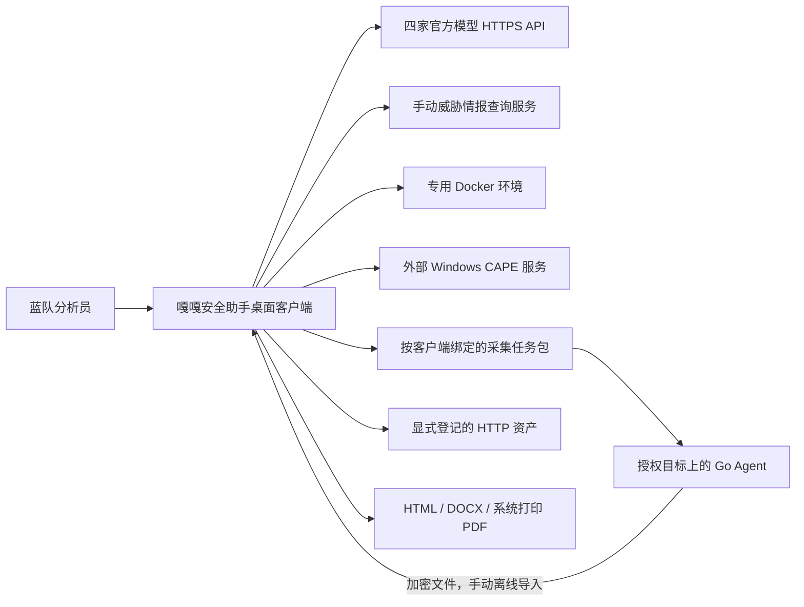
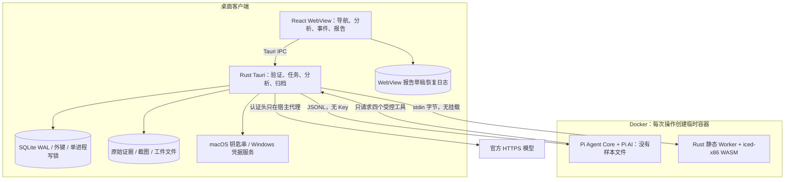
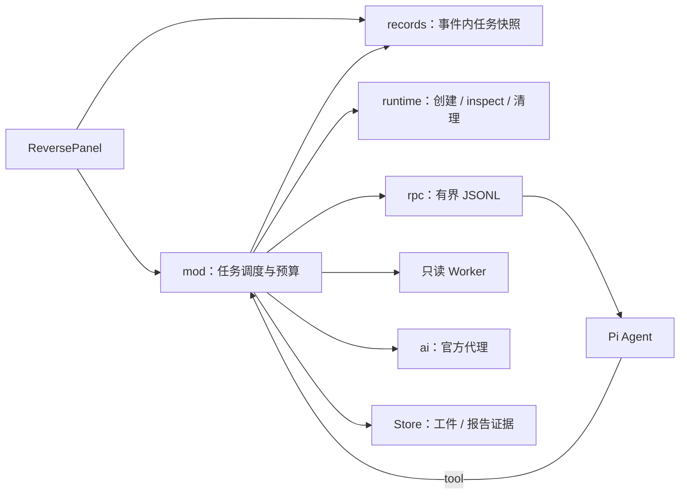
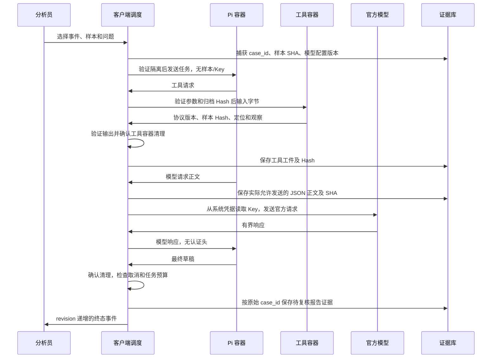

# 嘎嘎安全助手 0.6.7：C4 与实现边界

本文件描述当前源码的真实架构。客户端是 Tauri 2 / Rust / React，目标为 macOS 与 Windows；本轮实机主机是 macOS arm64。AI 自配 DeepSeek / Qwen / GLM / Kimi 官方服务，Pi 仅是容器内的受控工具调度器。

## C1：上下文

0.6.7 暂停在线回传与在线任务生成：RSA 依赖的未修复计时侧信道公告使网络自动解密不适合继续开放。后端拒绝入口，旧接收实现仅保留待协议迁移，不能视作本版可用能力。

Agent 不是远控终端，不接受任意命令。eBPF 运行在 Linux 目标侧，当前收集连接元数据，不是“所有流量正文”。页面巡检只取当前页面和最多 8 个同源 JS，不渲染 DOM、不截图、不登录、不递归、不跟随跳转。CAPE 是接口适配，未随客户端交付 Windows 虚拟机。

## C2：容器与存储

解析容器与 Pi：network none、只读根、UID 65534、cap-drop ALL、no-new-privileges、无宿主机目录或 Docker socket、IPC none、CPU 1、768 MiB、PIDs 64、受限 noexec tmpfs。运行前 inspect 验证；镜像版本标签用于兼容性检查，运行使用不可变 Image ID。标签不是数字签名，本地 daemon 和基础镜像仍是信任边界。普通 Docker 共享内核，不能代替专用可回滚 VM。

SQLite 与证据目录保存明文材料，没有身份认证、数据库加密或不可抵赖证据链。新 Unix 工作区目录为 0700，数据库/快照为 0600；Windows 依赖用户目录 ACL。截图解析与日志/HTTP 解析仍在客户端，存在有界解析器风险，不能宣称所有不可信内容均由 VM 处理。

## C3：组件与职责

| 组件 | 文件 / 目录 | 不变量 |
|---|---|---|
| IPC 与应用启动 | src-tauri/src/main.rs | 阻塞操作转到工作线程；调试验收入口只在 debug 开启 |
| 事件与归档 | store.rs / cases.rs | 工作区独占文件锁，快照计算 Hash，按原事件写入 |
| 日志索引 | logbook.rs | 流式有界读取、原始行号和时间依据、完整命中计数与分页 |
| HTTP 联合分析 | http.rs | 两侧关联保留、解码有界、请求线索与成功证据分离 |
| 离线采集与导入 | collector.rs / agent/ | 客户端公钥绑定、认证加密、任务范围/有效期/撤销/重放控制；在线入口暂停 |
| 静态逆向调度 | isolated/mod.rs | 固定预算；完整性/隔离/清理失败为致命错误 |
| 镜像和容器生命周期 | isolated/runtime.rs | 创建前即安装清理守卫，删除前验证工作区标签 |
| Pi 通信 | isolated/rpc.rs | 有界队列/行长/写超时；取消不会卡在同步写管道 |
| 逆向记录 | isolated/records.rs | Upsert 保持行身份，递增 revision，取消不依赖列表分页 |
| 模型适配与凭据代理 | ai.rs / ai-providers.json | 只允许四家官方端点和模型；材料归档后发送，Key 不进入 Pi |
| 静态工具 | reverse-worker/src/ | 参数独立验证；四个只读操作；入口映射检查溢出和文件区间 |
| 持续巡检 | monitoring.rs | 启动捕获事件；子资源失败保留证据；并发更新不覆盖启停/基线 |
| 报告 | report_draft.rs / report.rs / Reports.tsx | 五步骤、负责人/时间/状态/节点/截图；导出前先保存 |
| 前端任务同步 | Reverse.tsx / reverse-state.ts | 订阅、快照和轮询合并 revision；按事件过滤，限制历史数 |
| 报告恢复日志 | draft-journal.ts | SQLite 确认前保留；迟到回执不清除新版本；冲突需要显式选择 |

## 关键时序

默认预算：单个 Pi 任务与单个静态工具；8 次模型、16 次工具、80 条控制消息、300 秒调度时间。工具 Docker 命令最长 45 秒，管道单次写最长 10 秒；取消模型请求约 100ms 轮询，正在执行的工具可等待该工具结束或超时。创建/检查/删除有自己的有界时限，清理耗时可使墙钟总时长超过 300 秒。清理不确定时显示尚未确认，不能生成完成报告。

## 状态、恢复与维护

任务 running → completed / cancelled / failed。重启把未完成任务标为 failed，不自动重放模型或执行样本。每次任务保存递增 revision；历史记录缺失字段使用默认值，保留旧记录原始信息，不编造旧模型名称。按事件和创建时间建索引；取消按主键和事件查询。

报告编辑的 600ms 自动保存队列绑定原事件，立即编辑时写本地恢复日志。成功回执只清除同版本草稿；启动时与数据库版本相同则恢复，冲突提供“恢复本机未保存草稿 / 使用数据库版本”。恢复日志不等于备份；清除 WebView 数据会清除未确认的草稿。导出 HTML / DOCX 前强制保存，PDF 使用系统打印。

SQL 结构当前采用可重复执行的建表/索引，记录字段用 serde(default) 兼容；不是完整的版本化迁移框架。后续若重建表或改变语义，需要显式迁移版本、关闭状态的备份和回滚验证。Workspace 聚合接口仍会加载当前事件的全部证据摘要；大规模事件的分页和内存压力需要独立基准，不能用 1 GiB 单日志流式测试代替千事件容量验收。main.tsx、platform.rs 和 ai.rs 仍有进一步拆分空间，本轮优先拆分具有权限和故障边界的隔离模块。

本轮验收与未测范围见 AUDIT-0.6.7.md；运行与贡献规则见 ../CONTRIBUTING.md。
