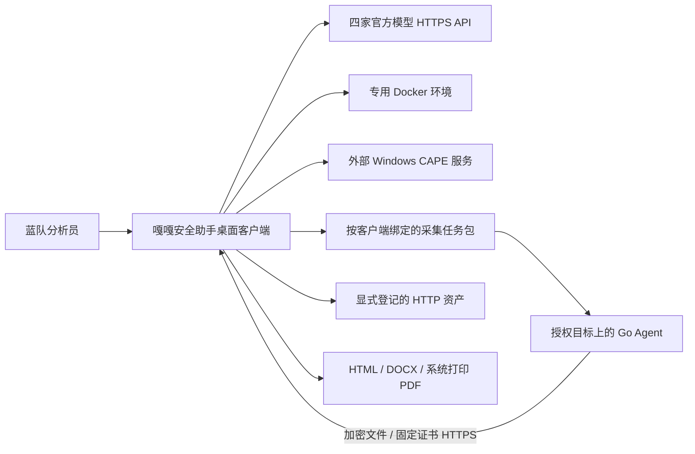
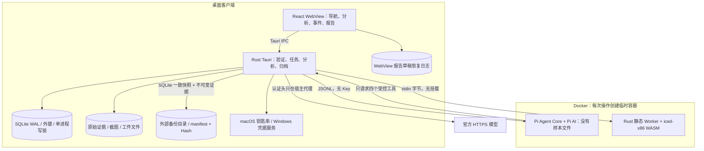
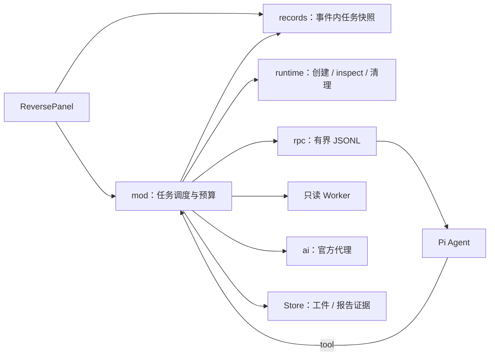
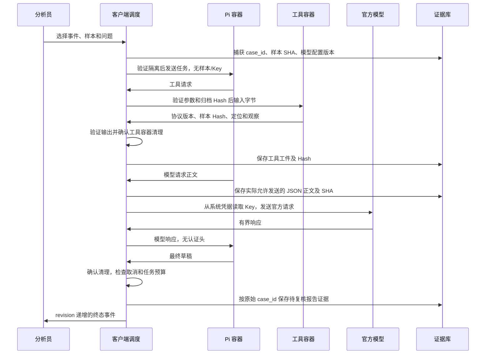
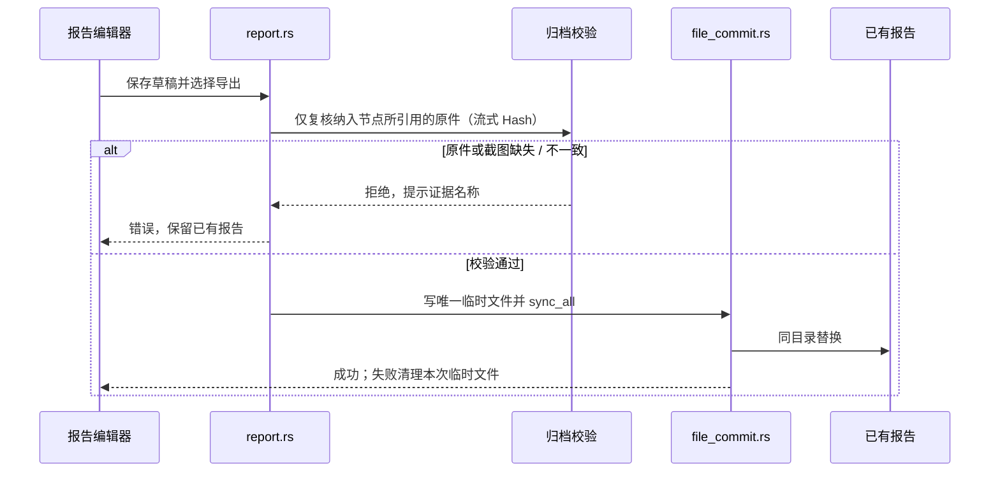
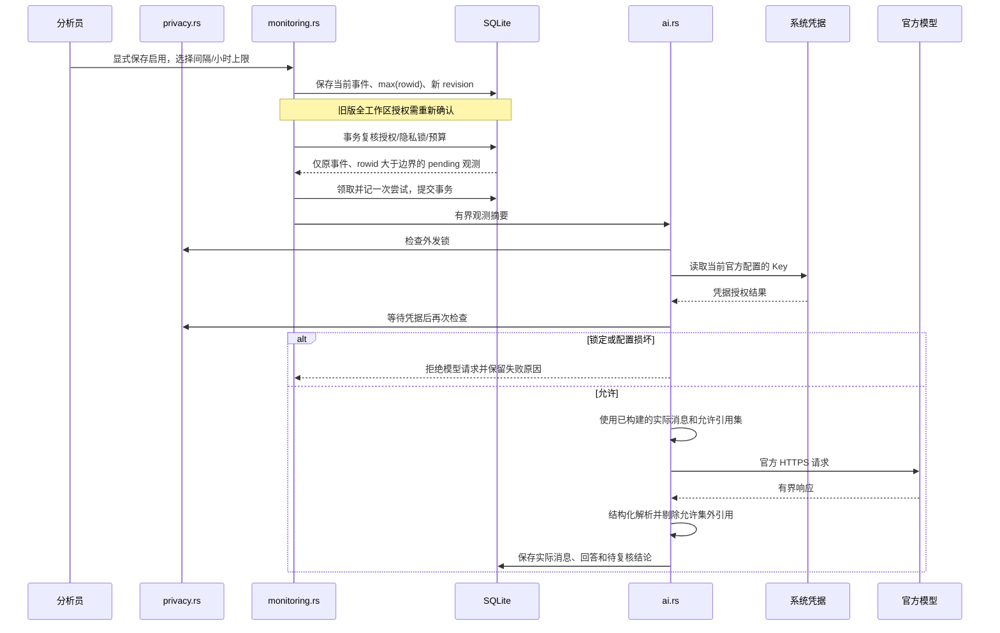

# 嘎嘎安全助手 0.7.2：C4 与实现边界

本文件描述当前源码的真实架构。客户端是 Tauri 2 / Rust / React，目标为 macOS 与 Windows；本轮实机主机是 macOS arm64。AI 自配 DeepSeek / Qwen / GLM / Kimi 官方服务，Pi 仅是容器内的受控工具调度器。

## C1：上下文

0.7.0 保留原 RSA-OAEP / AES-GCM / HMAC 包格式，将私钥运算迁移至 AWS-LC。接收默认关闭，显式配置固定 HTTPS 证书后启动；旧 PKCS#8 与 Go 固定向量验证兼容。没有将实现替换等同于整个协议通过独立密码学审计。

Agent 不是远控终端，不接受任意命令。eBPF 运行在 Linux 目标侧，当前收集连接元数据，不是“所有流量正文”。页面巡检只取当前页面和最多 8 个同源 JS，不渲染 DOM、不截图、不登录、不递归、不跟随跳转。CAPE 是接口适配，未随客户端交付 Windows 虚拟机。

## C2：容器与存储

解析容器与 Pi：network none、只读根、UID 65534、cap-drop ALL、no-new-privileges、无宿主机目录或 Docker socket、IPC none、CPU 1、768 MiB、PIDs 64、受限 noexec tmpfs。运行前 inspect 验证；镜像版本标签用于兼容性检查，运行使用不可变 Image ID。标签不是数字签名，本地 daemon 和基础镜像仍是信任边界。普通 Docker 共享内核，不能代替专用可回滚 VM。

SQLite 与证据目录保存明文材料，没有身份认证、数据库加密或不可抵赖证据链。新 Unix 工作区目录为 0700，数据库/快照为 0600；Windows 依赖用户目录 ACL。截图解析与日志/HTTP 解析仍在客户端，存在有界解析器风险，不能宣称所有不可信内容均由 VM 处理。

## C3：组件与职责

| 组件 | 文件 / 目录 | 不变量 |
|---|---|---|
| IPC 与应用启动 | src-tauri/src/main.rs | 阻塞操作转到工作线程；调试验收入口只在 debug 开启 |
| 事件与归档 | store.rs / cases.rs | 工作区独占文件锁，快照计算 Hash，按原事件写入 |
| 日志索引 | logbook.rs | 流式有界读取、原始行号和时间依据、完整命中计数与分页 |
| HTTP 联合分析 | http.rs | 两侧关联保留、解码有界、请求线索与成功证据分离 |
| 离线采集与导入 | collector.rs / agent/ | 客户端公钥绑定、认证加密、任务范围/有效期/撤销/重放控制；AWS-LC 私钥运算 |
| 静态逆向调度 | isolated/mod.rs | 固定预算；完整性/隔离/清理失败为致命错误 |
| 镜像和容器生命周期 | isolated/runtime.rs | 创建前即安装清理守卫，删除前验证工作区标签 |
| Pi 通信 | isolated/rpc.rs | 有界队列/行长/写超时；取消不会卡在同步写管道 |
| 逆向记录 | isolated/records.rs | Upsert 保持行身份，递增 revision，取消不依赖列表分页 |
| 模型适配与凭据代理 | ai.rs / ai-providers.json | 只允许四家官方端点和模型；材料归档后发送，Key 不进入 Pi |
| AI 外发锁 | privacy.rs / Privacy.tsx | 工作区持久化；密钥读取前和授权等待后检查；锁定停用自动 AI，解锁不恢复授权 |
| 静态工具 | reverse-worker/src/ | 参数独立验证；四个只读操作；入口映射检查溢出和文件区间 |
| 持续巡检 | monitoring.rs | 启动捕获事件；子资源失败保留证据；并发更新不覆盖启停/基线；自动 AI 按事件、插入边界与授权版本领取 |
| 报告 | report_draft.rs / report.rs / Reports.tsx | 五步骤、负责人/时间/状态/节点/截图；导出前先保存，流式核对所引用原件和截图 |
| 文件提交 | file_commit.rs | 唯一同目录临时文件、同步后替换，不先删除旧文件；报告和指针共用 |
| 前端任务同步 | Reverse.tsx / reverse-state.ts | 订阅、快照和轮询合并 revision；按事件过滤，限制历史数 |
| 工作区维护 | maintenance.rs | 一致快照；校验原始 Hash；恢复新目录、路径白名单、禁用后台任务；不含系统凭据 |
| 支持诊断 | diagnostics.rs / Support.tsx | 仅字段白名单，无 Key / 客户原文 / 路径；功能状态共用 release-manifest.json |
| 采集密码学 | collector_crypto.rs | AWS-LC OAEP-SHA256，旧 label 与 PKCS#8 保持兼容 |
| 报告恢复日志 | draft-journal.ts | SQLite 确认前保留；迟到回执不清除新版本；冲突需要显式选择 |

## 关键时序

默认预算：单个 Pi 任务与单个静态工具；8 次模型、16 次工具、80 条控制消息、300 秒调度时间。工具 Docker 命令最长 45 秒，管道单次写最长 10 秒；取消模型请求约 100ms 轮询，正在执行的工具可等待该工具结束或超时。创建/检查/删除有自己的有界时限，清理耗时可使墙钟总时长超过 300 秒。清理不确定时显示尚未确认，不能生成完成报告。

## 状态、恢复与维护

任务 running → completed / cancelled / failed。重启把未完成任务标为 failed，不自动重放模型或执行样本。每次任务保存递增 revision；历史记录缺失字段使用默认值，保留旧记录原始信息，不编造旧模型名称。按事件和创建时间建索引；取消按主键和事件查询。

报告编辑的 600ms 自动保存队列绑定原事件，立即编辑时写本地恢复日志。成功回执只清除同版本草稿；启动时与数据库版本相同则恢复，冲突提供“恢复本机未保存草稿 / 使用数据库版本”。恢复日志不等于备份；清除 WebView 数据会清除未确认的草稿。导出 HTML / DOCX 前强制保存，PDF 使用系统打印。

SQL 结构使用 user_version=1 与可重复执行的建表/索引，记录字段用 serde(default) 兼容。升级旧结构前自动生成一致性迁移快照，初始化成功才写版本，拒绝未来版本。当前只有这一阶段的版本门禁；后续重建表或改变语义仍需逐版迁移和回滚验证。Workspace 聚合接口仍会加载当前事件的全部证据摘要；大规模事件的分页和内存压力需要独立基准，不能用 1 GiB 单日志流式测试代替千事件容量验收。main.tsx、platform.rs 和 ai.rs 仍有进一步拆分空间。0.7.0 已拆分隔离模块；0.7.2 新增独立隐私模块，并收紧自动研判和引用边界。

本轮增量验收与未测范围见 [AUDIT-0.7.2.md](AUDIT-0.7.2.md)；历史大日志及官方模型验收见 [ACCEPTANCE-0.7.0.md](ACCEPTANCE-0.7.0.md)。运行与贡献规则见 ../CONTRIBUTING.md。

## 备份、恢复与结构版本

备份通过 SQLite Backup API 获取一致数据库快照，再读取快照引用的不可变证据/截图并比对已有 SHA-256。逆向工件、动态报告一并保留；不含临时输入、系统凭据、Docker 镜像及可重建日志索引。大文件流式复制，不把整个数据库或证据读进内存。复制期间数据库可以继续保存后续修改，这些修改归入下一次备份。

备份目录包含 manifest.json 与文件清单、大小和摘要。恢复只接受白名单路径，限制大小/数量，拒绝重复路径、符号链接、数据库触发器/视图/虚拟表、缺失证据及摘要错误。恢复到新建目录，失败时清理该目录；不覆盖当前工作区。恢复后停用资产调度、自动 AI 和旧任务，模型配置重新确认。manifest 提供完整性核对，不提供来源真实性签名；只导入可信来源的备份。

结构版本为 PRAGMA user_version=1。旧版工作区修改前保存数据库快照；只有初始化成功后写入版本。拒绝来自较新结构的数据库。下次启动切换指针保存在应用配置目录，保留 previous 文件；激活新目录不热切换当前会话，启动路径不可用时报错，不静默建立空调查。

人员字段为人工标注，个人 PC 间通过报告/IOC 交付，不提供多用户身份认证或协作服务器。证据不自动清理；当前保留策略是显式备份与按工作区归档。

## 0.7.1：报告提交和调度边界

本地 Hash 核对能发现归档与数据库不一致，不能防止具有同一 PC 写权限的人同时改数据库和原件，也不构成签名或司法级证据链。校验后被另一个本机进程修改的竞争不在本轮解决；不宣称存储不可篡改。

Unix 使用 rename，Windows 使用 MoveFileExW(REPLACE_EXISTING | WRITE_THROUGH)，不跨卷复制、不预先删除目标。Windows 分支尚未实机验证。这里提供应用层替换保护，不保证任意网络盘、文件系统故障或断电条件下的持久性。

调度器候选 ID 不是执行许可；在同一数据库锁内读取配置并重新检查 enabled、running 和 next_at。运行结束仅在 next_at 仍等于领取时的值时推进调度；用户期间改动保留。停用阻止领取新任务，已领取任务可能完成。SQLite 占用为读取时主文件、WAL、SHM 的逻辑字节数，非同一事务瞬时快照，也不等于文件系统实际分配块大小。

## 0.7.2：模型外发、自动授权和引用

授权插入边界不使用墙钟，避免时间回拨令历史观测被重新授权；显示时间用于说明。一次只授权一个事件，再次保存启用会建立新边界并替换原授权，先前积压留待人工。领取事务后停用不撤销已领取任务；锁定可拦截其尚未进入发送阶段的模型调用。已进入发送阶段的调用可能完成。小时预算统计领取尝试，包含失败，不能视为官方账单。

手动与自动研判在请求前写入过程记录，成功收到响应后才归档完整实际 Prompt 和回答；失败过程保留错误，但当前不保证为每次失败请求保存完整消息。Pi 则在每次代理请求前归档允许发送的 JSON 正文及摘要。两条路径的归档时间不同。

锁按工作区持久化，配置损坏时拒绝外发。锁定与停用自动 AI 在同一事务，解锁不恢复自动 AI。手动研判、追问、连接测试、Pi 启动及宿主模型代理均检查；Pi 只读工具、本地规则与报告仍有独立生命周期。锁不控制页面抓取、CAPE 原文件上传、Agent 回传或 Docker 镜像访问，完整数据流见 [PRIVACY.md](../PRIVACY.md)。

Prompt 0.4.0 与响应解析共用本次材料的允许引用集：当前证据 ID，以及仍有来源/行号标记的归档发现和定位。最多 128 项、8192 字符，单项最多 240 字符。材料可以由使用者编辑，该机制仅约束引用范围，不验证编辑内容真实性，不证明引用支持推断，也不提供抗提示注入保证。禁止凭空宣称调用 RAG 或在线情报。

发布检查独立于运行时权限：check-source.mjs 检查 Git tracked 文件或干净源码目录，固定摘要允许公开的互操作测试私钥；不访问系统凭据，不输出匹配内容。依赖归档、全部厂商 Key 和客户文档识别仍需人工审阅。
