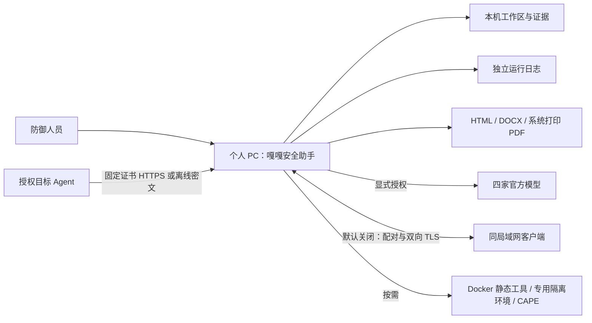
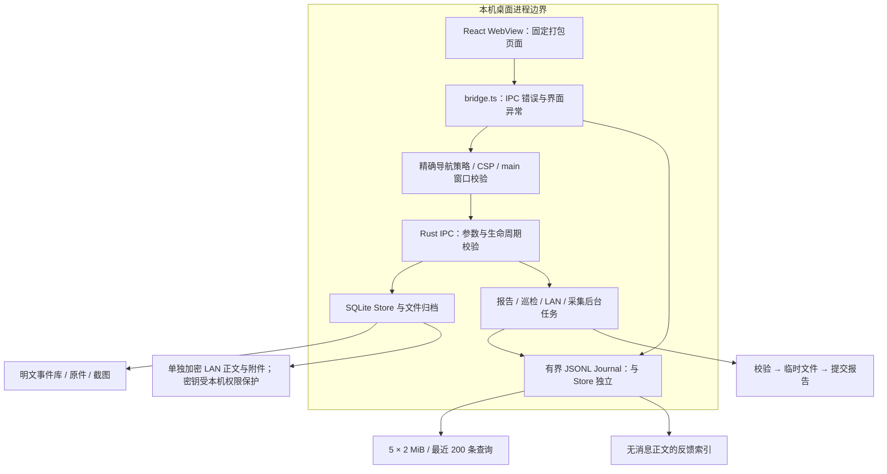

# C4 架构增量 · 0.7.8

定位不变：面向防御团队，运行在个人 PC 上的事件调查、分析、举证和交付终端。当前以 Mac 为实际验收平台。本文补充运行日志、报告流转与桌面信任边界，其他模块见 [0.7.3 架构](C4-architecture-0.7.3.md)、[报告交付](C4-report-delivery.md)、[局域网](C4-lan-0.7.6.md) 与 [启动](C4-startup-0.7.7.md)。

## C1：使用环境

模型、LAN、资产巡检、Agent 接收和 CAPE 是独立的联网/执行路径。AI 外发锁不代替系统防火墙，也不关闭其他显式功能。客户端不是面向互联网暴露的管理平台。

## C2：进程和存储

导航策略在所有主窗口导航时拒绝外部页面，避免高权限 WebView 被远程页面替换。IPC 另限 main 窗口；capabilities 不开放任意 shell 插件。业务命令仍需独立检查输入和路径。当前不是为每条 IPC 实现独立 origin 二次校验，XSS 与供应链防护仍需持续维护。

## C3：报告与诊断组件

`Reports.tsx`、`report-structure.ts` 和 `report_draft.rs` 管理自由正文、章节与引用；`report_input.rs` 捕获显式事件快照；`report_jobs.rs` 管理状态/取消；`report.rs` 校验原件并编排 HTML/DOCX；`file_commit.rs` 负责临时文件提交。任务完成状态持久记录到 Journal，任务本身不跨重启续传。

PDF 输出由系统打印，水印副本由 `report_watermark.rs` 用修复后的 lopdf 解析并增量写入。可解析 Catalog、非空页、大小限制、签名拒绝和源字节保留是程序检查；独立阅读器检查用于交付验收。可打开不等于所有 PDF 内容语义安全或版式必然完美。

`runtime_log.rs` 管理遮盖、去重、轮转、查询和索引；`bridge.ts` 记录 IPC 拒绝和全局界面异常；`AppErrorBoundary.tsx` 保留首屏失败恢复；`RuntimeLogs.tsx` 提供设置独立页面。日志不依赖 SQLite，数据库打不开时也可以查。事件材料不进入日志参数。

`connection.rs` 为 LAN 和 Agent TLS 套接字统一增加绝对连接截止时间及空闲超时，防止持续滴入少量字节无限延长线程占用；配合既有并发上限，不等于抵抗任意资源耗尽攻击。

## 代码与维护约束

Rust 已按分析、存储、报告、LAN、隐私与执行环境分模块，关键注释说明信任边界、取消提交顺序和恢复方式。接口由 [契约](IPC-API.md) 与 81 项生成目录共同维护，CI 检查漂移。

`src/main.tsx` 仍约 3500 行，是明确的维护债务；本轮抽出错误边界与统一 IPC 层，没有把整个工作台完成拆分。后续应按日志、HTTP、设置和事件控制器渐进迁移，保留跨事件迟到结果与报告草稿恢复回归，避免一次重写破坏既有流程。

本机管理员能读取/更改工作区与密钥；没有硬件密钥封装、证据整库加密或司法不可篡改链。沙箱隔离、模型正确性、平台差异和供应链都有独立验收边界，详见 [审计](AUDIT-0.7.8.md)。
