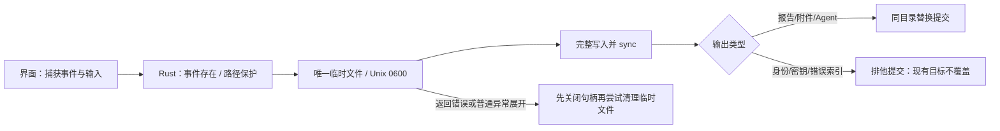
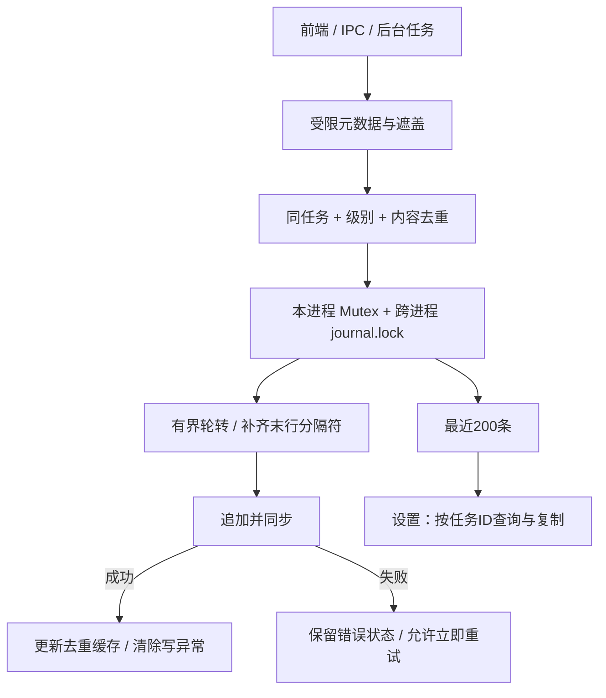

# C4 异常恢复增量 · 0.7.9

上下文、信任边界和既有模块见 [0.7.8 C4](C4-architecture-0.7.8.md)。本轮改变输出提交和诊断恢复，不新增公共服务、常驻管理员组件或模型外发路径。

## 输出与身份边界

`file_commit::PartialOutput` 拥有写句柄，解决 Windows 上先删文件再关闭句柄会失败的清理顺序。Mac 新建提交使用 renamex_np / RENAME_EXCL；Windows 使用不带 REPLACE_EXISTING 的 MoveFileExW；其他平台使用硬链接发布完整 inode，不支持时明确失败，不退回覆盖写。仅 Mac 实际执行验收，外平台模块类型检查范围见审计。

LAN 身份和水印密钥只在缺失时创建，已有有效文件不迁移、不重加密、不替换；已有损坏文件继续保留并明确报错。没有把普通异常清理等同于强杀/断电也能清理。

## Agent 包状态

前端在保存窗口前捕获 caseId，`platform_action.agentGenerate` 显式传给 `collector::generate_for_case`。后端检查事件及输出后再读取身份；包始终使用捕获事件，不重新取当前事件。

ZIP 在临时文件完成，登记任务是 before_commit；登记失败不会替换旧输出，文件提交失败删除本次登记，清理失败明确报错。SQLite 与文件没有通用跨资源事务，强杀窗口仍需人工检查，不谎报完全原子。

## 日志恢复

文件锁竞争最多等待 250 ms；读取也拿锁，避免轮转时读到已更名/半条文件。日志路径按当前用户的应用目录共享，任务 ID 帮助关联；它不是事件证据库或不可篡改审计链。自动索引仍省略消息正文与 contextId，本机复制详情才带任务 ID。

本轮不改变证据明文状态、LAN 密钥保护级别、沙箱隔离能力或官方模型配置范围。当前维护约定见 [IPC 契约](IPC-API.md)、[审计](AUDIT-0.7.9.md) 和 [贡献指南](../CONTRIBUTING.md)。
