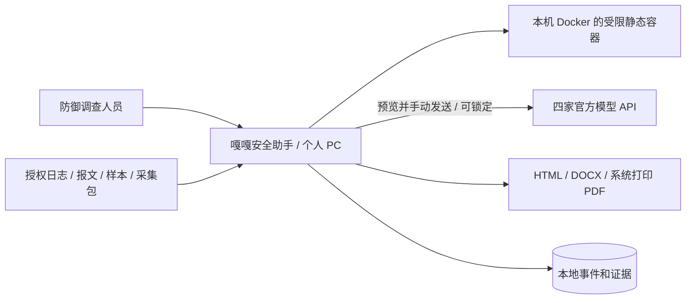
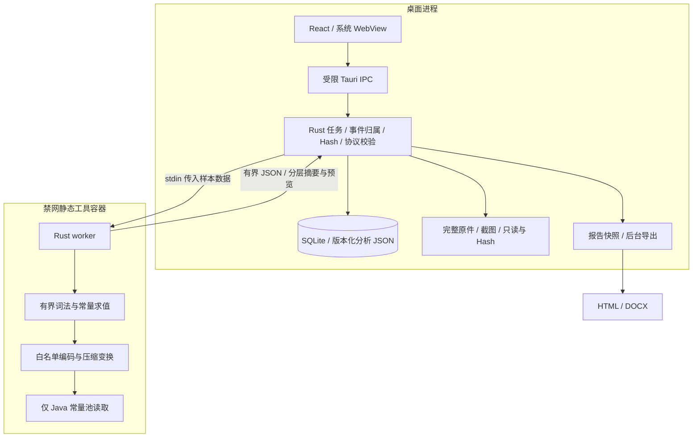
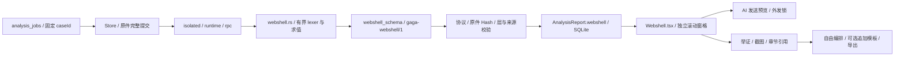

# C4 · 分层静态分析与调查报告 · 0.9.0

定位保持个人 PC 上的一站式防御调查终端。既有启动、局域网、采集与文件提交见 [0.7.9 增量](C4-architecture-0.7.9.md)，后台扫描与取消见 [0.8.0 本地任务](LOCAL-ANALYSIS-0.8.0.md)。本轮增加隔离解析能力和界面，不新增公网服务或任意命令工具。

## C1：系统上下文

模型不直接持有 Docker 凭据或宿主机执行工具；原始样本不自动上传。AI 输出与工具数据均作为待复核材料，不能成为样本执行或自动封禁指令。

## C2：容器与信任边界

容器策略：非 root、禁网、只读根、无宿主机挂载、无 Docker socket、cap-drop、no-new-privileges，资源与运行时限沿用既有控制。样本数据只进入静态 worker，不经过 PHP/JS/JVM 执行器，不反序列化。release 没有宿主机静态解析回退。普通 Docker 仍共享内核，不能据此宣称具备专用虚拟机的恶意代码动态隔离能力。

## C3：组件与来源

lexer 不执行样本里的函数，只对固定常量及白名单操作求值。未知变量、插值、未知重新赋值不继承旧常量。PHP 变量保留大小写；Java/.NET 限定成员调用由 token 识别，普通 `Start`/`Load` 不泛化为命令执行。

每个工件有独立输入/输出 Hash。`parentId` 是变换输入的派生父层，`sourceLayerId` 是表达式实际所在层，来源字节区间属于后者；不把嵌套调用表达式伪装成存在于解码输出。词法依赖不具备控制流、作用域、跨函数或跨文件证明。Java 常量不代表内存驻留。

worker 内暂存完整派生字节，IPC 和数据库仅保存预览、摘要、位置、发现与限制。host 校验原件 Hash、schema 版本、顺序 ID、层数/深度、父层、来源范围及发现引用。它不能从预览重新验证每个完整派生输出的 Hash；该摘要来自受限 worker，复核需要基于原件重算。原证据库仍未整库加密。

旧 `AnalysisReport` 缺少可选分层字段时能读取，界面提示新版重导；不回写伪造层结构。镜像版本升至 0.9.0。Pi metadata 发给模型前另限制最多 8 层、每层 1500 字；普通 AI 材料同样有总预算和覆盖说明，用户可在发送预览修改。

报告模板只追加指导章节，复用既有草稿版本检查与节点/截图事务，不引入第二套报告实体。新增 Web/勒索/容器模板各 6 节，仍受两级/64 节约束。报告来源保存工件标识、原件 Hash、派生 Hash 和表达式位置；导出继续校验完整原件，生成待复核草稿。

## 故障与维护

解析损坏、超出深度/大小/时间预算与未知动态输入分别留下限制说明。容器协议、Hash 或结构无效时拒绝完整结果；普通任务取消、提交边界和日志关联沿用 0.8.0。没有完成逐层实时推送或统一普通 AI 生命周期。

源码注释覆盖执行边界、预算、变量失效与父层/来源差异。API 定义继续为 84 个业务命令；详见 [IPC 契约](IPC-API.md)。[验收记录](AUDIT-0.9.0.md)单独记录静态负例、真实 Docker、原生 UI、报告和未覆盖环境，依赖公告见 [本轮审阅](DEPENDENCY-REVIEW-0.9.0.md)。
