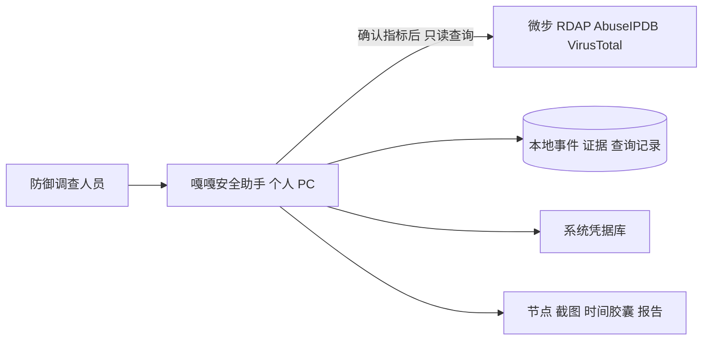
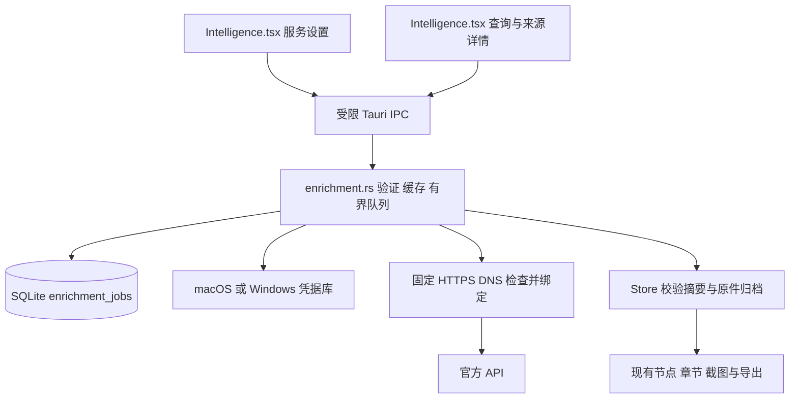

# C4 · 官方情报查询 · 0.10.0

既有分析与报告架构见 [0.9.0](C4-architecture-0.9.0.md)。本轮无新增 J4team 服务端，不增加样本执行器或第五家模型。

## C1：上下文

情报锁、AI 锁和其他主动网络功能各自控制；情报结果不自动发送给模型，样本容器不获得厂商凭据或网络权限。

## C2：组件与存储

前端只拿到 Key 是否配置。SQLite 保存配置版本与任务，不保存凭据。`enrichment_jobs.case_id` 为外键，记录请求参数、来源证据、任务状态、服务结论、时间、脱敏响应及结果摘要。列表在 SQL 层移除响应，详情才读取大字段。本地 `intel_indicators.verdict` 不被修改。

## C3：生命周期

取消和响应提交采用仅更新 queued/running 的条件写入，晚到响应不能复活任务。系统凭据操作结束后重新读取配置锁，避免弹窗等待覆盖新锁。入队和锁定串行，防止锁定后插入旧授权任务。重启初始化只将旧任务标为中断，不重新发送。

归档先核对规范化结果摘要，沿用 Store 原件与报告快照链。同进程归档锁和结果证据指针防重复点击；若原件完成而指针登记前进程被强杀，可能留下未关联证据。本轮不提供跨文件与数据库的原子事务或不可篡改保证。

## 主要威胁控制

固定目标、标准 HTTPS 端口、DNS 地址检查/绑定、Key 不跨域重定向、有界响应和总时限限制网络与资源。RDAP 注册服务发现无 Key，每跳重新验证。错误不能回显凭据、请求头或完整查询；后台失败进入现有运行日志。

厂商文本和链接不具备执行或工具授权能力。合法响应也可能错误、过时或受再分发限制；须保留查询范围和来源，不能升级为现场事实或自动封禁指令。用法和边界见 [功能说明](THREAT-INTELLIGENCE-0.10.0.md)，接口见 [契约](IPC-API.md)。
