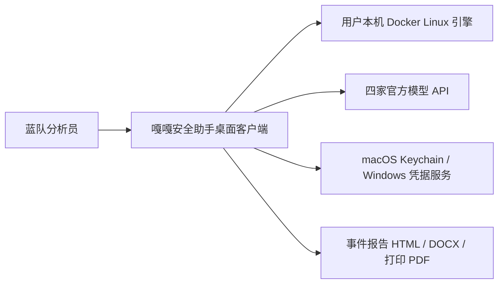
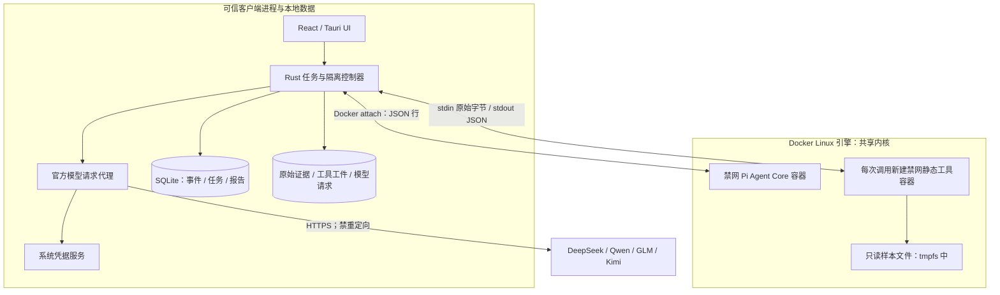
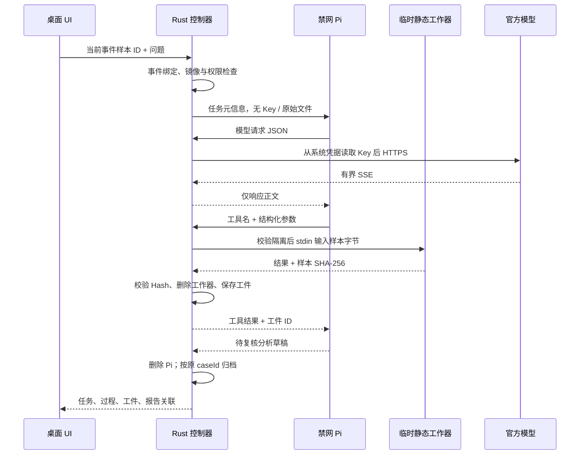

# C4：0.6.6 隔离分析增量架构

完整平台背景见 [0.6.0 C4](C4-architecture-0.6.0.md)。本文对应 `isolated.rs`、`ai.rs::agent_transport`、`Reverse.tsx` 与 `reverse-worker/` 的实际代码，不包含尚未实现的反编译器或本地 VM 编排。

## C1：系统上下文

## C2：容器与信任边界

两个容器无网络、无 Key、无宿主目录或 Docker socket 挂载。Pi 不能直接连接静态工作器或官方 API；每次工具名、参数、样本归属与预算均经 Rust 控制器处理。

## C3：组件与数据路径

| 组件 | 责任 |
|---|---|
| `Reverse.tsx` | 独立环境页签、当前事件样本选择、任务状态、工件预览、取消、时间线入口 |
| `store.rs` | 原始字节快照与 Hash；生产样本解析路由到隔离工作器；结果按原事件归档 |
| `isolated.rs` | 镜像构建、配置 inspect、临时容器生命周期、JSON 行 RPC、预算与任务恢复 |
| `ai.rs::agent_transport` | 保存配置 revision 校验、官方目录校验、系统凭据、受限 HTTPS 模型调用 |
| `reverse-worker/agent.mjs` | Pi 核心模型循环，四个自定义工具；不加载 shell、扩展或用户资源 |
| `reverse-worker/src/` | Rust 静态解析、源码行切片、ASCII 字符串和结构定位；样本从 stdin 读取 |
| `reverse-worker/disassemble.mjs` | 在同一工作器容器读取固定样本路径，WASM 解码 x86 / x64 窗口 |
| `report_draft.rs` / `report.rs` | 五步报告正文、节点关联、截图与文档导出 |

本版本的动态样本运行仍使用既有独立实验环境流程。Pi 静态分析任务不会自动触发该流程，也不因模型请求而启动样本。
