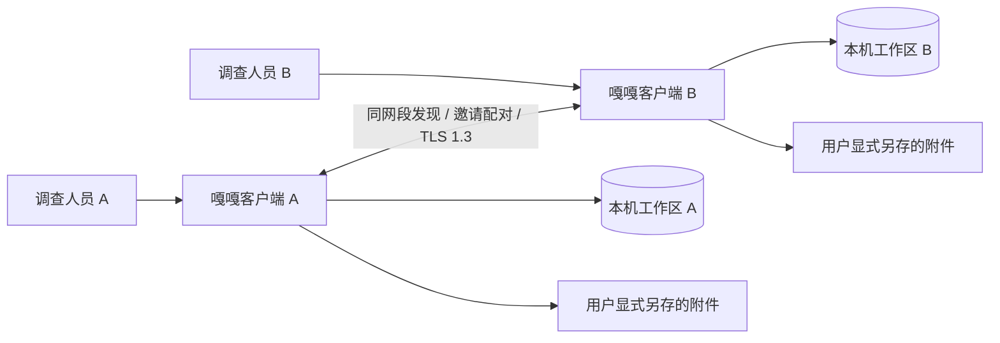
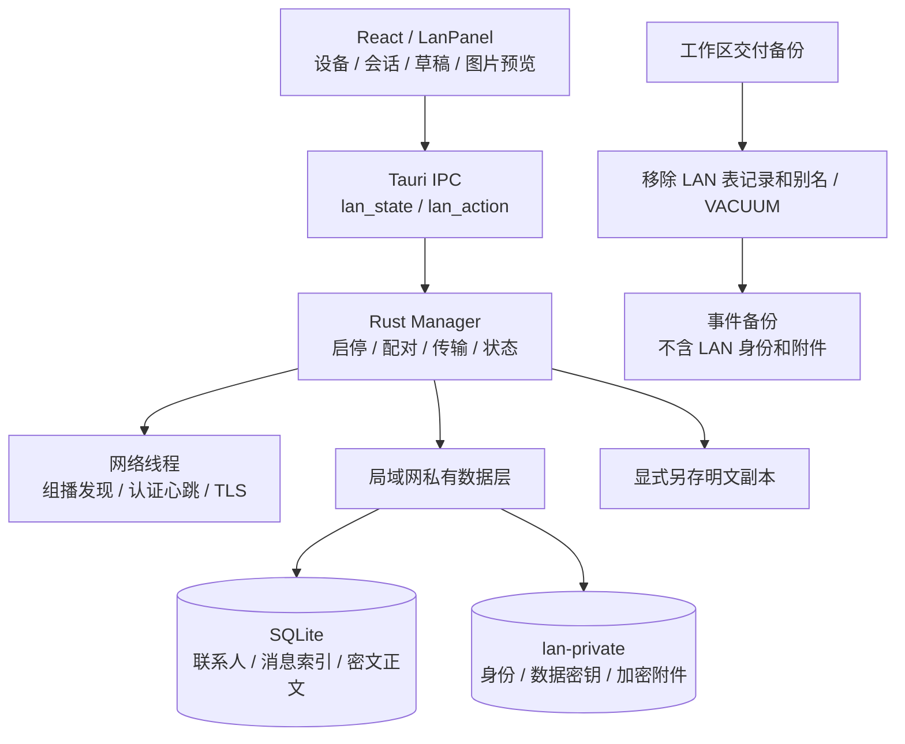

# 0.7.6 局域网协作与本地保存

## 使用

顶部右侧的“局域网协作”消息图标，或“全部工具”搜索“聊天 / P2P / 局域网”，打开独立的联系人与会话页。

1. 两端开启协作，填写设备名称。同 IPv4 网段自动发现附近设备。
2. 任意一方生成邀请，通过可信渠道私下交给另一方；另一方粘贴邀请、确认设备地址后配对。邀请固定设备证书，5 分钟内有效、仅用一次，生成新邀请使旧邀请失效。
3. 发送文字或 Unicode 表情，选择 PNG/JPEG/WebP/GIF 表情图片、普通文件。在输入区 Cmd+V / Ctrl+V 粘贴截图，先预览再发送。
4. 接收方点击接收，下载、校验、加密保存后预览图片或另存文件。拒绝时不下载附件，不自动打开或执行普通文件。
5. 协作期间后台心跳确认在线状态，离线约 15 秒内反映。关闭协作停止监听与发现；重启默认关闭，联系人与消息保留。

文字的“对方已保存”表示写入对端数据库，不是人工已读。文件先显示“已通知，等待对方接收”，收到校验保存回执才显示“对方已接收”。发送未确认可按原消息 ID 重试，不重复插入。无服务器离线代收，不自动无限重发。

## C4 Level 1：系统上下文

没有公共中继或云端消息服务，聊天不发往模型。跨公网、跨 NAT、群聊、音视频、已读状态、断点续传、自动导入对方调查记录未实现。报告等可主动选中导出文件发送；不自动上传事件库。

## C4 Level 2：客户端容器

## C4 Level 3：组件与协议

`lan/mod.rs` 管理启停、邀请、配对、任务与 IPC；`lan/net.rs` 处理帧、TLS、发现与心跳；`lan/data.rs` 提供数据库和附件的唯一加解密入口。`Lan.tsx` 与 `lan.css` 提供固定工作区，联系人、消息独立滚动，输入区固定底部。

发现使用 IPv4 组播 `239.255.74.74:44974`，TTL=1，约每 3 秒广播别名、证书指纹和服务端口，不广播邀请或配对凭据。TCP 使用系统分配端口。仅连接私网、链路本地或回环 IPv4。广告未经认证，只显示候选；成功验证固定证书与凭据的心跳才标记在线。

邀请包含 256 位随机一次性凭据、证书指纹和候选地址。客户端固定服务端证书指纹，双方都提交自签证书并验证握手签名，限定 TLS 1.3；应用帧身份还须匹配实际握手证书指纹。自签证书证明持有私钥，邀请和配对凭据决定是否可信；每对联系人另用独立 256 位凭据。邀请持有人在有效期内可配对，不能公开张贴。别名不是组织或人员身份认证。若初次配对连接中断，导致仅一侧留有关系，应取消该侧配对后重新交换邀请。

控制帧最多 64 KiB，文字 UTF-8 最多 16 KiB，文件最多 32 MiB，图片最多 8 MiB / 4096×4096；GIF 另限 128 帧及累计 32M 像素。服务端最多 4 条并行连接，连接/读写有超时；发现上限 128 台，联系人上限 64 台。历史每批 50 条，界面最多保留 500 条展示。

接收路径由本地消息 UUID 生成，远端文件名不能指定路径。下载后核对长度、SHA-256、声明图片类型与解码限制。AES-256-GCM 使用随机 96 位 nonce 和记录 ID 等 AAD。附件密文先写临时文件、同步，再原子提交；聊天目录无明文附件临时文件。相同 ID 仅接受完全一致的重试，不能替换正文、跨联系人复用或读取其他人的文件。

## 本地保存与边界

原有事件、草稿、节点和分析结果保存在 SQLite；证据与截图按文件归档，有 Hash 校验、事件隔离和工作区备份恢复。**事件证据及数据库仍未整库加密**。只读防误写，不能阻止管理员修改权限、删除或同时篡改本机数据。

新增聊天正文、配对凭据和附件单独加密。消息序号、联系人关联、类型、状态、时间等索引元数据未加密。`lan-private/identity.json` 保存网络身份和数据密钥；Unix 新建目录 0700、文件 0600。Windows 依赖用户工作区权限，尚未实机验收，没有新增精细 ACL。密钥未做硬件封装，当前用户和管理员仍能读取，不能宣称不可见、不可修改删除。

通用工作区备份清除 LAN 表及别名并整理复制出的数据库，不复制 `lan-private`，恢复同样清除旧配对数据；原工作区不变。**没有聊天专属备份或密钥迁移界面**。保留原工作区和密钥才能读旧聊天，丢失密钥无法恢复。主动另存附件是普通明文副本。

局域网权限、主机防火墙、AP 访客隔离、不同子网可能阻止发现或通信。同路由器不必然互通，手动地址不能绕过隔离；当前不自动创建防火墙规则。

## 验收范围

同一 Mac 的两个独立工作区使用真实组播数据报和 TLS 套接字验证收发；原生 WebView 验证导航、输入、表情、粘贴预览、文件接收、状态和重启。实际结果见本轮验收记录，**不等同于双物理设备、Windows 或不同网络拓扑已联调**。
