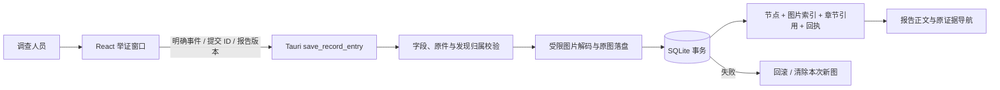

# 0.7.5 举证录入架构增量

产品定位仍为个人 PC 上的蓝队防御终端。上下文、容器总图沿用主 C4 文档，本文件描述举证与报告关联增量。

`RecordOptions` 只加载指定事件的报告章节。存在未确认恢复草稿时清除关联选择，保留单独记录节点与截图的能力；加载按请求代次处理，迟到的刷新不覆盖后一次结果。截图允许 PNG、JPEG、WebP，原文件上限 8 MiB，后台另有解码尺寸和内存限制，图注必填。

`record_entry::save` 在数据库锁内建立事务，先验证报告版本、证据及发现所属事件；将新图片完整写入随机标识文件并同步，再提交节点、截图索引、报告引用与指纹回执。输入相同且提交 ID 相同的重试返回原节点，修改内容的同 ID 重试拒绝。仅补空缺章节负责人，不改已有正文或负责人。

文件系统与 SQLite 不具备跨系统原子提交：普通失败会回滚并删除本次原图，突然断电或进程被强杀仍可能留下未引用文件。本轮没有声称消除这一边界。

编辑既有节点仍用已有更新路径。报告内部新建节点前先确认正文保存；返回原证据也先保存正文，按证据类型打开分析页，关联发现存在时定位其结果。日志原文查询在换案后返回的迟到结果不会再弹出旧事件窗口。

证据库的搜索、类型与举证状态筛选在内存数据上执行，每页最多渲染 24 行；没有替换为后端数据库分页，也不代表支持无限规模。环境页将本机、Docker、静态镜像的只读检查聚合展示；模型状态只读取是否配置的元数据，连接测试仍由用户手动发起。

社区收件暂使用公众号后台，文件提供格式、署名授权、需求分诊与验收流程。外部仓库和群聊未创建。
