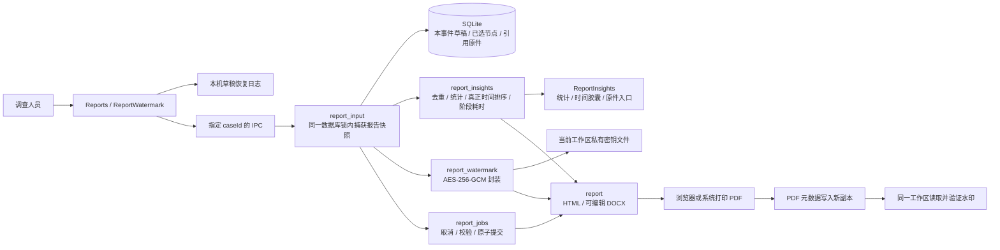

# 报告交付、时间胶囊与加密水印

0.7.6 已实现局域网协作首版，见 [当前局域网架构与使用](C4-lan-0.7.6.md)。本文件末尾保留 0.7.5 时的后续设计记录，不能据此理解为所有设想均已实现；当前没有自动导入调查包、断点续传或跨公网能力。

本增量基于 0.7.5 工作区。此前发布的安装包和 12 页案例包不被覆盖。新增能力需要本增量构建；P2P 为后续设计，当前没有发现或聊天服务。

## 已实现的组件边界

统计的输入范围与导出一致：只包含当前事件已纳入的节点及引用证据。同一节点跨章节引用不重复计数；证据按 ID 去重；候选 IOC 按类型和值去重，不把命中数量称为攻击次数。记录人员按填写名称去重，不认证真实身份。当前没有结构化的受影响资产登记，因此不从 IP 或正文猜测“受害资产数”。

节点跨度取有效发生时间的首尾，使用 RFC 3339 解析后的真实时刻排序，统一展示 UTC+8；无有效时间的节点置于末尾并提示，不用归档时间替代。阶段耗时只在起止都有效且先后正确时计算。章节状态由编写人填写；章节完成不代表事件结案，也不代表节点操作已有设备回执。

HTML 的时间胶囊链接跳转到对应正文举证；同一节点多章复用时，锚点只生成一次。DOCX 使用可编辑文字与表格，并保留正文、引用、截图、Hash 和页脚页码。打印样式独立分页展示封面、数据、阶段和时间胶囊。共享统计入口避免三种输出分别推算数值。

## 水印与证据保护的边界

水印名称由报告配置填写。每次导出生成随机批次 ID、本机时间和报告标题，用随机 96 位 nonce 与 AES-256-GCM 加密。HTML meta、DOCX 自定义属性与 PDF 文档信息只承载密文。密文改动无法通过认证标签；相同内容的不同导出使用不同 nonce。此认证仅证明持有工作区密钥的一方生成了水印，不认证人员身份，也不认证整份正文。没有可信授时服务，生成时间来自本机时钟。

`report-watermark.key` 只存于工作区；Unix 新建权限为 0600，工作区目录为 0700。通用案例备份不包含此密钥，恢复备份后仍可编辑和重新导出报告，但不能据此解读旧工作区签发的水印。原工作区与密钥需另行妥善保管。当前没有密钥迁移或恢复 UI，不应删除原工作区后承诺旧水印仍能解密。

HTML / DOCX 自动嵌入水印。系统打印不保证保留 HTML 元数据，因此 PDF 需在电子水印面板中写入新副本。PDF 解析使用 lopdf；保护原文件，拒绝改写已加密或带数字签名的 PDF，包括省略 Type 字段的签名字典与空签名域。只追加新的文档信息，原 PDF 字节保留，避免页面尺寸、字体与正文流重新序列化；这也意味着历史版本仍存在，不能用来脱敏。读取和最终输出限制为 64 MiB。文档编辑器可能删除元数据；标识缺失时无法判定是否曾经存在，客户端明确显示缺失或无法核验，不能承诺不可发现、不可删除。

新导入原件与新增举证图落盘后设置只读属性；内容不原地编辑，派生结果与节点修订另存。报告、AI 材料、备份和原图读取沿用原件 SHA-256 校验；检测到变动会拒绝相关读取或交付。只读属性防误写，拥有文件权限的用户或管理员可解除；Hash 也不是独立可信签名。旧原件不会在启动时全盘遍历或改写权限。

**当前没有完整原件静态加密库，也没有 WORM 或外部不可改写存储。** 隐藏目录不能替代这些能力；不把本地权限和 Hash 描述为管理员无法删除。备份应保存在独立介质，生产环境若要求强留存，需要单独设计密钥恢复、受控解密、流式读取和不可改写副本。

## 后续 P2P 协作设计（未实现）

单独提供“局域网协作”页：默认停用，用户启用后发布设备别名与临时发现标识；通过 mDNS 发现同网段服务，配对码确认双方身份后建立加密连接。自动发现不等于授权发送或接收。路由/AP 的隔离策略可能阻止发现，不能保证只要连接同一台路由就必然可达。

消息、普通文件与调查数据分别使用消息类型和大小限制。文件进入独立收件箱，路径和文件名由接收方生成，Hash 校验通过后再开放。调查记录先展示来源、原件摘要、节点与截图清单，由接收方选择导入为新事件或关联现有事件；不能静默合并覆盖，不能自动运行接收文件。模型 Key、Agent 私钥、水印密钥和工作区凭据不进入分享包。

需要增加的持久化数据包括已配对设备、公钥、接收批次、消息状态与导入映射。网络处理与分析进程隔离，限速、断点续传、撤销设备配对和停止监听属于同一验收范围；跨 NAT 或外网中继不属于首版局域网范围。
