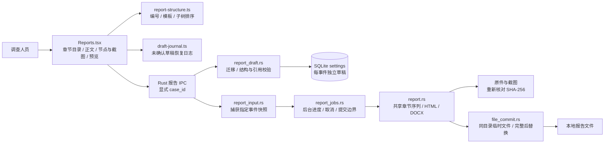

# 0.7.4 自由报告编排：C4 组件与数据流

系统上下文、容器边界沿用 [0.7.3 C4](C4-architecture-0.7.3.md)，存储索引见 [本轮存储增量](C4-storage-0.7.4.md)。本轮没有引入报告云服务，正文与举证仍按事件保存在本地。

## 组件视图

## 结构约束

`ReportDraft.structure_version = 2`；`steps` 沿用旧字段名以兼容旧数据，其元素现在是可编辑章节。每节包含稳定 ID、标题、正文、可选 `parent_id`、负责人、时间、状态和 `node_ids`。最多 64 节、两级，父章节紧接其所有子章节；后端拒绝重复 ID、无效父引用、循环、第三层及错序。正文每节最多 12000 字、合计最多 240000 字，引用数量有界。

同一节点可由多个章节引用，章节内不可重复。节点仍只属于原事件，跨事件引用被拒绝。章节删除只删除正文和引用关系，原始节点、证据、截图不删除；仍选中但未分章节的节点进入附录。人员是人工记录，不是认证签名。

新事件初始化空章节，模板仅由用户明确插入并追加。旧版五步草稿首次读取时，将旧顶层正文迁入各章节；保留旧字段供兼容，但新版预览与导出只读取章节正文。显式保存的 version 2 空结构不会重新生成五步。前端未确认恢复日志也经过相同语义的迁移，确认写入仍以后端为准。

## 保存与交付

编辑先更新内存与恢复日志，再自动保存到当前事件的 SQLite 草稿。事件切换加载独立草稿；失败保留恢复入口。导出先等待保存确认，再按显式事件 ID 捕获正文、所选节点和引用原件。后续编辑不改变已捕获的任务输入。

HTML 和 DOCX 使用同一个动态章节序列和编号。主章节、子章节及其举证分别保留标题层级；同一截图跨章节引用时在对应章节出现，原始截图只归档一份。纯人工正文可先导出，输出明确说明未关联节点与待补举证。原件校验、后台任务取消、内部路径保护和原子提交沿用 0.7.3。

正式 UI 不提供测试报文、内置示例或演示创建入口；相关 IPC 仅允许 debug 且显式独立验收模式。历史演示记录保留来源标签。验收脚本自己输入明确标记的合成报文和截图，测试工作区与用户工作区分开。
