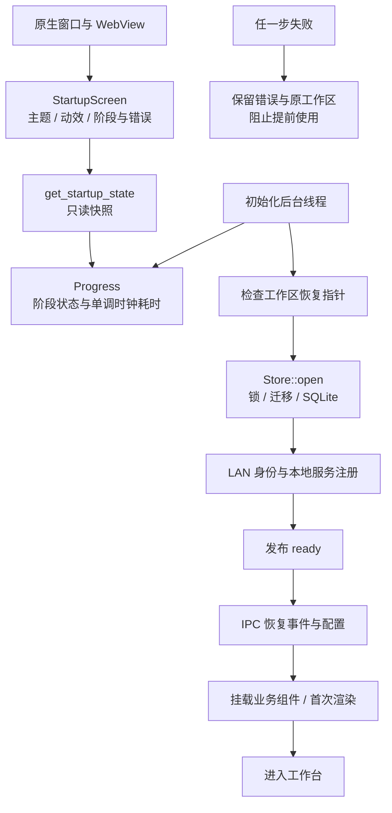

# 0.7.7：启动与局域网体验

本轮延续个人 PC 上的一站式防御终端定位，不增加公网服务或多用户后台。

## 可见行为

启动页以黑白背景、细线轨道与原安全帽鸭子 SVG 为主。六个阶段分别是检查工作区、加载数据库、加载安全组件、注册本地服务、恢复事件与配置、加载工作界面。状态与阶段耗时来自实际操作，没有按定时器生成虚假的加载百分比。

前四步由 Rust 记录，后两步由真实 IPC 读取完成与 React 首次渲染确认。系统较快时多步会在第一帧已完成，启动页保留这些真实记录；不人为延迟数据库或把已完成状态重放成“正在加载”。完整动效正常启动最多补足约 1.1 秒的视觉展示，支持立即进入；初始化较慢时持续显示实际运行阶段。关闭动画或系统减少动态效果时，不额外等待这段视觉时长。

“收起动效”只停止视觉运动，实际初始化继续，业务界面在就绪前不可使用。失败保留阶段、错误和复制入口，不自动创建替代工作区。数据库恢复正常后重新启动；若只是启动状态或事件读取请求失败，可重试读取，不重新执行数据库迁移。设置里的重播显示本次记录，不重开数据库，不启动新的巡检或联网服务。

## C4 Level 2：进程内职责

`src-tauri/src/startup.rs` 保存初始化状态并运行后台操作；`main.rs` 先注册状态，启动线程，统一拦截未就绪的 Store 相关 IPC。只读启动状态、退出和不依赖 Store 的报告任务查询可在等待期间使用。调试验收接口需要显式验收模式及临时目录，普通工作区拒绝。

`src/Startup.tsx` 的 `useStartup` 读取真实后端状态、恢复数据，以 React DOM commit 确认业务组件装配完成。隐藏或最小化的 WKWebView 可能暂停动画帧，因此就绪判断不依赖动画帧回调。`StartupScreen` 只负责展示；`src/startup.css` 使用可停用的 CSS 运动，不引入远程字体、图片或启动网络请求。键盘焦点留在启动页，退出后恢复到原按钮或总览入口。首次业务渲染异常由错误边界提供重新加载入口，不以空白窗口结束。

## 局域网增量

对端已接收或拒绝附件，但回执丢失时，发送方此前可能一直显示等待。新版可点击“查询接收状态”，重复发送同一 ID 的通知；接收方校验内容一致后返回已经落盘的结果，不重新插入消息或自动重新下载。旧版客户端没有返回该字段时，仍显示已通知，不虚构接收成功。

聊天页在联系人和会话内分别滚动，输入区固定。操作栏、表情和接收按钮允许换行；窄窗口保留消息输入、关闭协作和配对入口。文件名及长文本可换行，配对弹窗在自身内部滚动。

macOS bundle 增加局域网访问用途描述，组播显式启用回环，发送与接收异常会进入页面提示，避免“附近设备为空”时丢弃底层错误。系统权限、网络隔离或路由器丢弃数据仍可能影响发现；手动地址与邀请是同等认证的连接入口，不能绕过系统或网络限制。

## 验收与边界

Rust 包含真实套接字收发、失落回执恢复，以及一个线程被阻塞时仍可读取运行状态、失败不能转为就绪的回归。原生验收通过 macOS Launch Services 打开完整应用，使用实际 SQLite 排他锁暂时阻塞打开，再释放锁；另用无效 SQLite 文件验证失败页及原字节保留，并实际隐藏窗口验证初始化可完成。没有用虚构后端进度测试启动成功，也没有用终端直接运行二进制替代 GUI 应用的局域网权限环境。

原生检查对启动页和 P2P 页请求 960×660、1100×720、1320×860、1600×1000 的窗口尺寸，分别检查浅色/深色；实际可见区域会受系统标题栏和显示器约束，随验收 JSON 记录。P2P 额外覆盖配对弹窗、长文件名、长文本、表情面板和固定输入区。

本轮仍是同一 Mac 的独立工作区实际通讯，不代表双物理设备、Windows 或隔离访客网络已经验收。关闭应用、系统杀进程、底层 WebView 创建失败等发生在前端启动之前的故障，不能靠启动页全部捕获。原事件库仍未整库加密，聊天密钥与备份边界沿用 [0.7.6](C4-lan-0.7.6.md)。
