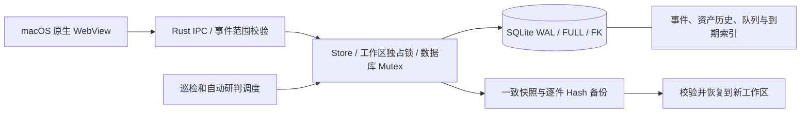

# 0.7.4 存储与 Mac 验收架构增量

系统上下文、容器边界和报告后台任务沿用 [0.7.3 C4](C4-architecture-0.7.3.md)。本轮没有增加外部服务、网络权限或自动采集范围。

新增索引对应实际读取路径：monitor_assets 的 case_id 和待领取 next_at 部分索引；monitor_snapshots 的 asset_id / created_at；monitor_observations 的 case_id / created_at、ai_state / case_id 和 evidence_id / kind；monitor_ai_calls 的 started_at。采集模块增加 collector_tasks 的 case_id、collector_batches 的 task_id / state / created_at 和 flow_windows 的 case_id / created_at。

资产全局列表和事件列表使用两个明确 SQL 分支，避免 OR 混合条件阻碍事件索引；数量上限与返回结构保持原语义。新增索引会在已有工作区打开时创建，首次升级耗时取决于现有数据规模和磁盘空间，仍需在打开大型工作区前备份。user_version 保持 1，因为表结构和数据格式兼容，新增索引不要求数据重写。

压力验收通过真实 Store / monitoring / dashboard / maintenance Rust 路径执行。移除索引仅发生在明确新建的合成测试空间；比较结果后重新走初始化补齐，再核对备份恢复和重启。测试不读取凭据、不启动模型、不请求资产、不执行样本。原生启动 / 导航的验证空间必须有该测试写出的 syntheticStorageFixture 标记。

索引不改变工作台聚合读取当前事件所有证据的边界，也不提供原件自动删除、无限容量或后台续传。当前累计数据每事件仅 20 份小原件，不代表单事件数万证据、单份大归档或数千截图性能。本轮实际结果与启动问题状态见 [Mac 验收](MAC-ACCEPTANCE-0.7.4.md)。
