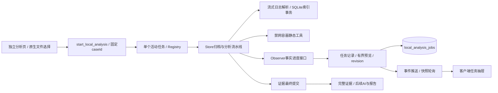

# 本地分析任务与真实进度 · 0.8.0

本轮落实[开源产品调研](BLUE-TEAM-DESIGN-RESEARCH-2026-10-30.md)中的第一优先工作：日志、WebShell和PE/ELF导入能够在后台运行、展示真实进展和有限发现，使用者可以切页、查看任务并取消。独立功能页、原始归档与派生证据结构继续保留。

## 已实现的交互

- 底部任务入口和可收起抽屉；按任务选择，显示所属事件和文件名，跨页面可见。
- 日志显示归档字节、扫描字节、处理行数、结构化解析、未识别、无效编码/超长跳过、规则命中、耗时和扫描均速。速率为实际扫描字节与阶段耗时的平均值，不是磁盘基准测试。
- 最多24条发现预览，有原文片段与行号；不自动滚动或切换选中项。完整命中在既有SQLite索引分页查看，预览不代表全部风险。
- 静态样本显示归档、环境检查、隔离工具运行和保存阶段。工具报告完整返回并校验后才展示发现，不虚构逐行解析进度，不执行样本。
- 已完成任务点击“打开结果”，自动进入原事件；取消或失败不会作为完整结果保存。输入文件始终不改动。
- 任务ID与失败终态进入运行日志，任务历史重启保留。已有证据已提交但任务终态未保存时，重启通过证据关联复核；其余未完成任务标记中断。

## C4组件增量

`analysis_progress::Observer`独立于Tauri，现有同步调用使用Silent。`analysis_jobs::Control`实现状态持久化、200ms进度节流和取消；原分析引擎不直接操作React。日志读取包括超长行丢弃过程也检查取消，每1024行汇报计数，早期发现另外提供预览。完整索引和原文件不装入前端数组。

原始归档使用既有排他完整文件提交器，常规失败和普通异常展开清理暂存文件。日志索引事务在取消时回滚；索引已提交但证据保存失败时删除该导入的派生行，不删除其他证据。索引补偿失败会记运行日志，不能视为完整成功。

## 任务与取消边界

状态为running → completed / failed，或running → cancelling → cancelled；重启无法确认完成的标记interrupted。阶段记录是实际进入该阶段的时间，不虚构内部算法步骤。进度条只对有实际分母的归档/扫描阶段显示百分比，其余阶段显示不定进度。

取消和进入committing共用任务锁。进入最终保存后拒绝取消，避免结果已提交却显示取消。归档/日志扫描检查取消标志；隔离工具会终止该CLI工作进程组，随后通过已有容器生命周期清理本任务容器。清理失败优先显示失败，不宣称清理成功。Docker环境检查沿用命令超时，需要等当前检查返回后响应取消。

每事件保留30项历史，界面最多80项；预览最多24项、每项沿用原解析器的片段限制。事件与轮询按revision合并，迟到初始响应不能覆盖终态。内存另缓存最近终态以补偿最终任务记录写入失败，运行日志会报告该故障；断电/磁盘失败仍不保证持久化完整。

## 验证范围

新增故障测试覆盖归档中取消、扫描中取消、原输入字节保留、无partial残留、索引回滚、拒绝并行扫描、事件切换后归属、完整计数/预览上限、证据插入失败和重启复核。实际工作进程组取消另用无害sleep子进程验证。前端合并回归检查迟到初始响应、同revision终态和跨事件任务共存。

原生验收使用生成的128MiB、1,328,902行日志与不执行的PHP片段，检查完成前已有真实计数/发现、切页继续、停止按钮、错误记录、禁网容器静态结果、最小窗口明暗主题和重启历史。新增19项原生断言通过；连同启动、LAN、HTTP、举证、报告等回归，共278项原生断言通过。Rust共142项通过、4项忽略，前端状态共25项通过。完整结果见随交付验收JSON。

本轮没有调用外部模型或运行真实恶意样本。普通AI仍是阶段状态和完整回答，未实现逐字回答；没有实现持续tail本地日志或全面自动还原攻击链。Windows/CAPE及双物理设备仍未实机验收。原证据库未整库加密，Mac预览包未Apple公证。剩余依赖公告沿用[0.7.9审阅](DEPENDENCY-REVIEW-0.7.9.md)。

完整命令契约见[IPC文档](IPC-API.md)。代码入口：`analysis_jobs.rs`、`analysis_progress.rs`、`store.rs`、`logbook.rs`、`analyzers.rs`、`isolated/mod.rs`、`LocalAnalysis.tsx`和`local-analysis-state.ts`。
