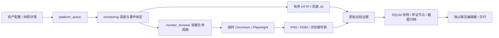
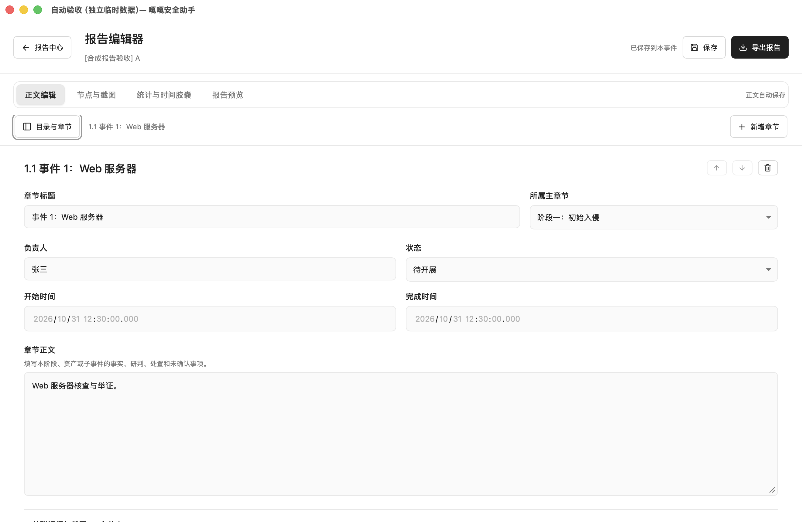
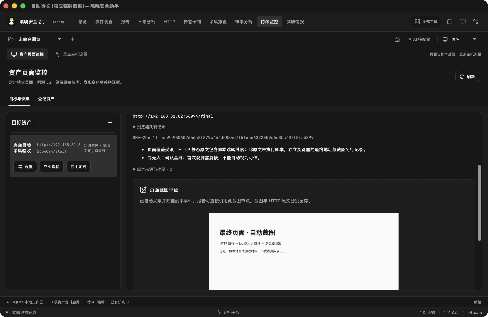

# 报告独占工作区与自动页面举证

适用源码版本：0.10.1，2026-10-31。

本日后续专项又修复了 HTTP 跳转开关绕过、浏览器错误页误归档及页面切换刷新问题，最新验收见 [后续审计记录](AUDIT-MONITOR-REPORT-2026-10-31.md)。下方“本轮实际结果”保留初次实现的验收记录。

## 使用

报告中心 → 编写报告：编辑器独占客户端工作区，隐藏应用级工具、模型栏和底栏。目录默认关闭，可通过“目录与章节”切换、插入模板及管理两级章节。正文保留自动保存、冲突检查、节点和截图引用；返回报告中心恢复全局导航。报告预览使用固定白色纸张，编辑界面仍跟随浅色/深色主题。

资产页面监控 → 登记资产：独立选择“跟随页面跳转”和“自动页面截图”，新登记默认开启，新资产仍暂停定时。已有资产通过行内“设置”修改；旧资产升级后保留原有关闭行为，避免未操作就新增页面脚本执行。修改对下一次巡检生效，运行中的巡检沿用启动时的配置。

自动截图首次需启动 Docker Desktop 并点击“准备截图环境”。该操作单独构建 `gaga-monitor-browser:1`，不增加客户端安装包内的浏览器体积，不自动拉取或运行未知镜像。可先“检测环境”。静态 HTTP 采集始终可单独使用，截图环境缺失会记录截图失败及覆盖缺口，不把已有 HTTP 原文丢弃。

截图镜像同时核对浏览器源码摘要，旧镜像会提示重新准备，避免客户端更新后复用旧采集逻辑。摘要用于版本兼容检查，不是镜像发布者签名。关闭跟随跳转时，HTTP 302 入口没有已加载正文，会保留 HTTP 证据并明确提示截图受阻；已加载页面的 JavaScript 跳转被阻止后，仍可截取入口页面并标注覆盖缺口。连接失败生成的 Chromium 内部错误页不会作为站点截图归档。

HTTP 跟随重定向及可解析的 meta refresh，最多请求 8 个页面；每跳保存响应原文、URL、状态码、目标与 SHA-256。同源 JS 最多 8 个、每个 512 KiB；静态子资源重定向只记录。任意 JS 导航不在桌面求值；开启自动截图时由容器浏览器处理。界面分别显示 HTTP 最终地址、浏览器最终地址和对应跳转记录，二者是独立请求，不能当成完全相同的一次响应。浏览器逐跳校验 HTTP Location，不依赖 Chromium 的自动重定向；请求数与顶层导航另有限额。

截图固定为 1440×900 可见视口，无登录态，保留采集时间、渲染 DOM 和摘要、PNG 摘要。自动创建属于本次采集事件的举证节点，可进入现有 HTML / DOCX / 打印 PDF 流程；原件仍按既有 Hash 校验与只读归档机制保护。手动截图作为补充入口。并发切换事件不会改变后台截图归属。

## 架构



浏览器容器不接收原始客户文件、宿主目录、Docker socket、API Key 或已有浏览器配置。非 root、只读根、丢弃 capabilities、禁止提权、限制 CPU/内存/进程、临时 /tmp；任务结束及超时都按随机容器名清理，不执行全局 prune。运行镜像先检查标签及不可变 ID。

页面浏览需要网络，与禁网的恶意样本分析容器分开。请求路由限制 HTTP/HTTPS、GET/HEAD、请求数、顶层导航次数；阻止下载、Service Worker、WebSocket、弹窗，以及公共目标向私有地址的常见跳转。显式登记的内网资产仅允许回访同一内网主机。它不是完整的出口代理或虚拟机安全边界，DNS 重绑定/浏览器漏洞仍是威胁模型限制；高风险站点应使用专用 Docker context/虚拟机及独立网络。该限制不应包装成“绝对安全”。

快照列表仅传元数据，不携带重定向响应、渲染 DOM 或图片 Base64；图片经过 `screenshot_data` 按需校验加载。原始跳转正文只进入证据归档，避免历史页 IPC 放大。

## API 扩展

`platform_action` 新增：

| action               | args / 返回                                                                                                |
| -------------------- | ---------------------------------------------------------------------------------------------------------- |
| `assetImport`        | 原 `text`、`intervalSecs`；可选成对传入 `followRedirects`、`autoScreenshot`。旧调用保持关闭行为。          |
| `assetConfigure`     | `id`、`followRedirects`、`autoScreenshot`，校验当前事件归属。                                              |
| `browserEnvironment` | 无参数，返回 `{ready,message}`。                                                                           |
| `browserPrepare`     | 无参数，可选 `mirror`：`official` / `aliyun`（默认官方）；显式构建独立浏览器镜像，构建互斥，失败返回错误。 |

Asset 增加两个布尔配置，serde 缺省为 false。Snapshot 增加 `finalUrl`、`redirects`、`browserFinalUrl`、`browserNavigations`、`domSha256`、`screenshot`、`screenshotError`，均兼容历史记录。Screenshot 沿用既有数据格式。

本地镜像手动构建：

```sh
npm run build:monitor-browser
# 网络需要时可显式指定镜像站；默认仍使用 Alpine 官方软件仓库。
npm run build:monitor-browser -- --mirror aliyun
```

构建脚本会计算与 Rust 后端一致的源码摘要并写入镜像标签。不要跳过该步骤直接构建无摘要标签的镜像；客户端会将其识别为需要更新。

## 验证

使用隔离临时 SQLite 工作区；不向使用者事件写入测试资料，不读取模型 Key，不执行恶意样本。

```sh
npm run build
cargo test --locked --manifest-path src-tauri/Cargo.toml
cargo clippy --locked --manifest-path src-tauri/Cargo.toml --all-targets -- -D warnings
node tests/native-report-structure.mjs /absolute/debug/binary /absolute/output
node tests/native-monitor.mjs /absolute/debug/binary /absolute/output
npm run test:browser-capture -- /absolute/browser-results.json
```

原生截图验收仅支持 macOS，需要可访问 Docker Desktop 的本机 IPv4、Swift 编译器及屏幕录制权限。仅截该验收进程自己的窗口。系统打印对话框和 Windows 原生界面不属于自动验收结论。

## 本轮实际结果

- Mac 原生报告专项：首次 32 项、重启 5 项、文件检查 11 项通过；960 / 1180 / 1320 三种窗口、浅色 / 深色、独占正文、目录键盘操作、多阶段章节、证据复用、水印、实际 HTML / DOCX 图片均已检查。[记录](verification/report-monitor-2026-10-31/report-structure.json)
- Mac 原生巡检专项：首次 14 项、重启 2 项、文件检查 3 项通过。经可见登记/巡检按钮完成 HTTP 302 → JS 导航 → 最终页自动截图，核对 DOM / 原文 / PNG Hash，生成事件节点，实际导出 HTML / DOCX。关闭两个开关后第二次保留 302、不新增截图；重启后查询并校验原图。[记录](verification/report-monitor-2026-10-31/monitor-summary.json)
- 单独使用同一容器浏览器实测 `https://www.baidu.com/`：取得完整主页，标题“百度一下，你就知道”，PNG 97,968 字节、1440×900。原始采集时间 2026-10-31T13:09:18.513Z，DOM 摘要保留在[记录](verification/report-monitor-2026-10-31/baidu-auto.json)。该公开网站测试通过容器入口执行；客户端完整链路使用可重复的本地合成页面，不混淆两项来源。
- Rust 全套：169 通过、4 显式忽略；新增巡检测试 6 项通过，覆盖跳转循环、原始跳转响应、历史兼容、开关和后台跨事件截图归档。Clippy `-D warnings`、前端生产构建、25 项 UI 状态断言、格式、源码卫生、安全与接口文档检查通过。
- 首次浏览器环境安装遇到 Docker 网络下载缓慢；本机验收使用只转发官方签名 Alpine 包的临时下载代理完成安装，未关闭包签名校验，测试后已关闭代理。产品内可选择官方 / 阿里云软件源，已有可用镜像直接复用。网络故障仍可能导致首次准备失败，界面会返回错误供重试。




