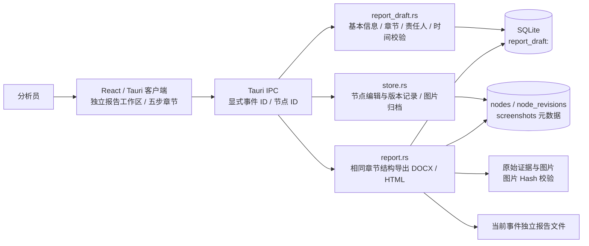

# 五步事件报告与完整案例验收

嘎嘎安全助手 0.6.5 · J4team

顶部「报告」是独立一级工作区，按当前事件隔离保存。正文、节点和截图在重启后可以继续编辑。

## 报告结构

基本信息：报告标题、编写 / 复核人员、事件类型、发现时间、发现人、危害等级、危害概述和事件摘要。

| 步骤 | 正文 | 责任与举证 |
|---|---|---|
| 1. 危害评估与影响范围 | 实际危害、业务和资产影响、调查范围与限制 | 负责人、开始 / 完成时间、状态、节点与截图 |
| 2. 事件紧急处置 | 处置计划、已下达指令和执行回执分别记录 | 同上 |
| 3. 事件过程排查（包含木马分析） | 日志、HTTP、木马静态或动态分析、链路断点 | 同上 |
| 4. 攻击或威胁溯源 | IOC、基础设施及关联依据；无法确认时保留未知 | 同上 |
| 5. 处置结果 | 清理、恢复、复测、残余风险与后续建议 | 同上 |

「正文编辑」内使用章节导航，每次编辑一个步骤。每步可关联当前事件已纳入报告的节点，直接粘贴或附加举证图片。一个节点归入一个步骤，图片与原始来源只导出一次；未分步骤的节点放入时间线附录。截图并非所有步骤的强制条件，缺图、缺证据、缺负责人或时间都明确显示待补。

「节点与截图」可修改节点说明、选择所属报告步骤、纳入或排除节点、粘贴 PNG / JPEG / WebP、选图并填写图注。修改节点不改变原始证据、来源引用、SHA-256 或原始录入时间，保留前后版本。报告预览、DOCX 和 HTML 按相同五步结构呈现。

停止输入 600 毫秒后自动保存，也可手动保存。导出前等待保存完成。正文由分析员核对，不将模型判断自动定稿。标记步骤已完成是一条人工填写状态，不代表后台执行了对应处置。当前没有团队账号、身份校验、审批签章或负责人消息通知。

DOCX 为可编辑 OOXML；HTML 自包含并嵌图。系统打印可保存 PDF；案例包中名称含 html-print 的 PDF 是实际 HTML 导出的浏览器打印副本，不是客户端原生 PDF 对话框验收。

## C4：报告容器和组件



`Reports.tsx` 管理章节编辑、自动保存、预览及证据关联。后台保存使用显式 `caseId`；切换事件时的延迟保存仍指向原事件。组件以事件 ID 为 key，串行保存，避免前次写入覆盖后次修改。

`report_draft.rs` 保存基本信息、五个固定章节正文和步骤责任元数据。旧版六字段正文按默认五步元数据加载，已有摘要、范围、结论与建议保留。时间必须为带时区的 RFC 3339，完成不能早于开始；节点必须属于目标事件且不可同时归入多个步骤。未填写时间保留空值，不能冒用导入时间。草稿保存在本地 SQLite，不存模型 Key。

`update_node` 只修改当前事件的节点，保留证据、发现项、录入时间和截图引用；事务同时新增 `node_revisions`。版本表用于审计留存，尚无可视化回滚界面。

`report.rs` 按五步输出正文及所属节点，随后输出未分步骤的时间线附录；读取当前事件的数据，导出前校验图片。文件检查独立验证 XML、图片像素、原图 Hash、图注、章节负责人和跨事件隔离。

## 四组完整合成案例

| 案例 | 材料 | 验证边界 |
|---|---|---|
| A：Web 暴露与疑似脚本 | HTTP、访问日志、注释内禁用脚本、模拟防火墙回执 | 正文返回、路径访问、文件落地和执行成功分开；人员指令与设备回执分开 |
| B：SSH 认证与提权线索 | 3003 行认证日志、模拟 EDR | 3000 次失败后的成功、sudo、cron 保留；全索引分页；时间与行号可追溯 |
| C：授权扫描对照 | HTTP 403、日志、模拟工单、正常 PHP | 人工误报反馈；白名单限事件；不可信报文指令不能替代分析 |
| D：覆盖缺口 | 不完整 inspect、无报文的 NDR、无年份时区 syslog | 未命中不等于安全；未知与未覆盖明确保留；未知时间不能伪造成发生时间 |

材料均为合成演练，IP 为文档保留地址、域名为 .test。脚本从未执行。图片标注为根据合成原文绘制的举证示意图，不是现场截图。每组报告填写五步负责人、时间、状态并关联本事件节点，用真实客户端导出。

## 复现与 AI 边界

```sh
node tests/build-case-fixtures.mjs
CARGO_TARGET_DIR=/absolute/path/to/gaga-build npm run desktop:build:mac-dev
node tests/native-cases.mjs /absolute/path/to/app-executable /absolute/path/to/configured-workspace /absolute/path/to/output
/absolute/path/to/python-with-Pillow tests/check-cases.py /absolute/path/to/output/native-cases.json /absolute/path/to/output/artifact-checks.json
```

`GAGA_CASE_LOCAL=1` 可运行不调用 AI 的案例。默认使用真实 DeepSeek，消耗已配置账号额度；仅向模型发送合成测试材料。脚本只复制 AI 配置元数据到隔离工作区，Key 由 macOS 钥匙串读取。macOS .app 使用 Launch Services 启动，避免直接运行内部二进制时系统凭据读取等待而没有可见弹窗。凭据步骤有 30 秒超时；失败不会伪造已发送或成功结果。

原生 GUI 验收串行运行。文字输入、步骤选择、截图粘贴、节点编辑使用真实 WebView 控件；文件导入、导出调用真实 Tauri 后台，文件选择 / 保存系统对话框本身不算物理键鼠验收。重启阶段不重复调用官方模型。

小脚本材料包含经 Hash 校验的完整或有界源码，明确注释边界与截断；HTTP 含双侧起始行与消息头，凭据脱敏。refs 要求每项与允许的来源标识完全一致；只兼容当前证据 ID 加已存在行号的组合写法，拒绝外事件、虚构行号与任意后缀，原始模型回答保留。引用可定位不等于判断正确；AI、ATT&CK 映射和归属均需人工复核。

具体通过数、官方结果、失败记录及未测环境以 [CASE-ACCEPTANCE-0.6.5.md](CASE-ACCEPTANCE-0.6.5.md) 和生成的 JSON 为准。
