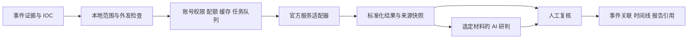

# 蓝队调查工作与官方情报 API 接入调研

项目：嘎嘎安全助手 / J4team。调研日期：2026-10-30。

**结论：适合接入，先做可选的只读情报查询，再独立考虑样本上传和网址扫描。** 重点是帮助分析人员核查来源、扩大调查范围、形成可引用的证据，而不是用一个恶意标签替代现场调查。

**交付状态：本文件是公开文档核对与接入设计，不是已实现或实机验收声明。** 当前 `src-tauri/src/intelligence.rs` 提供本地 IOC、证据关联、黑白名单与恶意样本案例；本轮未接入下列在线服务，未读取服务 Key、调用鉴权接口、上传样本或发送事件材料。已有的本地功能验收不能作为这些外部接口的验收。

后续实施更新：0.10.0 已实现首批只读查询，见[使用与边界](THREAT-INTELLIGENCE-0.10.0.md)和[验收](AUDIT-0.10.0.md)。下文保留调研时的设计与优先级，不代表全部规划已落地。

## 1. 蓝队调查还需要做哪些工作

| 调查工作 | 应解决的问题 | 工具应产出的材料 | 外部情报的作用与边界 |
| --- | --- | --- | --- |
| 确认范围与证据完整性 | 哪些资产、账号、时间段涉及事件？哪些数据缺失？ | 资产清单、时区/时钟偏差、采集清单、原件摘要、失败/缺失记录 | 外部服务不能补造现场日志，也不能把“未采到”变成“未发生” |
| 入口与攻击成功性判断 | 扫描、利用尝试、实际落地分别发生了吗？ | 请求/响应配对、访问日志、文件创建、进程或应用侧记录 | 入站 IP 信誉用于背景；HTTP 200 或恶意源 IP 都不能单独证明利用成功 |
| 主机与样本排查 | WebShell、下载器、持久化、异常账号在哪里？ | 文件来源链、派生层、Hash、进程树、启动项、容器/主机权限关系 | Hash 报告补充已知样本信息；变种未命中时仍需本地分析 |
| 凭据与横向移动调查 | 是否有异常登录、凭据使用、远程执行或权限提升？ | 账号—主机—会话关联、认证记录、相关命令和时间线 | 威胁情报只提供辅助；需认证/EDR/系统记录支撑 |
| 外联与数据泄露核查 | 是否连接 C2、矿池、异常 DNS 或上传数据？ | DNS/代理/防火墙记录、连接方向、进程归属、字节量与采集覆盖 | 使用出站场景情报；eBPF 元数据不能自动解密所有 HTTPS，也不能单靠流量大小证明泄露 |
| 基础设施关联与溯源 | 域名、IP、证书、样本之间是否存在可验证关联？ | 带时间和来源的关联图、当前/历史记录、替代解释 | RDAP、被动 DNS、公开测绘提供线索；共享主机、CDN、转售 IP、代理会造成误关联 |
| 网站与供应链变化调查 | 哪个页面、JS、跳转或第三方依赖发生变化？ | 内容差异、资源依赖、截图、变更时间和业务确认 | 先查已有 URL 报告；主动云扫描会访问目标，需与现有主动资产监控策略一致 |
| 遏制、恢复与复核 | 指令是否执行？业务是否恢复？是否仍有残留？ | 指令、执行人、设备回执、恢复验证、观察期记录 | 情报支持优先级，不自动代替封禁审批和回执 |
| 报告、复盘与情报沉淀 | 哪些是事实、哪些是推断？由谁确认？ | 多阶段/多资产报告、时间胶囊、举证/截图、责任人、未决问题、可分享 IOC | 引用冻结的情报结果和查询条件，避免以后重查覆盖当时依据 |

IP 所属国家、注册商、恶意家族标签或相似攻击手法均不等于攻击者真实身份。团伙归因应保留证据强度和替代解释，不能由 AI 直接定性。

## 2. 官方服务选择与优先级

优先级表示建议的实施顺序，全部仍为待接入。

| 服务 | 最适合的用途 | 已核对的条件/限制 | 建议顺序 |
| --- | --- | --- | --- |
| [微步 ThreatBook](https://x.threatbook.com/apiDocs) | 入站攻击源、出站 C2/恶意软件线索、IP/域名上下文、既有样本报告 | 自备 Key、接口权限/配额、绑定出口 IP；按记录计数，空结果或处理中也可能消耗配额 | A，主要中文情报服务 |
| [RDAP / ICANN](https://www.icann.org/rdap) | 域名当前注册信息、注册商、状态、日期；后续扩至网络分配背景 | 数据可能脱敏；当前注册信息不等于历史 WHOIS，也不证明真实控制人 | A，基础溯源能力 |
| [AbuseIPDB](https://docs.abuseipdb.com/) | IP 社区举报背景、最近举报时间与数量 | 自备 Key、按账号额度；举报评分受时间窗口影响，非入侵证明 | A，可选补充 |
| [VirusTotal](https://docs.virustotal.com/reference/public-vs-premium-api) | 通过 Hash 查询既有样本报告、多引擎标签与相关线索 | Public API 有严格用途限制；企业工作流应核对相应商业授权，不能默认所有用户可用 | A，满足授权条件后启用 Hash 查询 |
| [ThreatFox](https://threatfox.abuse.ch/api/) / [URLhaus](https://urlhaus.abuse.ch/api/) | 恶意基础设施/样本关联、恶意软件下载 URL | Auth-Key；公平使用及商业条件；ThreatFox 六个月前 IOC 从 API/导出中到期；URLhaus 部分详细文档需登录 | B，先只读查询/授权数据订阅 |
| [GreyNoise](https://docs.greynoise.io/docs/using-the-greynoise-community-api) | 识别公网扫描背景，辅助告警降噪 | Community 额度较小；观察到扫描不等于攻击成功，也不是全局白名单 | B，扫描背景补充 |
| [urlscan](https://docs.urlscan.io/guides/quickstart) | 已有网页扫描结果、截图、跳转及资源关系 | 先检索；提交扫描会由云端访问目标；Unlisted 仍对部分研究人员/公司可见 | B，既有结果优先，主动扫描单列 |
| [Shodan](https://developer.shodan.io/api) / [Censys](https://docs.censys.com/docs/platform-api) | 公开端口、服务、证书等基础设施背景 | 账号授权/额度；被动查询与主动扫描分开；Censys 具体接口合同仍需继续核对 | C，按实际需求扩充 |
| [CISA KEV](https://www.cisa.gov/known-exploited-vulnerabilities-catalog) / [MITRE ATT&CK](https://attack.mitre.org/resources/attack-data-and-tools/) | 已被利用漏洞的排查优先级、攻击技术知识 | 可设计成版本化本地知识同步，不需要上传事件；被列入 KEV 不代表本次已被利用 | A/B，本地辅助知识 |

不建议首版堆满服务名称。优先把一个服务的来源、状态、配额、失败解释和报告引用做完整，再扩充适配器。

### 2.1 微步：要按调查方向选接口

官方文档明确区分入站与出站用途，不能统一调用“IP 信誉”代替所有分析。

| 调查输入 | 官方接口 | 用法 |
| --- | --- | --- |
| WAF/访问日志中的攻击来源 IP | `/v3/scene/ip_reputation` | 面向入站访问源，扫描/利用风险识别 |
| 需要完整上下文的 IP | `/v3/ip/query` | 不限定流量方向，查看原始情报、样本、ASN/端口/证书等账号可用字段 |
| DNS/代理/出口日志的外联 IP 或域名 | `/v3/scene/ioc` 或 `/v3/scene/dns` | 面向出站 C2、恶意软件、矿池等失陷线索；仍需现场连接证据 |
| 域名调查 | `/v3/domain/query`、`/v3/domain/adv_query` | 按权限获得域名上下文及历史线索，不承诺免费账号完整历史 |
| 已有样本 Hash | `/v3/file/report`、`/v3/file/report/multiengines` | 查已有报告；Hash 支持范围按接口核对，多引擎数量依实际返回 |
| 已有网址报告 | `/v3/url/report` | 查询既有结果，区别于主动提交扫描 |
| 新样本或新网址分析 | `/v3/file/upload`、`/v3/url/scan` | 发送文件或触发云端访问；单列操作，不作为查询失败的自动回退 |

重要接入细节：

- Key 参数为 `apikey`；接口支持的 POST 表单等方式优先于把 Key 拼进可被日志记录的 URL，具体以每个接口合同为准。
- 官方要求绑定调用方互联网 IP。笔记本换 Wi-Fi、VPN 或出口后，可能是 IP 未绑定，不能笼统显示“Key 错误”。
- `realtime_verdict` 影响是否纳入历史过期情报；IP 信誉文档的默认值包含历史过期情报。必须保存实际选项并标注历史/当前范围。
- 配额按成功记录扣除：`response_code` 为 0 或正整数时，包括“无数据”“处理中”；批量 100 个资源不是只消耗 1 次。先去重、缓存，再请求，轮询有预算。
- 必须同时判断 HTTP 状态和业务码。`0` 成功、`1` 部分成功、`2` 无数据、`3` 处理中、`4` 无报告、`5` 无多引擎数据分别呈现；`-1` 还需区分 Key、出口 IP、账号/接口权限、到期或隐私样本无权限；`-4` 区分限频和额度不足。
- 文档建议在无报告时重新上传文件，这只是服务端建议。客户端不得因此自动上传客户文件。

依据：[IP 信誉](https://x.threatbook.com/apiDocs/ip/reputation)、[IP 分析](https://x.threatbook.com/apiDocs/ip/query)、[失陷检测](https://x.threatbook.com/apiDocs/scene/dns)、[绑定 IP](https://x.threatbook.com/apiDocs/start/bind_ip_address)、[权限](https://x.threatbook.com/apiDocs/start/confirm_api_permissions)、[配额](https://x.threatbook.com/apiDocs/start/consumption_rules)、[业务码](https://x.threatbook.com/apiDocs/start/response_code)。

### 2.2 在线查杀：先查 Hash，不能默认公开上传

“查杀”应拆成三个能力：查询已有报告、提交文件检测、执行处置。前两者不能自动获得删除、隔离或清理原始证据的权限；本项目应先提供分析与研判，不修改原始样本。

VirusTotal 已核对的 Hash 查询为 `GET https://www.virustotal.com/api/v3/files/{id}`，`x-apikey` 请求头；上传文件则是独立的 `POST /api/v3/files`，返回分析任务 ID，不能把“已提交”显示成“分析完成”。

其 [Public API 说明](https://docs.virustotal.com/reference/public-vs-premium-api) 当前写明每天 500 次、每分钟 4 次，同时禁止用于商业产品/服务，以及不贡献新文件的业务工作流。项目免费或用户有一个 Key，并不自动使企业应急调查满足授权条件；也不能为了符合贡献要求而默认上传客户样本。

其[上传文档](https://docs.virustotal.com/reference/files-scan)还提示，提交或查询的 IOC 会进入其数据体系，勿查询或提交敏感、保密或个人信息指标。因此，Hash 查询不上传样本字节，但仍属于对外披露指标，不能叫“完全私密”。[标准服务说明](https://docs.virustotal.com/docs/how-it-works)描述了结果及样本与合作方和符合条件客户的共享。

[Private Scanning](https://docs.virustotal.com/docs/private-scanning) 是付费且需特定权限的独立流程，**不包含多反病毒引擎的判定**，不能包装成“私有多引擎查杀”。有保留期、权限和删除条件，应单独展示。

无论服务返回多少引擎报毒，都保留引擎名、标签、分析时间与缺失情况，不用固定引擎总数，不把“零检出”写成“安全”。Hash 未命中也不自动下载关联恶意样本。

### 2.3 其他服务的关键差别

- **AbuseIPDB**：`GET /api/v2/check` 使用 `Key` 请求头；`maxAgeInDays` 默认 30。报告需要保存查询窗口、评分、数量和最近举报时间。提交举报是另一个操作，不能自动上传客户日志；`isWhitelisted` 可能为空，也不作为本项目全局白名单。
- **ThreatFox**：`Auth-Key` 必需；查询使用 POST 并不表示上传样本。自 2025-05-01 起，超过六个月的 IOC 不再由 API/导出返回，故历史事件“无结果”有明确覆盖限制。
- **URLhaus**：公开文档确认 Auth-Key、数据导出、公平使用/商业条件及提交策略；部分当前接口细节需登录。不能照搬网上旧路由并声称已验证。某些导出 URL 含路径中的 Key，日志脱敏必须覆盖路径。
- **GreyNoise**：官方指南列出 `/v3/community/{ip}`；企业邮箱的免费账号当前最多每周 50 次，API 与 Visualizer 合并计数，个人免费邮箱账号不提供 Key 级访问。`noise=true` 仅表示最近 90 天观察到互联网扫描，不等于归因或自动放行依据。
- **urlscan**：先检索既有记录；新扫描使用 `API-Key`，提交可见性要明确。Public 可公开检索，Unlisted 可被部分研究者/安全公司查看，Private 仍由服务方处理且有保留期。提交网址会访问目标，可能触发一次性链接或让攻击者察觉。官方快速入门要求首次取结果前至少等待 30 秒；任务结果处理中可返回 404，删除后为 410，不能混为“无情报”。
- **RDAP**：用 IANA bootstrap 选择注册服务，不靠抓取 WHOIS 网页。此次已读取域名 bootstrap JSON；未来 IP/ASN 查询需要相应 IPv4/IPv6/ASN bootstrap，不能用域名表冒充全部支持。字段可能脱敏，当前注册数据不是历史 WHOIS。

## 3. 适合嘎嘎的使用流程

1. 从 HTTP 请求/响应、日志、WebShell、样本静态结果或 Agent 回包提取 IOC，保留原始证据、行号/字节范围、主机与观察时间。
2. 用户选中要查的 IOC，显示将发送给谁、发送哪些字段、当前查询方向和预计额度；支持仅本地分析。
3. 默认跳过私网、回环、链路本地、保留/测试 IP 和本地域名。跳过的状态是“未外发”，不是“安全”。Hash 也可能暴露未公开调查线索，仍遵循事件外发策略。
4. 根据入站、出站、完整上下文或 Hash 查询选择接口；去重、缓存、排队，显示每条任务的实际结果。
5. 在同一 IOC 下并列显示各服务结论、源数据时间、查询窗口、限制和关联材料。分歧保留，不简单求平均。
6. AI 仅分析用户选定且允许发送的材料，引用本地证据和情报结果 ID；明确事实、推断、缺口与建议下一步。不由情报服务自动增加第五家模型，仍只支持 DeepSeek、Qwen、GLM、Kimi。
7. 人工复核后加入当前事件的关联图、时间胶囊与报告章节，保留负责人、复核状态、截图/图注和出处。封禁指令与实际设备回执仍分开记录。

例如，WebShell 常量层提取出一个域名，可先查域名/样本情报；若代理日志又记录同主机访问该域名，则形成“本地访问记录 + 外部情报背景”的关联线索。只有域名报恶意而没有本机访问证据时，报告应写“样本含相关域名，未证实外联”，不能写成“已连接 C2”。

## 4. 客户端界面设计

沿用现有功能导航，不增加一排情报厂商主菜单：

- **设置 → 情报服务**：厂商卡片、Key 配置状态、接口权限、出口 IP 要求、账号授权范围、查询测试、配额及外发策略。厂商测试说明实际发送内容和可能消耗的额度，不能用“访问文档成功”冒充鉴权测试。
- **威胁情报 → 在线查询**：左侧可筛选 IOC 列表，中间为结果，右侧详情随窗口宽度折叠；小窗口用页签切换详情，避免宽表格挤出界面。列表保留类型、方向、来源事件、缓存/新查询状态。
- **HTTP / 日志 / WebShell 证据详情**：对选中 IOC 提供“查询情报”，可回到原始定位，并提供“引用到报告”。只查询用户选项，不在打开文件时悄悄遍历所有厂商。
- **报告编辑**：情报作为可复核的引证材料插入，不覆盖正文；展示来源、时间、查询范围、结果摘要、复核人和引用 ID。

不能只有一个转圈和“分析失败”。至少区分未配置、未获接口权限、出口 IP 未绑定、额度不足、限频、等待报告、无结果、部分结果、超时、取消、缓存已过期；为可恢复错误给出具体下一步。

完整 URL 可能含令牌、邮箱或内部路径。发送前展示准确查询对象，提供只查域名的选项；改为域名查询后必须标注范围变化，不能声称已检查原路径或完整 URL。

## 5. 接入架构与数据边界（建议，尚未实现）

宿主 Rust 后端持有网络能力和系统凭据库访问，前端不持有明文 Key，也不直接访问第三方服务；用户自备 Key，直接连接厂商，不新增 J4team 中转。Key 不进入证据、报告、P2P 分享、诊断包或 AI Prompt。样本分析容器不能获得这些 Key，也不能获得情报服务网络权限来绕过隔离策略。

建议增加独立的 `enrichment` 模块。按能力声明 `ip_reputation`、`ip_context`、`domain_context`、`hash_lookup`、`url_lookup`、`file_submit`、`url_submit`；查询与提交在权限、界面和任务类型上区分。保留现有 `intelligence.rs` 的本地实体/人工结论职责。

建议的新数据实体：

| 实体 | 主要内容 |
| --- | --- |
| 情报任务 | 固定的 `caseId`/`evidenceId`、调用操作、厂商/账号配置 ID、查询对象与选项、发起人、状态、耗时、可见配额消耗、错误分类 |
| 情报结果 | 服务原始结论、标准化标签、来源记录 ID、可用数据范围、查询/分析/更新时间、历史有效范围和覆盖限制 |
| 来源快照 | 授权允许保存的响应字段或原始响应、格式版本、摘要、保存及可分享范围；厂商不允许保存/再分发时按合同限制，而非照单全存 |
| 事件与报告引用 | 引用冻结结果、关联证据、分析人员结论、复核人/时间；不被后台缓存刷新覆盖 |

当前 `intel_indicators.verdict` 是本地结论，**不能被远程恶意标签直接覆盖**。请求状态、服务结论、人工判断分别保存；多个平台可能引用同一来源，不按平台数当作独立证据数。

事件发生时间、现场观察时间、服务首次/最近观察时间、服务分析时间、客户端查询时间必须分开。今天查到的标签不能自动证明事发当时已恶意；今天没有数据也不能否定历史攻击。

外发策略需覆盖 AI、情报查询、样本/URL 提交等不同类别。**现有 AI 外发锁不能在未修改与验收前声称已约束情报服务。** 设计全局离线开关及事件级策略，分开展示允许外发的数据。若只允许同步公共 KEV/ATT&CK 数据，应说明网络仍在使用但没有发送事件材料。

适配器使用固定官方 HTTPS 目标、证书校验、限定超时/响应大小、有限重试与退避；限频和缓存按厂商、账号、操作、指标和查询参数隔离。RDAP 发现地址、重定向和第三方响应 URL 逐次验证，拒绝本地/私网等不符合策略的目标，跨域绝不转发凭据。不得因为官方示例关闭证书校验就照抄。

外部返回的名称、注释、链接、HTML 和 AI 可见文本均按不可信数据处理：不执行脚本、不打开任意本机路径、不自动加载攻击者图片/网页，不允许情报文本改变工具权限。截图和附件仅通过受限下载器处理允许的目标、类型和大小，报告渲染时转义。

任务支持取消、重启后追踪与预算上限；取消只阻止后续本地操作，不能承诺撤回已经发送的数据或终止厂商后台任务。提交型请求超时后不盲目重发，先按服务支持的任务 ID/幂等机制核对，避免重复上传、重复费用或扫描。

## 6. 分期实施与验收

### 批次 A：只读查询闭环

微步按方向查询、域名 RDAP、可选 AbuseIPDB，以及满足服务授权条件的 VirusTotal Hash 查询。补齐设置、系统凭据库存储、任务/缓存/配额、来源快照、复核与报告引用。公共 KEV/ATT&CK 同步可单独安排。

本批不需要 Windows 虚拟机即可在 Mac 开发与验收，但鉴权、配额、字段可见性仍需各自的可用账号；没有 Key 时只能完成离线合同/失败路径测试，不能称正式联网验收通过。

### 批次 B/C：按需求扩充

只读 ThreatFox/URLhaus、GreyNoise、urlscan 既有结果；再评估被动测绘和明确授权的 URL/样本提交。在线沙箱与现有 Docker/CAPE 保持独立：云端分析受上传条款与可见性限制，本地分析受隔离环境和样本覆盖限制，均不承诺必定识别反沙箱行为。

后续可调研云审计、邮件头/投递记录和身份平台日志连接器，补齐入口、账号和横向移动证据；本轮没有核对这些 API 的权限合同，不计为完成项。

### 必须覆盖的测试

| 测试组 | 必须验证 |
| --- | --- |
| 服务合同 | 正常/无数据/字段缺失；HTTP 401/403/429/超时；微步 HTTP 200 但业务码失败、批量部分成功、隐私报告无权限 |
| 异步结果 | 已提交与分析完成分离；urlscan 处理中 404/删除 410；有限轮询、恢复追踪、提交超时不重复发起 |
| 外发和凭据 | 离线策略、事件限制、私网/测试 IP 跳过、完整 URL 预览；无结果不自动上传/扫描/举报；Key 不进入各类日志、报告和共享 |
| 界面和便捷性 | Key 掩码、权限/IP/额度错误可区分；大批量进度、去重与缓存可解释；小窗口/键盘/切页可用 |
| 数据一致性 | 切换事件不串写；取消/重启/账号变更；缓存区分参数；报告冻结引用与导出一致，时间语义正确 |
| 不可信返回 | 大响应、坏 JSON、恶意链接/HTML、跨域重定向、SSRF、提示注入、附件大小/类型；错误日志脱敏 |
| 有界实机 | 使用用户授权账号与明确允许发送的非敏感指标，记录接口、日期、账号权限、状态及费用范围；不以模拟服务器代替正式验证 |

## 7. 调研证据与未确认项

核对方式：读取官方公开文档，保存 URL、HTTP 状态、字节长度和 SHA-256；部分公开 JSON 已解析。本次共记录 49 个 URL 尝试，包含跳转、404/405 及内容不足的页面，**不表示 49 个可用接口，也不表示执行过鉴权测试**。完整元数据在调研交付目录的 `sources.json`，内部原始文档快照保存在研究工作目录；未将全文重新分发为厂商资料镜像。

主要补充官方依据：

- 微步：[域名分析](https://x.threatbook.com/apiDocs/domain/query)、[域名高级查询](https://x.threatbook.com/apiDocs/domain/adv_query)、[文件报告](https://x.threatbook.com/apiDocs/file/report)、[多引擎报告](https://x.threatbook.com/apiDocs/file/report_multiengines)、[文件提交](https://x.threatbook.com/apiDocs/file/upload)、[URL 报告](https://x.threatbook.com/apiDocs/url/report)、[URL 提交](https://x.threatbook.com/apiDocs/url/scan)。
- VirusTotal：[Hash 报告](https://docs.virustotal.com/reference/file-info)、[API 概览](https://docs.virustotal.com/reference/overview)。
- urlscan：[可见性](https://docs.urlscan.io/pages/visibility)、[调用建议](https://docs.urlscan.io/pages/api-best-practices)、[额度](https://docs.urlscan.io/pages/api-rate-limits)。
- RDAP：[IANA 域名引导注册表](https://www.iana.org/assignments/rdap-dns/rdap-dns.xhtml)、[域名 bootstrap JSON](https://data.iana.org/rdap/dns.json)。
- 公共知识：[CISA KEV JSON](https://www.cisa.gov/sites/default/files/feeds/known_exploited_vulnerabilities.json)、[ATT&CK 数据与工具](https://attack.mitre.org/resources/attack-data-and-tools/)。

尚未确认：MalwareBazaar 文档、FAQ 和 API 根地址在本次读取中返回 405；NVD 页面返回了缺少正文的占位内容；URLhaus 部分接口文档要求登录；Censys 只确认当前 Platform API 官方入口，具体路由/额度仍待核对。以上不作为可直接实现的已验证合同，不能从过时第三方示例补齐后宣称官方确认。

服务条款、配额、接口、保留期及套餐可能变化；上线前应按目标账号和预期使用场景复核。项目“个人及非商用免费、商用需 J4team 单独授权”的许可，不替代任何第三方服务的使用、保存或再分发授权。
