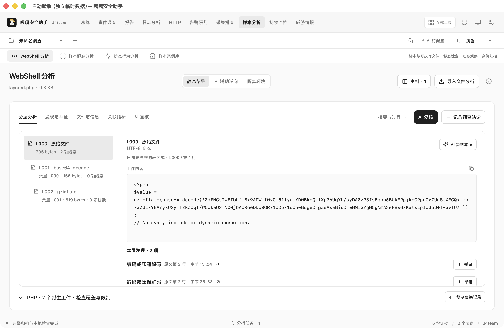
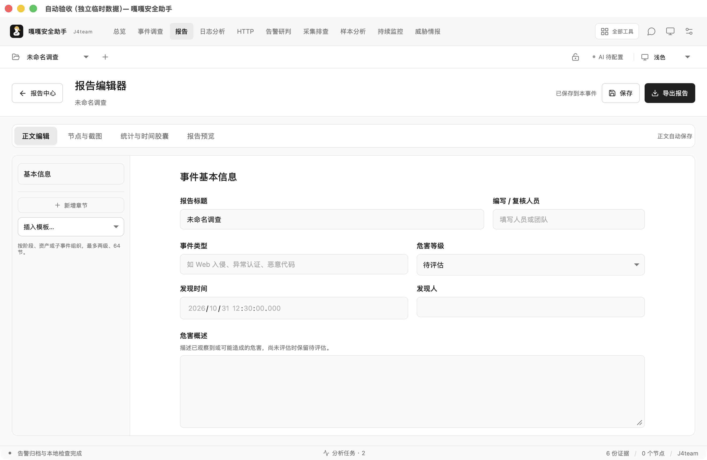

# 分析工作区与报告体验验收 · 2026-10-31

适用版本：0.10.1。目标是减少同时展示的层级，将主要空间交给材料、代码和调查结果。本轮直接修改真实客户端，未调用模型、未读取云模型密钥、未运行恶意样本。

本文件保留本日早期一轮的验收结论和原始记录。后续已经补齐容器浏览器自动截图、可选跟随跳转及独占报告工作区，当前行为见 [页面自动举证说明](REPORT-WORKSPACE-MONITOR-2026-10-31.md)；下文的“人工独立举证、未新增自动浏览器”仅描述此前实现。

## 布局与入口

- 分析页将文件名放入标题区，结果标签和操作合并一行。资料列表默认收起；摘要、SHA-256、指标和阶段信息在“摘要与过程”查看。
- HTTP、告警录入占据独立编辑区；提交后切到结果，新增材料再进入录入。日志保留时间线、原文和小窗口可见的 AI 研判按钮。
- WebShell 使用原文 / 派生层选择器及独立代码滚动区，来源表达式按需展开。覆盖说明与变换记录位于底部。静态分析不执行 PHP、类文件或可执行样本；它用于解码、敏感调用、字符串、IOC、Hash 和证据定位，不能代替动态行为证据。
- 报告默认进入报告中心；编辑器、节点截图、时间胶囊和预览为子页面。导出格式、水印及任务记录集中在“导出报告”。“保存并打开报告”直接进入编辑；底部导出状态直接打开任务窗口。
- 处置动作放在事件时间线，新增动作使用独立表单弹窗。报告正文保留引用和最终导出，避免编辑页面再堆叠处置表单。
- 按钮、选择框、边框、焦点和主题色统一；补齐旧面板使用的主题变量。报告模板选择器也使用完整控件尺寸。

## 页面监控与全局名单

名单默认全局；仅当前事件仍可用于临时例外，旧规则可逐条提升范围。后端校验事件归属、失效时间和启用状态，保留黑白冲突。匹配只记录依据，不执行封禁或放行；当前接入页面巡检和流量观测，不承诺在所有分析工具中过滤命中。

巡检历史使用后端分页，界面每页十份、一次展示一份。新增截图入口可直接粘贴，关联 URL、快照 ID、静态采集时间和 HTML SHA-256；图注与截图采集时间需要使用者核实。截图是人工独立举证，没有新增自动浏览器渲染或网页脚本执行。

实际对 `https://www.baidu.com/` 执行两次原生 IPC 巡检：HTTP 200、收到 227 字节跳转占位 HTML，SHA-256 为 `3d7414a921a24780e3fc3774dcbbf6dace8eec37162daed0fa0a0f3fb0b9a3a7`。该次未采到最终主页或 JS；200 不能证明完整页面监控。现在对 meta refresh 和脚本跳转持续保留覆盖缺口，即使内容与人工基线一致。跳转检测是静态线索匹配，不保证识别所有动态导航形式。

使用独立临时浏览器会话取得百度页面截图，再经 WebView 粘贴事件、填写图注、保存节点，实际导出含图 HTML 和 DOCX。浏览器截图与静态 HTTP 抓取可能收到不同内容，二者分别记录。

## 实测结果

1. [原生验收记录](verification/ux-analysis-2026-10-31/native-comfort.json)：147 项通过，60 组布局；960×660、1180×760、1320×860，各覆盖浅色和深色。包括 HTTP 输入/结果、告警输入/结果、日志、容器配置、WebShell、PE 静态结果、报告中心和编辑器。保存 20 张客户端窗口截图。
2. 使用真实 Docker 对无害分层 PHP 与本项目 Windows Agent 二进制进行禁网静态分析，未执行样本。HTTP、日志和容器配置通过实际分析 IPC 归档。
3. [复杂报告回归](verification/ux-analysis-2026-10-31/report-structure.json)：首次 24 项、重启 5 项、文件检查 11 项通过。验证多阶段 / 子事件、负责人、同一证据复用、章节移动与删除、截图、时间胶囊、独立事件和电子水印，实际检查 DOCX ZIP/XML 及图像内容。
4. Rust：167 项通过、4 项显式忽略；Clippy `-D warnings` 通过。前端构建、格式、25 项 UI 状态断言、源码卫生、安全配置及生成接口文档检查通过。

复杂报告回归同时修复了延迟图片未进入视口却显示读取失败的问题。预览中的延迟加载按实际滚动验证；打印入口会请求全部引用截图，等待解码完成，错误或超时会阻止打开打印，并记入运行日志。已加载像素在预加载结束后保留，避免切换状态时清空图片。此次未自动操作系统打印对话框生成 PDF；打印前置检查不等于 PDF 排版验收。

验证材料来自临时 SQLite 工作区，不写入使用者调查记录。当前是 macOS 实机结果；Windows / CAPE、四家官方模型联网验收和长期压力不属于本轮结论，不能据此声称所有环境无缺陷。

## 复现

先启动 Vite，构建 debug 二进制。安装本地分析镜像后，将独立采集的公开网页 PNG 作为第二个参数：

```sh
node tests/native-comfort.mjs /absolute/path/to/gaga-security-assistant /absolute/path/to/page.png
node tests/native-report-structure.mjs /absolute/path/to/gaga-security-assistant /absolute/output/directory
```

首个脚本仅支持 macOS，使用 Swift / CoreGraphics 找到该测试进程自己的窗口，截取窗口而非整个桌面。脚本创建独立临时数据库，主动访问百度用于公开网站验收；请勿传入客户截图。全部截图和详细进程日志保留在输出的临时目录。




